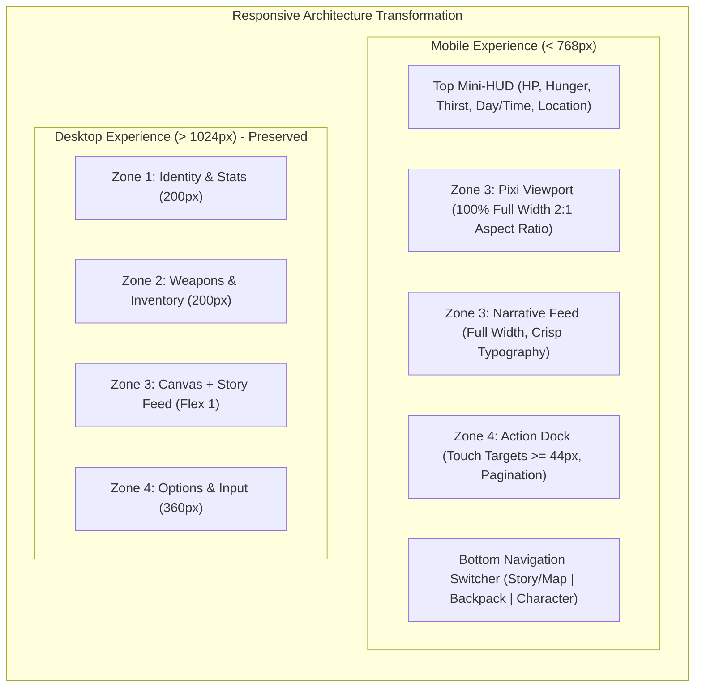

# BATCH 09: MOBILE-FIRST UI & RESPONSIVE REFACTORING
## Architectural Strategy & Phased Implementation Plan

**Document Version:** 1.0  
**Date:** 2026-11-06  
**Status:** Architecture Specification & Roadmap  
**Target Regression Baseline:** 95/95 Tests Passing  
**Core Directive:** Strict Gameplay & Architecture Preservation. All game loops, state machines, save/load schemas, combat logic, and DOM element identities remain completely intact.

---

## 1. EXECUTIVE SUMMARY & MOBILE-FIRST STRATEGY

### 1.1 Architectural Vision
Zombie World RPG is fundamentally an immersive, text-driven post-apocalyptic survival RPG with graphical map visualization. While the desktop 4-zone dashboard (Zones 1–4) works well on 1920×1080 and 1366×768 displays, forcing this multi-column dashboard into a 2×2 grid on mobile viewports (≤ 768px) squashes the core game viewport into an unplayable 140×70px box and traps touch gestures.

**The Solution: Mobile-First Adaptive Presentation**
- **Mobile (< 768px):** A cohesive, full-width single-column flow with a persistent top Mini-HUD (essential vitals), full-width PixiJS Viewport (Map & Combat), rich narrative feed, bottom fixed Action Dock (options & input), and ergonomic tabbed access for secondary panels (Backpack, Equipment, Detailed Stats).
- **Tablet (768px–1024px):** A balanced 2-column adaptive layout optimizing readable line lengths and side-by-side management.
- **Desktop (> 1024px):** The proven, high-performance 4-zone horizontal command center is 100% preserved.

---

## 2. DESIGN SPECIFICATIONS & METRICS

### 2.1 Viewport Breakpoint Hierarchy
| Breakpoint Token | Media Query | Target Form Factors | Layout Architecture |
|---|---|---|---|
| **Compact Mobile** | `< 480px` | iPhone SE, Galaxy S21/S22/S23, iPhone Mini | Pure single-column, 100dvh, compact mini-HUD, full-width viewport |
| **Phablet / Large Phone** | `480px – 767px` | iPhone 14/15/16 Pro Max, Pixel 8 Pro | Single-column with expanded card grids and comfortable touch spacing |
| **Tablet** | `768px – 1023px` | iPad 9/10th Gen, iPad Air, Surface Go | Adaptive 2-column layout (Left: Map/Story, Right: Actions/Inventory) |
| **Desktop / Laptop** | `≥ 1024px` | Laptops, Desktops, Ultrawide | Preserved 4-zone horizontal command dashboard |

### 2.2 Touch Ergonomics Standards
In strict alignment with WCAG 2.5.5 and Apple Human Interface Guidelines:
- **Primary Action Buttons (`.option-item`):** `min-height: 44px` (recommended `46px`), padding `10px 14px`, 6px vertical spacing.
- **Pagination Controls (`.pagination-btn`):** `min-height: 44px`, `min-width: 44px`.
- **Category Tabs (`.inv-tab`):** `min-height: 38px`, horizontal touch-scrolling strip without wrapping.
- **Card Interactive Buttons (`.inv-card-btn`):** `min-height: 36px`, `min-width: 36px` touch-box.
- **Input & Submit Fields (`#action-input`, `#submit-btn`):** `min-height: 44px`, font size `16px` (prevents iOS Safari auto-zoom).

### 2.3 Typography Scale (Mobile)
- **Primary Narrative:** `14px` (line-height: `1.65`, letter-spacing: `0.2px`).
- **Options / Action Buttons:** `14px` bold.
- **Section Headers & Titles:** `14px–16px` bold uppercase.
- **Badges & Quantities:** `11px–12px` bold (eliminating all 7px–9px micro-labels).
- **Stat Labels:** `12px` bold with clear high-contrast coloring.

---

## 3. PHASE-BY-PHASE IMPLEMENTATION BREAKDOWN

### Phase 09.2: Foundation & Base Layout Refactoring [COMPLETED]
- **Status:** COMPLETED (Report: `docs/BATCH_09_PHASE_09_2_REPORT.md`)
- **Focus:** HTML Viewport, CSS Variables, Reset, Root Containers, and Responsive Shell.
- **Completed Tasks:**
  1. Updated `index.html` viewport meta to `<meta name="viewport" content="width=device-width, initial-scale=1.0, viewport-fit=cover">`.
  2. Implemented dynamic viewport height (`min-height: 100vh; min-height: var(--vh-dynamic); height: var(--vh-dynamic);`) with `@supports (height: 100dvh)`.
  3. Safe-area padding integration (`env(safe-area-inset-*)`) on `body` and `#game-container`.
  4. Established Breakpoint Tier Architecture in stylesheet (Tiers 1–5: 320px–1920px).
  5. Established Desktop & Large Tablet Protection Tier (`@media (min-width: 1024px)`).
  6. Added Touch Foundation sizing variables (`--touch-target-min: 44px;`) and helper utility classes.
  7. Added mobile scroll protection to `#name-setup` to prevent keyboard clipping.
- **Validation:** 95/95 regression tests PASS; base container adapts cleanly across 320px–1920px.

---

### Phase 09.3: Game Zones Mobile Layout & Navigation
- **Focus:** Zones 1–4 Reorganization on Mobile Screens.
- **Key Tasks:**
  1. **Top Mini-HUD Component:** Construct an unobtrusive, compact header strip showing Player HP bar, Hunger/Thirst indicators, Current Location, and Day/Time.
  2. **Mobile Viewport Switcher / Tabs:** Allow seamless mobile switching between:
     - `[🗺️ Trận địa / Bản đồ]` (Zone 3 Visual Viewport + Narrative Feed + Zone 4 Actions).
     - `[🎒 Túi đồ]` (Zone 2 Inventory Panel & Equipment).
     - `[👤 Nhân vật]` (Zone 1 Detailed Character Stats, Buffs, and Attributes).
  3. Ensure that when switching views on mobile, the underlying DOM state and event listeners in `#zone-1`, `#zone-2`, `#zone-3`, and `#zone-4` are strictly preserved without recreation or memory leaks.
  4. Keep all 4 zones simultaneously visible and side-by-side on desktop (`min-width: 1024px`).
- **Validation:** Seamless touch-switching; stats and inventory remain fully interactive; zero impact on game state.

---

### Phase 09.4: Sub-screens, Menus & Modals Mobile Polish
- **Focus:** Modals, Full-page Views, and Auxiliary Dialogs.
- **Key Tasks:**
  1. **Inventory Panel Refactoring (`#inventory-panel`):**
     - Replace wrapping category tabs with a single-row horizontal touch-scroll bar (`.inv-tabs-bar`).
     - Responsive item card grid (`repeat(auto-fill, minmax(130px, 1fr))`) ensuring 2 columns on 320px–360px phones.
     - Enlarge action buttons (`Sử dụng`, `Trang bị`, `Bỏ`) to touch-compliant hitboxes.
  2. **Warehouse Modal (`#warehouse-modal`):**
     - Replace crushed vertical stacking on screens ≤ 640px with a segmented pane switcher (`[🎒 Túi đồ] | [📦 Kho căn cứ]`).
     - Ensure full single-scroll per pane for effortless transfer operations.
  3. **Destructive Discard Modal (`#discard-confirm-modal`):**
     - Enlarge quick-selection chips (`1`, `5`, `10`, `Tất cả`) to 44px touch targets.
  4. **Player Auxiliary Tools (`#player-tools-page`):**
     - Convert fixed 380px iframe to flexible container: `height: calc(100dvh - 140px); min-height: 320px;`.
  5. **Main Menu (`#name-setup`) & Standalone Pages:**
     - Make character setup container scrollable so the virtual keyboard does not obscure inputs.
     - Fluid responsive grids for Achievements and Save Slots.
- **Validation:** All modals open, scroll, operate, and close cleanly on 320px–430px viewports without horizontal clipping.

---

### Phase 09.5: Combat, Narrative & Action Dock Mobile Polish
- **Focus:** Core Survival & Combat Loop Experience.
- **Key Tasks:**
  1. **Narrative Feed (`#story-area`):**
     - Set comfortable mobile typography (14px, line-height 1.65).
     - Ensure silky-smooth momentum touch scrolling (`-webkit-overflow-scrolling: touch`).
     - Auto-scroll to latest event on new narrative logs.
  2. **Combat HUD (`.combat-enemy-card`):**
     - Transform enemy card on mobile into a compact tactical banner (48×48px sprite, horizontal HP/Shield bars, status pills).
     - Save vertical height so combat action logs in `#story-area` remain visible in real time.
  3. **Action Dock (`#zone-4`):**
     - Elevate `.option-item` to 44px+ min-height with prominent numbered badges.
     - Modernize `.pagination-area` with touch-friendly 44×44px page navigation buttons.
     - Ensure `#action-input` has `font-size: 16px` to avoid iOS browser zoom on focus.
- **Validation:** Complete combat encounters playable single-handedly on small screens without scroll frustration.

---

### Phase 09.6: PixiJS Canvas & Graphical World Map Viewport Scaling
- **Focus:** 2D Viewport Scaling, Aspect Ratio Integrity, and Map Interaction.
- **Key Tasks:**
  1. Enable full-width rendering for `#pixi-viewport` on mobile devices (`width: 100%; aspect-ratio: 2 / 1;`).
  2. At 360px screen width, canvas renders at a crisp `356 × 178px` (more than 2.5× the current crushed 140×70px area!).
  3. Maintain fixed internal coordinate system (640 × 320) via PixiJS stage scaling to prevent map distortion.
  4. Optimize touch-tap hitboxes for POI map markers (minimum 32×32px virtual touch zone with radar reticle).
  5. Ensure debounced canvas resize listener handles orientation changes (portrait ↔ landscape) smoothly.
- **Validation:** Graphical world map, terrain tiles, roads, and POIs remain sharp, readable, and interactive.

---

### Phase 09.7: Final Cross-Device QA & Release Readiness
- **Focus:** Regression Testing, Device Matrix Verification, and Delivery.
- **Key Tasks:**
  1. Run full 95/95 test suite across all 8 test modules.
  2. Verify layout rendering across target viewports: 320×640, 360×800, 375×812, 390×844, 430×932, 768×1024, 1024×768, 1366×768, 1920×1080.
  3. Verify touch interactions, modal operations, save/load, combat rounds, and map travel.
  4. Compile final QA sign-off and changelog documentation.
- **Validation:** 100% test pass rate, zero gameplay regressions, flawless mobile and desktop experience.

---

## 4. RISK ASSESSMENT & SAFEGUARDS

| Risk Factor | Probability | Impact | Mitigation Strategy |
|---|---|---|---|
| **DOM ID Disruption** | Low | High | **Strict Rule:** Never rename, delete, or relocate core DOM IDs (`#zone-1`, `#zone-2`, `#zone-3`, `#zone-4`, `#pixi-viewport`, `#story-area`, `#options-area`). All responsive adaptations occur through CSS classes and layout wrappers. |
| **Test Suite Regression** | Medium | High | Existing 95/95 tests inspect UI element existence and handlers. Run `npm test` after every styling change. |
| **Virtual Canvas Aspect Ratio Distortion** | Medium | Medium | PixiJS renderer uses a fixed 640×320 internal buffer with CSS `width: 100%; height: auto; aspect-ratio: 2 / 1;`. Never hardcode canvas height in CSS. |
| **Desktop Dashboard Regression** | Low | High | Encapsulate desktop layout inside `@media (min-width: 1024px)`. Desktop 4-zone CSS remains identical to current proven baseline. |
| **Touch Gesture Conflict** | Medium | Medium | Consolidate scrolling to one active container per screen; avoid nested scrollable areas on mobile. |

---

## 5. PHASE ACCEPTANCE CRITERIA
Each phase in Batch 09 must fulfill the following acceptance criteria prior to sign-off:
1. **Zero Gameplay Regression:** Character state, combat formulas, item consumption, map navigation, and permadeath rules execute identically.
2. **Zero Test Failures:** `npm test` maintains 100% pass rate (minimum 95/95 tests).
3. **Mobile Usability:** All interactive controls on screens ≤ 768px meet or exceed 44×44px touch targets.
4. **Legible Typography:** Zero text elements rendered below 11px on mobile viewports.
5. **No Clipping or Dead Zones:** Bottom action dock and inputs remain accessible regardless of mobile browser dynamic chrome state.

---

## 6. PHASE OBSERVATIONS & PROGRESSION LOG

### Phase 09.2 Execution Observations (2026-11-06)
1. **Dynamic Viewport Validation:** Modern mobile browsers calculate `100vh` against an ideal un-chromed viewport. The implementation of `--vh-dynamic: 100vh;` with progressive enhancement via `@supports (height: 100dvh) { --vh-dynamic: 100dvh; }` ensures backward compatibility for older webviews while solving the toolbar occlusion problem on iOS Safari and Android Chrome.
2. **Safe-Area Inset Handling:** Adding `viewport-fit=cover` in `index.html` allows `env(safe-area-inset-top)` and `env(safe-area-inset-bottom)` to properly pad device notches and home indicator bars without letterboxing.
3. **Desktop Protection Isolation:** Desktop styles (`min-width: 1024px`) were isolated to ensure zero regression on desktop while preparing cleanly for Phase 09.3 (Game Zones Mobile Layout).
4. **Regression Stability:** Full suite of 95 tests passed with zero regressions or modifications to test assertion logic.

