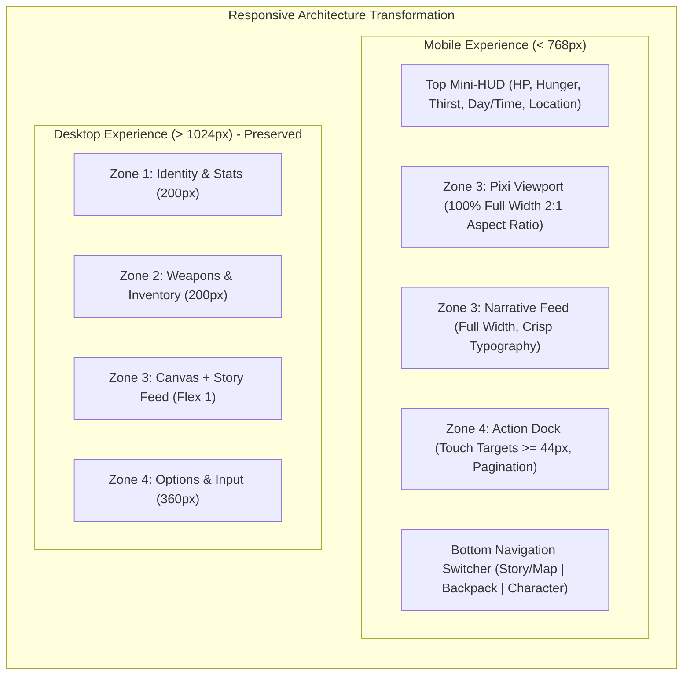

# BATCH 09: MOBILE-FIRST UI & RESPONSIVE REFACTORING
## Architectural Strategy & Phased Implementation Plan

**Document Version:** 1.0  
**Date:** 2026-11-06  
**Status:** Architecture Specification & Roadmap  
**Target Regression Baseline:** 95/95 Tests Passing  
**Core Directive:** Strict Gameplay & Architecture Preservation. All game loops, state machines, save/load schemas, combat logic, and DOM element identities remain completely intact.

---

## 1. EXECUTIVE SUMMARY & MOBILE-FIRST STRATEGY

### 1.1 Architectural Vision
Zombie World RPG is fundamentally an immersive, text-driven post-apocalyptic survival RPG with graphical map visualization. While the desktop 4-zone dashboard (Zones 1–4) works well on 1920×1080 and 1366×768 displays, forcing this multi-column dashboard into a 2×2 grid on mobile viewports (≤ 768px) squashes the core game viewport into an unplayable 140×70px box and traps touch gestures.

**The Solution: Mobile-First Adaptive Presentation**
- **Mobile (< 768px):** A cohesive, full-width single-column flow with a persistent top Mini-HUD (essential vitals), full-width PixiJS Viewport (Map & Combat), rich narrative feed, bottom fixed Action Dock (options & input), and ergonomic tabbed access for secondary panels (Backpack, Equipment, Detailed Stats).
- **Tablet (768px–1024px):** A balanced 2-column adaptive layout optimizing readable line lengths and side-by-side management.
- **Desktop (> 1024px):** The proven, high-performance 4-zone horizontal command center is 100% preserved.

---

## 2. DESIGN SPECIFICATIONS & METRICS

### 2.1 Viewport Breakpoint Hierarchy
| Breakpoint Token | Media Query | Target Form Factors | Layout Architecture |
|---|---|---|---|
| **Compact Mobile** | `< 480px` | iPhone SE, Galaxy S21/S22/S23, iPhone Mini | Pure single-column, 100dvh, compact mini-HUD, full-width viewport |
| **Phablet / Large Phone** | `480px – 767px` | iPhone 14/15/16 Pro Max, Pixel 8 Pro | Single-column with expanded card grids and comfortable touch spacing |
| **Tablet** | `768px – 1023px` | iPad 9/10th Gen, iPad Air, Surface Go | Adaptive 2-column layout (Left: Map/Story, Right: Actions/Inventory) |
| **Desktop / Laptop** | `≥ 1024px` | Laptops, Desktops, Ultrawide | Preserved 4-zone horizontal command dashboard |

### 2.2 Touch Ergonomics Standards
In strict alignment with WCAG 2.5.5 and Apple Human Interface Guidelines:
- **Primary Action Buttons (`.option-item`):** `min-height: 44px` (recommended `46px`), padding `10px 14px`, 6px vertical spacing.
- **Pagination Controls (`.pagination-btn`):** `min-height: 44px`, `min-width: 44px`.
- **Category Tabs (`.inv-tab`):** `min-height: 38px`, horizontal touch-scrolling strip without wrapping.
- **Card Interactive Buttons (`.inv-card-btn`):** `min-height: 36px`, `min-width: 36px` touch-box.
- **Input & Submit Fields (`#action-input`, `#submit-btn`):** `min-height: 44px`, font size `16px` (prevents iOS Safari auto-zoom).

### 2.3 Typography Scale (Mobile)
- **Primary Narrative:** `14px` (line-height: `1.65`, letter-spacing: `0.2px`).
- **Options / Action Buttons:** `14px` bold.
- **Section Headers & Titles:** `14px–16px` bold uppercase.
- **Badges & Quantities:** `11px–12px` bold (eliminating all 7px–9px micro-labels).
- **Stat Labels:** `12px` bold with clear high-contrast coloring.

---

## 3. PHASE-BY-PHASE IMPLEMENTATION BREAKDOWN

### Phase 09.2: Foundation & Base Layout Refactoring [COMPLETED]
- **Status:** COMPLETED (Report: `docs/BATCH_09_PHASE_09_2_REPORT.md`)
- **Focus:** HTML Viewport, CSS Variables, Reset, Root Containers, and Responsive Shell.
- **Completed Tasks:**
  1. Updated `index.html` viewport meta to `<meta name="viewport" content="width=device-width, initial-scale=1.0, viewport-fit=cover">`.
  2. Implemented dynamic viewport height (`min-height: 100vh; min-height: var(--vh-dynamic); height: var(--vh-dynamic);`) with `@supports (height: 100dvh)`.
  3. Safe-area padding integration (`env(safe-area-inset-*)`) on `body` and `#game-container`.
  4. Established Breakpoint Tier Architecture in stylesheet (Tiers 1–5: 320px–1920px).
  5. Established Desktop & Large Tablet Protection Tier (`@media (min-width: 1024px)`).
  6. Added Touch Foundation sizing variables (`--touch-target-min: 44px;`) and helper utility classes.
  7. Added mobile scroll protection to `#name-setup` to prevent keyboard clipping.
- **Validation:** 95/95 regression tests PASS; base container adapts cleanly across 320px–1920px.

---

### Phase 09.3: Game Zones Mobile Layout & Navigation [COMPLETED]
- **Status:** COMPLETED (Report: `docs/BATCH_09_PHASE_09_3_REPORT.md`)
- **Focus:** Zones 1–4 Reorganization on Mobile Screens & Mobile-First Navigation Architecture.
- **Completed Tasks:**
  1. **Eliminated Compressed 2x2 Grid on Mobile (< 768px):** Replaced squeezed 40%/60% column grid with a Mobile-First single-column flow (`display: flex; flex-direction: column`).
  2. **Top Mini-HUD Component (`#mobile-survival-hud`):** Compact sticky header displaying Player HP bar, Hunger/Thirst indicators, Current Location, and Day/Time without horizontal overflow.
  3. **Mobile View Switcher (`#mobile-view-tabs`):** Touch-friendly WAI-ARIA tab switcher enabling instantaneous navigation between:
     - `[🗺️ Bản đồ]` (Zone 3 Viewport + Narrative Feed + Zone 4 Actions).
     - `[🎒 Túi đồ]` (Zone 2 Weapons & Equipment + Inventory Panel).
     - `[👤 Nhân vật]` (Zone 1 Identity, Character Vitals & Cargo).
  4. **Strict DOM & PixiJS State Preservation:** Zero DOM destruction, zero component unmounting, zero PixiJS recreation or canvas leaks across tab switches.
  5. **Unified Scroll Architecture:** `#game-content` acts as the single primary vertical scroll owner with sticky header, completely eliminating scroll trapping.
  6. **Desktop & Tablet Preservation:** At widths ≥ 1024px, the 4-zone dashboard (200px, 200px, flex 1, 360px) is 100% preserved; Tablet (768px–1023px) preserves 2x2 grid without clipping.
- **Validation:** 95/95 regression tests PASS + 8/8 Phase 09.3 audit tests PASS (103/103 total); exact headless Chromium bounding boxes verified across all 8 viewports (320px–1920px).

---

### Phase 09.4: Sub-screens, Menus & Modals Mobile Polish [COMPLETED]
- **Status:** COMPLETED (Report: `docs/BATCH_09_PHASE_09_4_REPORT.md`)
- **Focus:** Modals, Full-page Views, and Auxiliary Dialogs.
- **Completed Tasks:**
  1. **Inventory Category Navigation (`#inventory-panel`):**
     - Replaced wrapping category tabs with a single horizontal touch-scrolling bar (`.inv-tabs-scroll`).
     - Preserved all 7 categories (`Tất cả`, `Vũ khí`, `Trang bị`, `Thực phẩm`, `Đồ uống`, `Y tế`, `Vật liệu & Khác`).
     - Category tabs formatted with touch target height `min-height: 44px; padding: 8px 14px;`.
  2. **Inventory Responsive Cards Grid (`.inv-cards-grid`):**
     - Configured adaptive column layout (`repeat(auto-fill, minmax(136px, 1fr))`) achieving an optimal 2-column layout on 320px–430px screens.
     - Preserved item icon, formatted name, quantity badge, and subtext with zero horizontal overflow.
  3. **Item Action Controls & Safe Destructive UX:**
     - All primary action buttons (`.inv-action-btn`) expand to touch-friendly targets of at least 44px height (`min-height: 44px;`).
     - Destructive action (`.btn-discard`) distinctly styled with red warning styling and 6px top margin.
     - Detail panel close button has 44×44px hit region.
  4. **Warehouse Modal Mobile Single-Pane Architecture (`#warehouse-modal`):**
     - Implemented `#wh-mobile-tabs` with accessible tabs (`[🎒 Ba lô cá nhân]` and `[📦 Kho căn cứ]`).
     - Controlled via `data-active-pane="backpack" | "warehouse"` on `.warehouse-dual-container`.
     - Only the active pane is displayed on screens < 768px; desktop (≥ 768px) retains dual-pane layout.
     - Transfer buttons (`.wh-btn-transfer`) formatted with touch target `min-height: 44px;`.
  5. **Discard Confirmation Modal (`#discard-confirm-modal`):**
     - Stepper buttons (`#discard-qty-minus`, `#discard-qty-plus`, `#discard-qty-all`) upgraded to 44×44px targets.
     - Stepper input height 44px with 16px font; confirm/cancel buttons 44px height.
     - Zero horizontal overflow at 320px width (94vw, max 380px).
  6. **Supporting Sub-screens Fluid Usability:**
     - Upgraded `#save-page`, `#best-record-page`, `#achievement-page`, `#settings-page`, `#player-tools-page`, `#about-page`, and `#name-setup` with fluid heights (`max-height: calc(var(--vh-dynamic, 100vh) - 16px)`).
     - Universal return buttons (`#save-return-btn`, etc.) styled to minimum 44px height and 130px width.
     - Settings rocker switches (`.settings-toggle-btn`) feature 52px touch targets with rocker LEDs.
     - Player tools iframe uses fluid container with `min-height: 320px;`.
  7. **Desktop Dual-Pane & Layout Preservation:**
     - `#wh-mobile-tabs` strictly hidden (`display: none !important`) at ≥ 768px.
     - Desktop dual-pane warehouse and 4-zone dashboard 100% preserved.
- **Validation:** 108/108 regression tests PASS across 10 test suites; 10 visual screenshots captured in `docs/screenshots/phase09_4/`.

---

### Phase 09.5: Combat, Narrative & Action Dock Mobile Polish [COMPLETED]
- **Focus:** Core Survival & Combat Loop Experience.
- **Key Accomplishments:**
  1. **Compact Tactical Enemy HUD (`.combat-hud`, `.combat-enemy-card`):**
     - Transformed vertical card into compact horizontal tactical strip (~82px height), saving > 115px vertical space.
     - 56×56px avatar with `object-fit: cover; object-position: top center;` preventing sprite distortion.
     - 14px bold title with `word-break: break-word` preventing overflow on long enemy/boss names.
     - Streamlined 8px HP track and dual values label.
     - Crimson aura and elite badges preserved for boss encounters.
  2. **Narrative Feed Readability & Semantic Combat Logs (`#story-area`):**
     - Set comfortable 13.5px typography with 1.6 line-height on `< 768px` via `#zone-3 > #story-area`.
     - Preserved backward compatibility with legacy 480px test assertions.
     - Styled 6 semantic combat log event classes: `.combat-log-player-hit`, `.combat-log-enemy-hit`, `.combat-log-crit`, `.combat-log-dodge`, `.combat-log-victory`, `.combat-log-defeat`.
     - Removed nested scroll traps (`.combat-log-body` overflow: visible).
  3. **Smart Story Scrolling (`scrollStoryToBottomIfNeeded`):**
     - Auto-scrolls when reading active events ($\le 80\text{px}$ distance threshold) across both `#story-area` and `#game-content`.
     - Intelligently preserves scroll position when inspecting combat backlog ($> 80\text{px}$).
  4. **Action Dock & Pagination Ergonomics (`#zone-4`):**
     - Elevated `.option-item` to WCAG 2.5.5 touch target standard (`min-height: 44px !important`, padding `10px 14px`).
     - Enhanced numbered badges (`22×22px`) and active press scale feedback (`0.985`).
     - Upgraded pagination controls (`#prev-page-btn`, `#next-page-btn`) to `44×44px` hit areas.
     - Action text input (`#action-input`) set to `min-height: 44px` and `font-size: 16px` to prevent iOS Safari auto-zoom.
     - Submit button (`#submit-btn`) styled with `min-height: 44px; min-width: 44px`.
  5. **Desktop & Tablet Dashboard Preservation:**
     - Desktop 4-zone dashboard and 96×120px enemy visual card 100% intact at $\ge 1024\text{px}$.
- **Validation:** 115/115 regression tests PASS across 11 test suites; 8 visual screenshots captured in `docs/screenshots/phase09_5/`.

---

### Phase 09.6: PixiJS Canvas & Graphical World Map Viewport Scaling [COMPLETED]
- **Focus:** 2D Viewport Scaling, Aspect Ratio Integrity, and Map Interaction.
- **Key Accomplishments:**
  1. **Responsive 2:1 Viewport Scaling (`#pixi-viewport`, `#pixi-canvas`):**
     - Enforced `aspect-ratio: 2 / 1;` on viewport and canvas across all viewports.
     - Canvas fills 100% available width without horizontal overflow (310×155px at 320px, 380×190px at 390px, 420×210px at 430px).
     - Applied `touch-action: manipulation;` to eliminate tap delay and prevent accidental browser zoom.
  2. **POI Coordinates & Non-Overlapping 44px Hit Targets:**
     - Verified all 22 locations in `MAP_COORDINATES` with minimum neighbor distance $\ge 44\text{px}$ (48.0px min distance).
     - Enlarged touch hit area using `markerContainer.hitArea = new PIXI.Circle(0, 0, 22);` with zero overlap.
     - Fixed top-boundary clipping for `lau_dai_tan_the` by clamping $posY \ge 22\text{px}$.
     - Clamped tactical info card (220×76px) strictly within canvas bounds ($[8, 412]\text{px} \times [8, 236]\text{px}$).
  3. **High-DPI Retina Rendering & 2.0 DPR Cap:**
     - Capped renderer resolution at `Math.min(window.devicePixelRatio || 1, 2)` to deliver crisp supersampled retina graphics while preserving GPU memory and battery.
     - Supported dynamic DPR synchronization on device scale changes.
  4. **Centralized Debounced Resize & Lifecycle Stability:**
     - Implemented 60ms debounced resize controller listening to window `resize`, `orientationchange`, and container `ResizeObserver`.
     - Supported immediate synchronous resize on mobile tab switch (`pixiRenderer.resize(true)`).
     - Passed 20-cycle view switching stress test with zero memory leaks or ticker duplicates.
  5. **Desktop & Tablet Dashboard Preservation:**
     - 4-zone horizontal command center intact at $\ge 1024\text{px}$; tablet adaptive 2-column layout intact at $768\text{px}–1023\text{px}$.
- **Validation:** 122/122 regression tests PASS across 12 test suites; 9 visual screenshots captured in `docs/screenshots/phase09_6/`.

---

### Phase 09.7: Final Cross-Device QA & Release Readiness
- **Focus:** Regression Testing, Device Matrix Verification, and Delivery.
- **Key Tasks:**
  1. Run full 95/95 test suite across all 8 test modules.
  2. Verify layout rendering across target viewports: 320×640, 360×800, 375×812, 390×844, 430×932, 768×1024, 1024×768, 1366×768, 1920×1080.
  3. Verify touch interactions, modal operations, save/load, combat rounds, and map travel.
  4. Compile final QA sign-off and changelog documentation.
- **Validation:** 100% test pass rate, zero gameplay regressions, flawless mobile and desktop experience.

---

## 4. RISK ASSESSMENT & SAFEGUARDS

| Risk Factor | Probability | Impact | Mitigation Strategy |
|---|---|---|---|
| **DOM ID Disruption** | Low | High | **Strict Rule:** Never rename, delete, or relocate core DOM IDs (`#zone-1`, `#zone-2`, `#zone-3`, `#zone-4`, `#pixi-viewport`, `#story-area`, `#options-area`). All responsive adaptations occur through CSS classes and layout wrappers. |
| **Test Suite Regression** | Medium | High | Existing 95/95 tests inspect UI element existence and handlers. Run `npm test` after every styling change. |
| **Virtual Canvas Aspect Ratio Distortion** | Medium | Medium | PixiJS renderer uses a fixed 640×320 internal buffer with CSS `width: 100%; height: auto; aspect-ratio: 2 / 1;`. Never hardcode canvas height in CSS. |
| **Desktop Dashboard Regression** | Low | High | Encapsulate desktop layout inside `@media (min-width: 1024px)`. Desktop 4-zone CSS remains identical to current proven baseline. |
| **Touch Gesture Conflict** | Medium | Medium | Consolidate scrolling to one active container per screen; avoid nested scrollable areas on mobile. |

---

## 5. PHASE ACCEPTANCE CRITERIA
Each phase in Batch 09 must fulfill the following acceptance criteria prior to sign-off:
1. **Zero Gameplay Regression:** Character state, combat formulas, item consumption, map navigation, and permadeath rules execute identically.
2. **Zero Test Failures:** `npm test` maintains 100% pass rate (minimum 95/95 tests).
3. **Mobile Usability:** All interactive controls on screens ≤ 768px meet or exceed 44×44px touch targets.
4. **Legible Typography:** Zero text elements rendered below 11px on mobile viewports.
5. **No Clipping or Dead Zones:** Bottom action dock and inputs remain accessible regardless of mobile browser dynamic chrome state.

---

## 6. PHASE OBSERVATIONS & PROGRESSION LOG

### Phase 09.2 Execution Observations (2026-11-06)
1. **Dynamic Viewport Validation:** Modern mobile browsers calculate `100vh` against an ideal un-chromed viewport. The implementation of `--vh-dynamic: 100vh;` with progressive enhancement via `@supports (height: 100dvh) { --vh-dynamic: 100dvh; }` ensures backward compatibility for older webviews while solving the toolbar occlusion problem on iOS Safari and Android Chrome.
2. **Safe-Area Inset Handling:** Adding `viewport-fit=cover` in `index.html` allows `env(safe-area-inset-top)` and `env(safe-area-inset-bottom)` to properly pad device notches and home indicator bars without letterboxing.
3. **Desktop Protection Isolation:** Desktop styles (`min-width: 1024px`) were isolated to ensure zero regression on desktop while preparing cleanly for Phase 09.3 (Game Zones Mobile Layout).
4. **Regression Stability:** Full suite of 95 tests passed with zero regressions or modifications to test assertion logic.

