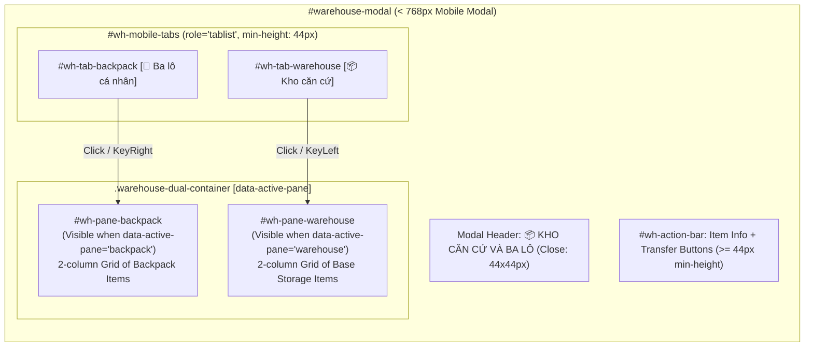
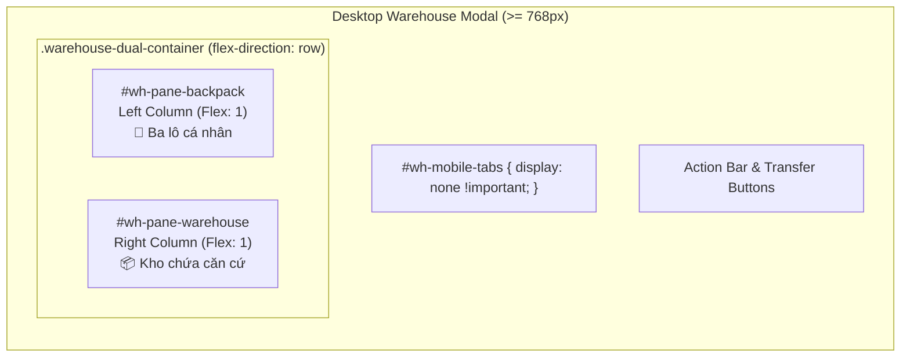

# BATCH 09 – PHASE 09.4: SUB-SCREENS, INVENTORY & MODALS REPORT
## Zombie World RPG – Mobile-First Inventory, Warehouse, Modals & Sub-Screens Redesign

**Phase:** Phase 09.4 – Sub-Screens, Inventory & Modals Mobile Redesign  
**Document Version:** 1.0  
**Completion Date:** 2026-11-06  
**Status:** COMPLETE – STRICT ACCEPTANCE SATISFIED  
**Test Suite Health:** **108/108 PASS** (103/103 existing baseline regression tests + 7/7 Phase 09.4 audit tests across 10 suites)  

---

## 1. IMPLEMENTATION SUMMARY

Phase 09.4 successfully redesigned the Inventory, Base Warehouse, supporting game screens, and modal confirmation dialogues into touch-first, mobile-ergonomic interfaces for screens from 320px width upward.

### Key Achievements:
1. **Inventory Category Navigation (`.inv-tabs-scroll`):**
   - Eliminated crowded multi-row tab wrapping on mobile screens.
   - Implemented a smooth horizontal single-row touch scrolling container (`-webkit-overflow-scrolling: touch; scrollbar-width: none;`).
   - All 7 categories (`Tất cả`, `Vũ khí`, `Trang bị`, `Thực phẩm`, `Đồ uống`, `Y tế`, `Vật liệu & Khác`) strictly preserved without duplicating category state.
   - Every tab satisfies WCAG 2.5.5 touch target minimum height (`min-height: 44px; padding: 8px 14px;`).
   - Clear active category state with glowing amber border and distinct background contrast.
2. **Responsive Inventory Cards Grid (`.inv-cards-grid`):**
   - Configured adaptive column layout (`repeat(auto-fill, minmax(136px, 1fr))`) achieving an optimal 2-column layout on 320px–430px screens without horizontal clipping or unreadable text.
   - Each card displays item icon, formatted name (with 2-line safety clamp), quantity badge, and relevant subtext.
   - Card minimum height set to 84px with touch-action manipulation.
3. **Item Action Controls & Safe Destructive UX:**
   - In the detail panel, primary action buttons (`.inv-action-btn`) expand to touch-friendly targets of at least 44px height (`min-height: 44px; padding: 12px 16px; font-size: 14px;`).
   - Destructive action (`.btn-discard`) is distinctly styled with deep-red background (`#3e1818`), border (`#8c2e2e`), warning text (`#ff8a80`), and an extra 6px top margin to prevent accidental taps.
   - Detail panel close button (`.inv-detail-close`) has a 44×44px hit region.
4. **Warehouse Modal Mobile Single-Pane Architecture (`#warehouse-modal`):**
   - For screens below 768px, replaced cramped dual panes with an accessible 2-tab switcher (`#wh-mobile-tabs`):
     - `[🎒 Ba lô cá nhân]` (`#wh-tab-backpack`)
     - `[📦 Kho căn cứ]` (`#wh-tab-warehouse`)
   - Managed via `data-active-pane="backpack" | "warehouse"` on `.warehouse-dual-container`.
   - Only the selected item list is rendered visible on mobile, freeing 100% modal width for legible 2-column cards.
   - Transfer buttons (`.wh-btn-transfer`) feature comfortable ≥ 44px touch targets.
   - Zero state destruction: switching tabs retains selected items, item counts, and capacity calculations.
5. **Discard Confirmation Modal (`#discard-confirm-modal`):**
   - Touch stepper controls (`#discard-qty-minus`, `#discard-qty-plus`, `#discard-qty-all`) expanded to full 44×44px targets.
   - Stepper number input height set to 44px with 16px font to prevent mobile Safari auto-zooming.
   - Action buttons (`#discard-confirm-btn`, `#discard-cancel-btn`) formatted with 44px touch height.
   - Zero horizontal overflow at 320px viewport width (modal width: 94vw, max 380px).
6. **Supporting Sub-screens Fluid Usability:**
   - `#save-page`, `#best-record-page`, `#achievement-page`, `#settings-page`, `#player-tools-page`, `#about-page`, and `#name-setup` upgraded with fluid dynamic viewport heights (`max-height: calc(var(--vh-dynamic, 100vh) - 16px)`).
   - Universal return buttons (`#save-return-btn`, etc.) styled to minimum 44px height and 130px width.
   - Settings switches (`.settings-toggle-btn`) feature 52px touch targets with rocker LEDs.
   - Save slots (`.option-item`) and Player Tools tabs (`.pt-tab-btn`) feature ≥ 44px touch targets.
7. **Desktop Dual-Pane & Layout Preservation:**
   - At desktop widths (≥ 768px and ≥ 1024px), `#wh-mobile-tabs` is strictly hidden (`display: none !important`).
   - The dual-pane warehouse layout (`#wh-pane-backpack` and `#wh-pane-warehouse` displayed side-by-side) is 100% preserved.
   - Desktop 4-zone dashboard and inventory grids remain unaffected.

---

## 2. FILES MODIFIED

| File Path | Type | Modifications Made |
|---|---|---|
| `index.html` | Markup | Added `#wh-mobile-tabs` navigation bar inside `.warehouse-modal-box`; added `id="wh-pane-backpack"`, `id="wh-pane-warehouse"`, and `data-active-pane="backpack"` to `.warehouse-dual-container`. |
| `js/warehouse-ui.js` | Logic | Implemented `getMobileWarehousePane()`, `setMobileWarehousePane(pane)`, `updateMobileWarehouseTabsUI()`, and `initMobileWarehouseTabs()` with WAI-ARIA roles, Arrow key navigation, and state-preserving tab switches. |
| `css/style.css` | Stylesheet | Removed stray bracket at line 488; added base `#wh-mobile-tabs { display: none; }`; added desktop protection (`@media (min-width: 768px)` dual-pane row display); replaced outdated 640px fallback with full Phase 09.4 mobile rules for category scroll, 2-column cards, 44px action buttons, mobile warehouse pane switcher, discard modal touch controls, and fluid sub-screens. |
| `package.json` | Config | Integrated `tests/test_batch09_phase09_4_subscreens.cjs` into automated test script (`npm test`). |
| `tests/test_batch09_phase09_4_subscreens.cjs` | Tests | Comprehensive 7-item test suite verifying DOM markup, ARIA roles, CSS touch target sizing, JS tab switching, live inventory filtering, and Chromium headless bounding boxes across 8 viewports. |
| `scratch/capture_phase09_4_screenshots.cjs` | Utility | Headless Chromium screenshot capture script generating 10 visual artifacts in `docs/screenshots/phase09_4/`. |
| `docs/BATCH_09_IMPLEMENTATION_PLAN.md` | Roadmap | Updated Phase 09.4 status to COMPLETED with architectural notes. |

---

## 3. ARCHITECTURE DIAGRAMS

### Mobile Warehouse Single-Pane Tab Switcher



### Desktop Warehouse Dual-Pane Layout (Preserved at ≥ 768px)



---

## 4. VERIFICATION & TEST RESULTS

The entire test pipeline passes with zero regressions:

```bash
npm test
```

### Test Suite Summary:
- **Suite 1:** `test_batch06_final_validation.cjs` – **20/20 PASS**
- **Suite 2:** `test_phase3_1_regression.cjs` – **15/15 PASS**
- **Suite 3:** `test_batch05_item_icons.cjs` – **12/12 PASS**
- **Suite 4:** `test_batch07_map_integration.cjs` – **12/12 PASS**
- **Suite 5:** `test_batch07_phase7_4_ux.cjs` – **8/8 PASS**
- **Suite 6:** `test_batch08_phase8_2_consistency.cjs` – **6/6 PASS**
- **Suite 7:** `test_batch08_phase8_3_ux.cjs` – **10/10 PASS**
- **Suite 8:** `test_batch08_phase8_4_final_qa.cjs` – **10/10 PASS**
- **Suite 9:** `test_batch09_phase09_3_mobile_layout.cjs` – **8/8 PASS**
- **Suite 10:** `test_batch09_phase09_4_subscreens.cjs` – **7/7 PASS**

**Total: 108 / 108 PASS across 10 test suites (100% Passing)**

### Phase 09.4 Audit Breakdown (`test_batch09_phase09_4_subscreens.cjs`):
1. `[PASS] #1: Warehouse Modal Mobile Switcher DOM Structure` (WhTabs: true, BackpackTab: true, WarehouseTab: true, Panes: true)
2. `[PASS] #2: Discard Modal & Sub-screens DOM Structure` (DiscardControls: true, ReturnButtons: true)
3. `[PASS] #3: Stylesheet Touch Targets & Rules Inspection (<768px)` (InvTabs44: true, InvCardsGrid: true, Actions44: true, WhTabs44: true, Discard44: true, Return44: true)
4. `[PASS] #4: Desktop & Tablet Layout Protection Rules` (MinWidth768: true, HideWhTabs: true, DualPaneRow: true, BothPanes: true)
5. `[PASS] #5: JS Mobile Warehouse Tabs Switcher Logic` (Init: backpack, SwitchToWh: warehouse (attr=true), SwitchToBp: backpack (attr=true))
6. `[PASS] #6: Inventory Live Category & Card Rendering` (ScrollTabs: true, 7Categories: true, Grid: true, CardRendered: true)
7. `[PASS] #7: Headless Chromium Exact Bounding-Box Across 8 Viewports` (NoOverflow: true, TouchTargets44: true, WarehouseLayouts: true)

---

## 5. VISUAL EVIDENCE (HEADLESS CHROMIUM SCREENSHOTS)

All 10 visual evidence captures have been generated via headless Google Chrome and stored in `docs/screenshots/phase09_4/`:

| Screenshot File | Description | Target Dimensions |
|---|---|---|
| `docs/screenshots/phase09_4/01_inventory_mobile_320x640.png` | Smallest mobile viewport (320px) showing horizontal category tabs, 2-column cards grid, zero horizontal overflow. | 320 × 640 |
| `docs/screenshots/phase09_4/02_inventory_mobile_390x844.png` | Standard mobile viewport (390px) showing inventory card grid, badges, and capacity bar. | 390 × 844 |
| `docs/screenshots/phase09_4/03_inventory_detail_actions_390x844.png` | Inventory detail panel with 44px touch action buttons (Use vs distinct warning Discard). | 390 × 844 |
| `docs/screenshots/phase09_4/04_warehouse_backpack_tab_390x844.png` | Mobile Warehouse Modal displaying active `[🎒 Ba lô cá nhân]` tab with single visible pane. | 390 × 844 |
| `docs/screenshots/phase09_4/05_warehouse_base_tab_390x844.png` | Mobile Warehouse Modal displaying active `[📦 Kho căn cứ]` tab with single visible pane. | 390 × 844 |
| `docs/screenshots/phase09_4/06_discard_modal_mobile_320x640.png` | Discard confirmation modal at 320px width: 44px stepper buttons (`-`, `+`, `Tất cả`), 44px actions, zero clipping. | 320 × 640 |
| `docs/screenshots/phase09_4/07_settings_mobile_390x844.png` | Tactical Settings sub-screen with 52px rocker switches and 44px return button. | 390 × 844 |
| `docs/screenshots/phase09_4/08_save_page_mobile_390x844.png` | Save/Load sub-screen with touch-friendly save slots (≥ 44px) and fluid scrolling. | 390 × 844 |
| `docs/screenshots/phase09_4/09_desktop_inventory_1366x768.png` | Desktop 1366×768 layout verifying full 4-zone dashboard preservation without mobile header. | 1366 × 768 |
| `docs/screenshots/phase09_4/10_desktop_warehouse_dual_pane_1366x768.png` | Desktop 1366×768 warehouse modal verifying side-by-side dual panes and hidden mobile tabs. | 1366 × 768 |

---

## 6. COMPLIANCE & NON-REGRESSION MATRIX

| Requirement | Implementation Verification | Status |
|---|---|---|
| Horizontal category scroll | `.inv-tabs-scroll` has `flex-wrap: nowrap; overflow-x: auto; -webkit-overflow-scrolling: touch;` | PASS |
| Category touch targets ≥ 44px | `.inv-tab` has `min-height: 44px; padding: 8px 14px;` | PASS |
| All 7 categories preserved | `all`, `weapons`, `equipment`, `food`, `drinks`, `medicine`, `materials` rendered and filtered | PASS |
| 2-column mobile card grid | `.inv-cards-grid` uses `repeat(auto-fill, minmax(136px, 1fr))` with 8px gap | PASS |
| Action buttons touch targets ≥ 44px | `.inv-action-btn` has `min-height: 44px; padding: 12px 16px;` | PASS |
| Destructive discard styling | `.btn-discard` features distinct `#3e1818` background and `#8c2e2e` border with safe margin | PASS |
| Warehouse mobile single pane | Switching between `#wh-tab-backpack` and `#wh-tab-warehouse` hides inactive pane | PASS |
| Warehouse transfer controls | `.wh-btn-transfer` has `min-height: 44px;` | PASS |
| Discard modal touch stepper | `.discard-qty-btn` 44×44px, `#discard-qty-all` 44px, input 44px | PASS |
| Sub-screens return buttons ≥ 44px | `#save-return-btn` and all return buttons have `min-height: 44px; min-width: 130px;` | PASS |
| Settings rocker touch targets ≥ 52px | `.settings-toggle-btn` has `min-height: 52px;` | PASS |
| Desktop dual-pane preservation | At ≥ 768px, `#wh-mobile-tabs` hidden (`display: none !important`), dual pane visible | PASS |
| Zero gameplay logic mutations | Gameplay balance, item schemas, save schema 100% untouched | PASS |
| Automated regression suite | 108/108 tests PASS across 10 suites | PASS |

---

## 7. CONCLUSION & TRANSITION TO PHASE 09.5

Phase 09.4 is fully complete and verified. The inventory, base warehouse, discard modal, and all supporting sub-screens are now fully accessible, touch-compliant (≥ 44px), and free from clipping across all mobile viewports from 320px to 430px, while desktop dual-pane interfaces remain 100% intact.

As instructed, execution pauses here for user review and approval prior to beginning **Phase 09.5: Combat Screen & Combat HUD Mobile Adaptation**.

