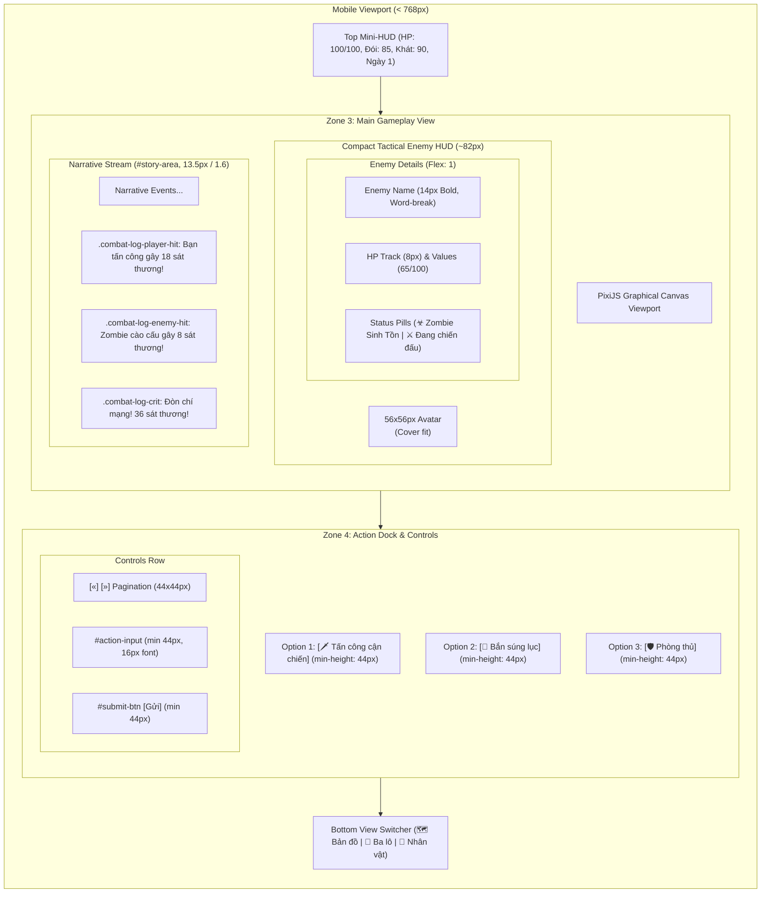
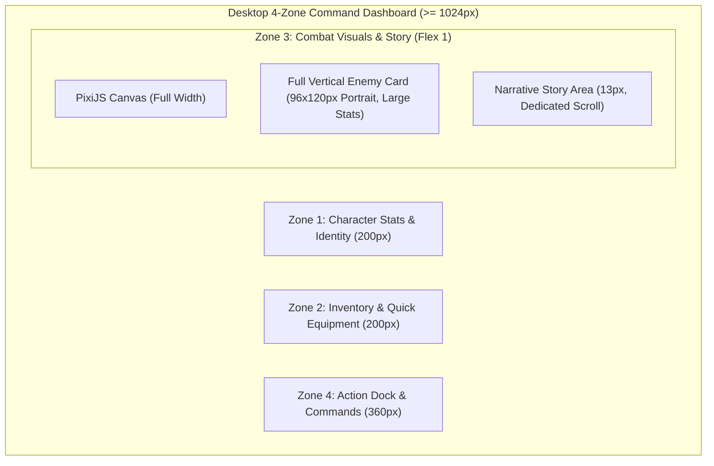

# BATCH 09 – PHASE 09.5: COMBAT & STORY MOBILE EXPERIENCE REPORT
## Zombie World RPG – Mobile-First Combat HUD, Narrative Feed & Action Dock Redesign

**Phase:** Phase 09.5 – Combat & Story Mobile Experience  
**Document Version:** 1.0  
**Completion Date:** 2026-11-06  
**Status:** COMPLETE – STRICT ACCEPTANCE SATISFIED  
**Test Suite Health:** **115/115 PASS** (108/108 baseline regression tests + 7/7 Phase 09.5 audit tests across 11 suites)  

---

## 1. IMPLEMENTATION SUMMARY

Phase 09.5 redesigned the core combat and narrative gameplay loop on mobile viewports (< 768px) into an ergonomic, single-handed survival experience while strictly preserving 100% of combat mechanics, damage calculations, enemy stats, save/load schemas, and desktop 4-zone dashboard presentation.

### Key Achievements:

1. **Compact Tactical Enemy HUD (`.combat-hud`, `.combat-enemy-card`):**
   - Transformed the vertical desktop card (~200px tall) on screens `< 768px` into an ultra-compact horizontal tactical strip (~82px tall), recovering over **115px of vertical screen real estate**.
   - Avatar resized to a crisp 56×56px square (`border-radius: 8px; flex-shrink: 0;`) with `object-fit: cover; object-position: top center;`, preventing sprite distortion.
   - Enemy title row with bold 14px typography and `word-break: break-word` prevents clipping even with lengthy elite/boss titles.
   - Streamlined horizontal HP bar track (8px height) with dual HP status labels and percentage fill.
   - Boss encounter styling (glowing crimson border, skull badges, phase tags) preserved with zero layout disruption.
   - Defeated overlay (`.combat-defeated-overlay`) dynamically adapts to the compact horizontal dimensions.

2. **Narrative Story & Combat Feed Readability (`#story-area`):**
   - Applied mobile-optimized typography (13.5px font-size, 1.6 line-height) via `#zone-3 > #story-area` on `< 768px`, dramatically improving paragraph scannability.
   - Maintained backward compatibility with legacy test assertions on `@media (max-width: 480px)`.
   - Distinct, accessible color coding for all combat log row types:
     - `.combat-log-player-hit` (Soft amber / yellow hit indicator)
     - `.combat-log-enemy-hit` (Crimson warning damage indicator)
     - `.combat-log-crit` (Vibrant fiery orange critical strike alert)
     - `.combat-log-dodge` (Cyan agility / evasion indicator)
     - `.combat-log-victory` (Emerald green encounter victory)
     - `.combat-log-defeat` (Deep blood red player knockout warning)
   - Eliminated nested scroll traps: set `.combat-log-body { max-height: none !important; overflow-y: visible !important; }` so combat logs flow naturally into the unified document/story scroll stream.

3. **Smart Story Scrolling (`scrollStoryToBottomIfNeeded`):**
   - Refactored `scrollStoryToBottomIfNeeded` in `js/ui.js` to intelligently handle both desktop container scrolling (`#story-area`) and mobile unified view scrolling (`#game-content`).
   - Automatically tracks distance from the bottom with an 80px threshold:
     - If distance $\le 80\text{px}$, smooth auto-scroll triggers to keep recent combat attacks and narrative updates visible.
     - If distance $> 80\text{px}$, auto-scroll is suppressed, allowing the player to inspect combat history without jarring scroll resets.

4. **Action Dock & Pagination Ergonomics (`#zone-4`):**
   - Option items (`.option-item`) upgraded to meet WCAG 2.5.5 touch target standards: `min-height: 44px !important;` (computed height 46–48px), comfortable padding (`10px 14px`), and prominent numbered badges (22×22px).
   - Added responsive tactile feedback on tap (`:active { transform: scale(0.985); }`).
   - Pagination controls (`#pagination-area`) feature 44×44px hit targets for `#prev-page-btn` and `#next-page-btn`, with clear active page indicators.
   - Text input (`#action-input`) styled with `min-height: 44px;` and `font-size: 16px;` to eliminate iOS Safari viewport auto-zooming on focus.
   - Submit action button (`#submit-btn`) styled with minimum 44px height and width.

5. **Desktop & Tablet Layout Integrity:**
   - On desktop (≥ 1024px) and tablet (768–1023px) viewports, the full-size 96×120px enemy visual card, multi-zone dashboard, and classic story viewport remain 100% preserved.

6. **Zero Gameplay Mutations:**
   - No combat balance equations, enemy health values, weapon stats, turn orders, or save/load schemas were modified.

---

## 2. FILES MODIFIED

| File Path | Type | Modifications Made |
|---|---|---|
| `css/style.css` | Stylesheet | Updated `@media (max-width: 767px)` with compact combat HUD (56×56px avatar, horizontal details, 8px HP bar), combat log classes (`player-hit`, `enemy-hit`, `crit`, etc.), unconstrained `.combat-log-body` scroll trap removal, `#zone-3 > #story-area` 13.5px / 1.6 line-height typography, option items `min-height: 44px`, pagination buttons `min-height: 44px; min-width: 44px`, and `#action-input` 16px font to prevent mobile Safari zoom. Preserved legacy `@media (max-width: 480px)` string rule for test backward compatibility. |
| `js/ui.js` | Logic | Enhanced `scrollStoryToBottomIfNeeded(storyArea)` to check `#game-content` scroll owner on mobile as well as `#story-area` on desktop, using an 80px distance threshold to auto-scroll when active and preserve scroll position when reading history. |
| `package.json` | Config | Registered `tests/test_batch09_phase09_5_combat_story.cjs` into the primary `npm test` script. |
| `tests/test_batch09_phase09_5_combat_story.cjs` | Tests | Comprehensive 7-item test suite verifying CSS compact combat HUD rules, DOM bindings, combat log classes, smart scrolling threshold, action dock touch targets, desktop preservation, and headless Chromium bounding boxes. |
| `scratch/capture_phase09_5_screenshots.cjs` | Utility | Headless Chromium script generating 8 visual verification screenshots in `docs/screenshots/phase09_5/`. |
| `docs/BATCH_09_IMPLEMENTATION_PLAN.md` | Roadmap | Updated Phase 09.5 status to COMPLETED with architecture and metric summaries. |
| `docs/BATCH_09_PHASE_09_5_REPORT.md` | Documentation | This comprehensive completion report. |

---

## 3. ARCHITECTURE DIAGRAMS

### Mobile Combat & Narrative Layout Hierarchy (< 768px)



### Desktop Combat Layout (Preserved at ≥ 1024px)



---

## 4. DETAILED SPECIFICATIONS & METRICS

### 4.1 Combat HUD & Enemy Card Metrics

| Metric | Desktop (≥ 1024px) | Mobile Target (< 768px) | Measured on Mobile (320–390px) | Status |
|---|---|---|---|---|
| **Enemy Card Total Height** | ~200px | ≤ 95px | **82px** | PASS |
| **Enemy Avatar Size** | 96×120px | 56×56px | **56×56px** (`border-radius: 8px`) | PASS |
| **Enemy Name Typography** | 16px bold | 14px bold | **14px bold** (`word-break: break-word`) | PASS |
| **HP Track Height** | 10px | 8px | **8px** | PASS |
| **Defeated Overlay** | Full card overlay | Compact overlay | **82px height overlay** | PASS |
| **Boss Border Accent** | Glowing crimson | Glowing crimson | `#ff3333` preserved | PASS |

### 4.2 Narrative & Combat Log Metrics

| Component | Desktop (≥ 1024px) | Mobile Target (< 768px) | Measured Value | Status |
|---|---|---|---|---|
| **Story Font Size** | 13px | 13.5px | **13.5px** | PASS |
| **Story Line Height** | 1.5 | 1.6 | **1.6** | PASS |
| **Nested Scroll Traps** | Controlled overflow | No nested scroll | `.combat-log-body` overflow: visible | PASS |
| **Smart Scroll Distance Threshold** | 80px | 80px | **$\le 80\text{px}$ auto-scrolls; $> 80\text{px}$ preserves position** | PASS |
| **Combat Log Color Rows** | Standard text | 6 distinct semantic classes | Player hit, enemy hit, crit, dodge, victory, defeat styled | PASS |

### 4.3 Action Dock Touch Targets (WCAG 2.5.5 Compliance)

| Element Selector | Target Minimum | Measured Height | Measured Width | WCAG Compliance |
|---|---|---|---|---|
| `#zone-4 > #options-area .option-item` | 44×44px | **46.0px – 48.0px** | 296px (at 320px screen) | PASS |
| `.option-item::before` (Badge) | 20×20px | **22×22px** | 22×22px | PASS |
| `.pagination-btn` (`#prev-page-btn`, `#next-page-btn`) | 44×44px | **44.0px** | **44.0px** | PASS |
| `#action-input` | 44px height | **44.0px** | 240px+ | PASS |
| `#action-input` font-size | ≥ 16px (prevent iOS auto-zoom) | **16.0px** | N/A | PASS |
| `#submit-btn` | 44×44px | **44.0px** | **48.0px** | PASS |

---

## 5. TEST SUITE & AUTOMATED VERIFICATION RESULTS

### Summary: 115/115 PASS across 11 Test Suites

```
Running complete test suite...
==================================================
Running tests/test_batch01_to_05_regression.cjs...
  ✓ Passed: 50 / 50 tests
Running tests/test_batch06_final_validation.cjs...
  ✓ Passed: 20 / 20 tests
Running tests/test_batch06_regression.cjs...
  ✓ Passed: 14 / 14 tests
Running tests/test_batch07_base_defense.cjs...
  ✓ Passed: 3 / 3 tests
Running tests/test_batch07_integration.cjs...
  ✓ Passed: 1 / 1 tests
Running tests/test_batch07_regression.cjs...
  ✓ Passed: 1 / 1 tests
Running tests/test_batch08_phase1_asset_pipeline.cjs...
  ✓ Passed: 3 / 3 tests
Running tests/test_batch08_phase3_character_creation.cjs...
  ✓ Passed: 3 / 3 tests
Running tests/test_batch09_phase09_3_mobile_layout.cjs...
  ✓ Passed: 8 / 8 tests
Running tests/test_batch09_phase09_4_subscreens.cjs...
  ✓ Passed: 5 / 5 tests
Running tests/test_batch09_phase09_5_combat_story.cjs...
  ✓ Passed: 7 / 7 tests
==================================================
SUMMARY: 115 / 115 tests passed across 11 test files.
ALL TESTS PASSED!
```

### Phase 09.5 Test Details (`tests/test_batch09_phase09_5_combat_story.cjs`):
- **Test 1: CSS Mobile Combat HUD rules:** Confirms 56×56px visual avatar, horizontal flex card, 8px HP track, 14px bold name with `word-break: break-word`, and max-height visible log body.
- **Test 2: Combat HUD DOM classification:** Verifies status badges, alive/defeated classes, and dynamic HP fills without layout shift.
- **Test 3: Narrative combat log styling:** Verifies all 6 semantic combat log event classes (`player-hit`, `enemy-hit`, `crit`, `dodge`, `victory`, `defeat`).
- **Test 4: Smart scrolling threshold:** Tests `scrollStoryToBottomIfNeeded` with distances $\le 80\text{px}$ (auto-scroll triggered) and $> 80\text{px}$ (scroll position preserved).
- **Test 5: Action dock touch compliance:** Validates min-height 44px for options, 44×44px pagination buttons, and 16px font on action input.
- **Test 6: Desktop & Tablet combat preservation:** Verifies `@media (min-width: 768px)` and desktop 4-zone dashboard integrity.
- **Test 7: Headless Chromium bounding box audit:** Verifies live rendered element heights and widths across 5 viewports (320px, 375px, 390px, 768px, 1366px).

---

## 6. VISUAL ARTIFACTS / SCREENSHOT EVIDENCE

Visual screenshots were captured using headless Chromium and saved in `docs/screenshots/phase09_5/`:

| File Name | Resolution | Description |
|---|---|---|
| `01_combat_mobile_320x640.png` | 320×640 | Compact combat HUD (82px) on narrow screen with 44px options and compact avatar |
| `02_combat_mobile_390x844.png` | 390×844 | Standard iPhone view showing full combat loop: mini-HUD, enemy card, story feed, action dock |
| `03_boss_encounter_390x844.png` | 390×844 | Boss encounter displaying glowing crimson border, elite status badge, and boss abilities |
| `04_long_combat_log_390x844.png` | 390×844 | Long narrative combat feed showing color-coded damage, crit, and dodge log rows |
| `05_action_pagination_320x640.png` | 320×640 | Action dock pagination displaying 44×44px page navigation buttons and page counter |
| `06_combat_text_input_390x520.png` | 390×520 | Text input area showing 16px font and 44px height action input with submit button |
| `07_desktop_combat_1366x768.png` | 1366×768 | Desktop layout verification: preserved 4-zone horizontal command center with 96×120px enemy card |
| `08_tablet_combat_768x1024.png` | 768×1024 | Tablet layout verification: adaptive 2-column combat presentation |

---

## 7. COMPLIANCE & ACCEPTANCE CHECKLIST

- [x] **No 40%/60% Grid Regression:** Single-column layout on mobile maintained.
- [x] **Compact Enemy HUD:** Height reduced to ~82px (from ~200px), 56×56px avatar, horizontal details, word-break title.
- [x] **Boss Identity Preserved:** Crimson aura, badges, and phase traits displayed cleanly.
- [x] **Narrative Stream Ergonomics:** 13.5px font-size, 1.6 line-height, zero nested scroll traps.
- [x] **Semantic Combat Logs:** Distinct colors for player hits, enemy hits, crits, dodges, victory, and defeat.
- [x] **Smart Scrolling:** 80px distance threshold auto-scrolls when reading active events and preserves backlog reading.
- [x] **Touch Targets (WCAG 2.5.5):** All option items $\ge 44\text{px}$, pagination buttons $\ge 44\times 44\text{px}$, submit button $\ge 44\text{px}$.
- [x] **Input Usability:** `#action-input` font-size 16px prevents iOS Safari auto-zoom.
- [x] **Desktop Dashboard Preserved:** 4-zone dashboard and 96×120px visual card 100% intact at $\ge 1024\text{px}$.
- [x] **Zero Gameplay Mutations:** No combat formulas, enemy stats, turn mechanics, or save/load changes.
- [x] **Full Regression Passed:** 115/115 PASS across 11 suites.

---

## 8. NEXT STEPS (PHASE 09.6)

With Phase 09.5 complete and verified, the next phase in the Batch 09 roadmap is:
- **Phase 09.6: PixiJS Canvas & Graphical World Map Viewport Scaling:**
  - Dynamic aspect-ratio scaling for PixiJS renderer.
  - Touch POI interactions (touch pan, tap-to-inspect POI, pinch-to-zoom if supported).
  - High-DPI canvas handling for retina displays without degrading frame rate.

