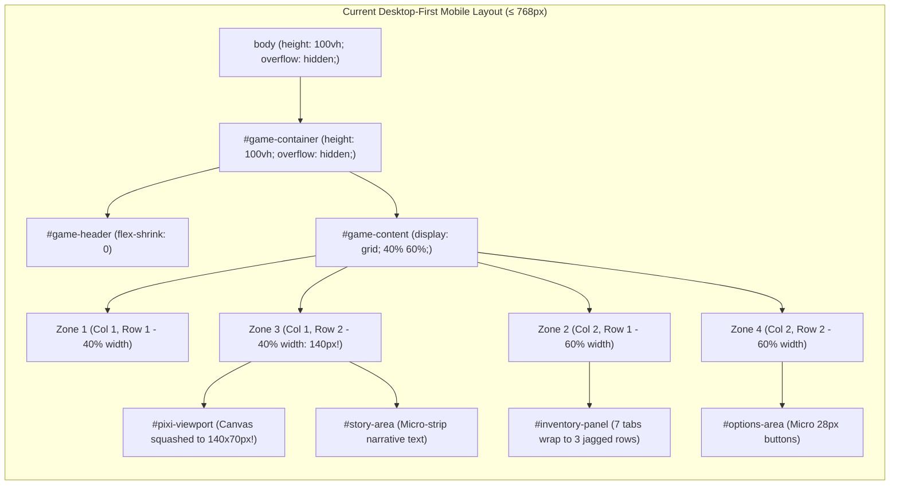

# BATCH 09 – PHASE 09.1: RESPONSIVE DEFECT AUDIT
## Zombie World RPG – Comprehensive Responsive Layout & Viewport Analysis

**Document Version:** 1.0  
**Audit Date:** 2026-11-06  
**Auditor:** Senior Frontend Architect & Responsive UX Specialist  
**Target Baseline:** 95/95 Tests Passing  
**Objective:** Thorough audit of responsive defects, layout bottlenecks, scrolling traps, touch ergonomics, and typography across target viewports (320px–1920px) to formulate a bulletproof Mobile-First refactoring strategy.

---

## 1. AUDIT METHODOLOGY & SCOPE

### 1.1 Methodology
This audit combines static source inspection of HTML structure (`index.html`), stylesheet layout rules (`css/style.css`), dynamic UI renderers (`js/ui.js`, `js/inventory-ui.js`, `js/warehouse-ui.js`, `js/combat-hud.js`, `js/map-renderer.js`), with computed viewport box-model calculations across 9 representative viewport resolutions.

### 1.2 Viewport Test Matrix
| Viewport Profile | Resolution | Orientation | Target Devices | Critical Layout Risk |
|---|---|---|---|---|
| **Ultra-Compact Mobile** | 320 × 640 | Portrait | iPhone SE (1st gen), small Androids | Maximum horizontal crushing, content truncation, overflow clipping |
| **Standard Android** | 360 × 800 | Portrait | Samsung Galaxy S-series, Redmi, Pixel | 2×2 grid collapse, micro-touch targets, canvas illegibility |
| **Compact iOS** | 375 × 812 | Portrait | iPhone 12/13 mini, iPhone X/XS | Safe-area notch interference, vertical scroll traps |
| **Mainstream Mobile** | 390 × 844 | Portrait | iPhone 12/13/14/15, Pixel 7 | Sub-optimal 40%/60% split, tab jagged wrapping, tiny action buttons |
| **Large Mobile / Phablet** | 430 × 932 | Portrait | iPhone 14/15/16 Pro Max, Galaxy Ultra | Canvas under-utilization, uneven whitespace, micro-labels |
| **Tablet Portrait** | 768 × 1024 | Portrait | iPad 9/10th gen, iPad Air | Breakpoint boundary edge-case; 2×2 grid looks stretched yet crammed |
| **Tablet Landscape / Netbook** | 1024 × 768 | Landscape | iPad landscape, 11" laptops | Desktop 4-column layout fits but Zone 1/2 take 400px of 1024px |
| **Standard Laptop** | 1366 × 768 | Landscape | Mainstream business laptops | Balanced desktop view; baseline reference |
| **Full HD Desktop** | 1920 × 1080 | Landscape | Standard 1080p monitors | Native designed experience; zero clipping |

---

## 2. RESPONSIVE DEFECT CATALOG

The following catalog identifies every layout failure, overflow defect, touch target hazard, and visual degradation found across the UI states.

### DEF-01: Rigid 2×2 Mobile Grid Collapses Core Viewport & Story (P0 Blocker)
- **Affected Screens:** Screen 8 (HUD), Screen 9 (Weapons), Screen 10 (Inventory), Screen 11 (PixiJS Viewport), Screen 12 (Story Area), Screen 18 (Options Area), and all Gameplay States (13–17, 21).
- **Affected Viewports:** 320×640, 360×800, 375×812, 390×844, 430×932, 768×1024 (all widths ≤ 768px).
- **Exact Selector / Rules:**
  `css/style.css` (lines 1070–1085, 1087–1120):
  ```css
  @media (max-width: 768px) {
    #game-content {
      display: grid;
      grid-template-columns: 40% 60%;
      grid-template-rows: auto minmax(0, 1fr);
      gap: 3px;
      flex: 1;
      min-height: 0;
      overflow: hidden;
    }
    #zone-1 { grid-column: 1; grid-row: 1; overflow: hidden; }
    #zone-2 { grid-column: 2; grid-row: 1; display: flex; flex-direction: column; overflow: hidden; height: 100%; }
    #zone-3 { grid-column: 1; grid-row: 2; overflow-y: auto; -webkit-overflow-scrolling: touch; }
    #zone-4 { grid-column: 2; grid-row: 2; display: flex; flex-direction: column; overflow: hidden; }
  }
  ```
- **Root Cause:**
  Instead of refactoring the 4-zone dashboard into a vertical single-column mobile flow, the media query forces a rigid 2×2 grid with a 40%/60% column split.
  - Column 1 (40% width): On a 360px screen, `360px * 0.40 = 144px`. It holds **Zone 1** (Character ID + 7 Stat Bars) stacked directly on top of **Zone 3** (PixiJS 2D Canvas + Story Narrative)!
  - Column 2 (60% width): `360px * 0.60 = 216px`. It holds **Zone 2** (Weapons + 7-Tab Inventory Grid) stacked on top of **Zone 4** (Options + Input).
- **Visual Symptom & UX Failure:**
  1. The 640×320 (2:1 aspect ratio) virtual canvas inside `#pixi-viewport` is constrained to 140px width, resulting in a microscopic 70px canvas height! The entire graphical world map (24 locations, roads, markers, labels, player radar pin) is squashed into an unreadable 140×70px stamp.
  2. The narrative text inside `#story-area` is cramped into a 140px vertical stripe where Vietnamese words wrap after every 2–3 words.
  3. Zone 2 (Inventory) and Zone 4 (Options) in the 60% column are similarly restricted, preventing clear inspection of item cards or long option labels.
- **Severity:** **P0 – Blocker** (Core game loop, map navigation, and combat visualization are rendered virtually unplayable).
- **Proposed Correction:**
  Implement a Mobile-First single-column flow (`grid-template-columns: 1fr` or `flex-direction: column`). Provide an ergonomic mobile tab bar or top toggle switcher (e.g., [🗺️ Map / Story] vs [🎒 Backpack / Gear] vs [📊 Character Stats]) allowing Zone 3 and Zone 4 full screen width (`100%`), with secondary panels accessed via drawer or switchable tabs.

---

### DEF-02: Viewport Locking & Dynamic Browser Chrome Clipping (P0 Blocker)
- **Affected Screens:** All 21 Screens & UI States.
- **Affected Viewports:** All mobile devices (320px–430px) on iOS Safari and Android Chrome.
- **Exact Selector / Rules:**
  `css/style.css` (lines 50–59, 78–86):
  ```css
  body {
    height: 100vh;
    overflow: hidden;
  }
  #game-container {
    display: flex;
    flex-direction: column;
    height: 100vh;
    width: 100%;
    padding: 0 8px 0;
  }
  ```
  `index.html` (line 5):
  ```html
  <meta name="viewport" content="width=device-width, initial-scale=1.0">
  ```
- **Root Cause:**
  1. `100vh` on mobile browsers calculates height based on the maximum viewport when browser toolbars (URL address bar, bottom tab bar) are hidden. When browser chrome is visible, the bottom 60px–80px of `#game-container` is clipped behind the browser chrome!
  2. `overflow: hidden` on `body` completely disables the native browser document scroll, trapping touch events.
  3. Viewport meta tag lacks `viewport-fit=cover`, leaving content unaligned with device notches and rounded corner safe areas (`env(safe-area-inset-bottom)`).
- **Visual Symptom & UX Failure:**
  The bottom `#input-area` (`#action-input`, `#submit-btn`) and the lowest pagination/option buttons in `#zone-4` are pushed below the fold and obscured by the browser toolbar or iPhone home indicator bar. Users cannot tap submit or view the final action option.
- **Severity:** **P0 – Blocker** (Players cannot interact with bottom action options on modern mobile browsers).
- **Proposed Correction:**
  Use `height: 100dvh` (with fallback to `height: 100vh`), add `viewport-fit=cover` to meta viewport, incorporate `padding-bottom: env(safe-area-inset-bottom, 8px)`, and allow parent containers to flex accurately without rigid viewport height overflow traps.

---

### DEF-03: Multi-Scroll Trap (4 Simultaneous Micro-Scrollable Panes) (P1 Severe)
- **Affected Screens:** Screen 8, 9, 10, 11, 12, 18 (Gameplay Dashboard).
- **Affected Viewports:** 320×640, 360×800, 375×812, 390×844, 430×932.
- **Exact Selector / Rules:**
  `css/style.css` (lines 1094, 1109, 1121, 1130):
  ```css
  #zone-2 > #inventory-panel .inventory-panel { height: 100%; overflow-y: auto; -webkit-overflow-scrolling: touch; }
  #zone-3 { overflow-y: auto; -webkit-overflow-scrolling: touch; }
  #zone-3 > #story-area { height: 100%; overflow-y: auto; -webkit-overflow-scrolling: touch; }
  #zone-4 > #options-area { overflow-y: auto; -webkit-overflow-scrolling: touch; }
  ```
- **Root Cause:**
  Within a 360×800 viewport, four separate adjacent sub-containers simultaneously have `overflow-y: auto`.
- **Visual Symptom & UX Failure:**
  When a user swipes up or down with their thumb, if their touch starts on Zone 2, only inventory scrolls; if on Zone 3, story scrolls; if on Zone 4, options scroll. Users experience severe "scroll trap" where touching between boundaries causes stutter, dead touches, and accidental taps on items or option buttons.
- **Severity:** **P1 – Severe** (Extremely poor touch ergonomics and frustrating navigation).
- **Proposed Correction:**
  Consolidate scrolling hierarchy on mobile. Only one active primary vertical scroll container should exist at any given time per view/tab.

---

### DEF-04: Sub-Standard Micro-Touch Targets on Interactive Buttons (P1 Severe)
- **Affected Screens:** Screen 10 (Inventory), Screen 18 (Options Area), Screen 16 (Trade), Screen 17 (Base Build).
- **Affected Viewports:** All touch-screen viewports (320px–1024px).
- **Exact Selector / Rules:**
  `css/style.css`:
  - `.option-item` (line 729): `min-height: 28px; padding: 5px 6px;`
  - `.inv-tab` (line 1863): `padding: 3px 6px; font-size: 10px; min-height: 22px;`
  - `.inv-card-btn` (lines 1978, 1988): `padding: 2px 4px; font-size: 9px; min-height: 20px;`
  - `.pagination-btn` (lines 802–812): `padding: 3px 8px; font-size: 11px; min-height: 24px;`
  - `.stat-row` tooltip / buttons: `min-height: 18px;`
- **Root Cause:**
  Desktop mouse-first styling designed for 12px cursor clicks without adhering to WCAG 2.5.5 / Apple HIG (minimum 44×44px) or Android Material Design (minimum 48×48px) touch target standards.
- **Visual Symptom & UX Failure:**
  High miss-rate when tapping option buttons, accidental activation of adjacent options (e.g., choosing "Attack" instead of "Flee", or "Discard" instead of "Use"), causing fatal gameplay mistakes in permadeath mode.
- **Severity:** **P1 – Severe** (Causes destructive accidental player actions and high frustration).
- **Proposed Correction:**
  Ensure all primary mobile action buttons (`.option-item`, `.pagination-btn`, modal action buttons) have `min-height: 44px;` (or `48px` on mobile), with generous padding and tap spacing (minimum 6px gap). For secondary item action buttons (`.inv-card-btn`), increase target area to ≥ 36×36px or utilize an ergonomic bottom action sheet.

---

### DEF-05: Illegible Micro-Typography (< 10px Font Sizes) (P2 Moderate)
- **Affected Screens:** Screen 8 (Stats), Screen 9 (Weapons), Screen 10 (Inventory), Screen 13 (Combat HUD).
- **Affected Viewports:** 320×640 to 430×932 (Mobile viewports).
- **Exact Selector / Rules:**
  `css/style.css`:
  - `.inv-badge-equipped` (line 1951): `font-size: 7px;`
  - `.inv-badge-count` (line 1938): `font-size: 8px;`
  - `.stat-bar-label` (line 1169): `font-size: 9px;`
  - `.stat-bar-value` (line 1172): `font-size: 9px;`
  - `#game-header .subtitle` (line 1068): `font-size: 9px;`
  - `.combat-meta-badge` (lines 1648, 1824): `font-size: 10px;`
  - `.inv-tab` (line 1864): `font-size: 10px;`
- **Root Cause:**
  Downscaling font sizes via `@media (max-width: 768px)` to force desktop HUD elements into the cramped 40% column.
- **Visual Symptom & UX Failure:**
  Text is virtually unreadable without pinch-to-zoom (which is blocked by `overflow: hidden`). Critical information like current HP, hunger, thirst, ammo count, and item quantities cannot be perceived at normal handheld distance.
- **Severity:** **P2 – Moderate** (Visual fatigue and severe readability degradation).
- **Proposed Correction:**
  Enforce a minimum font size of `12px` for badges/captions and `14px–15px` for body/stat labels on mobile screens. Increase badge padding and use icon-assisted indicators instead of shrinking text.

---

### DEF-06: Inventory 7-Category Tab Jagged Wrapping (P1 Severe)
- **Affected Screens:** Screen 10 (Visual Inventory).
- **Affected Viewports:** 320×640, 360×800, 375×812, 390×844.
- **Exact Selector / Rules:**
  `css/style.css` (lines 1851–1860):
  ```css
  .inv-tabs-bar {
    display: flex;
    flex-wrap: wrap;
    gap: 2px;
  }
  .inv-tab {
    flex: 1 1 auto;
    font-size: 10px;
    padding: 3px 6px;
    white-space: nowrap;
  }
  ```
- **Root Cause:**
  Seven category tabs (`Tất cả`, `Vũ khí`, `Đạn dược`, `Y tế`, `Thực phẩm`, `Tài nguyên`, `Công cụ`) with `flex-wrap: wrap` inside a 216px container wrap into 3 jagged, uneven rows.
- **Visual Symptom & UX Failure:**
  The tab bar consumes up to 80px of vertical space, pushing the inventory item card grid down. The tabs have uneven widths, look cluttered, and cause layout shifts when switching categories.
- **Severity:** **P1 – Severe** (Squeezes inventory cards into a tiny sliver of screen height).
- **Proposed Correction:**
  Transform `.inv-tabs-bar` on mobile into a horizontally scrollable single-row tab strip (`flex-wrap: nowrap; overflow-x: auto; -webkit-overflow-scrolling: touch; scrollbar-width: none;`). Each tab maintains consistent padding and pill styling.

---

### DEF-07: Combat HUD Stacks Vertically & Hides Battle Narrative (P1 Severe)
- **Affected Screens:** Screen 13 (Combat Encounter & Enemy HUD).
- **Affected Viewports:** 320×640, 360×800, 375×812, 390×844, 430×932.
- **Exact Selector / Rules:**
  `css/style.css` (lines 1771–1782):
  ```css
  @media (max-width: 600px) {
    .combat-enemy-card {
      flex-direction: column;
      text-align: center;
    }
    .combat-enemy-meta { justify-content: center; }
    .combat-ability-list { justify-content: center; }
  }
  ```
  `js/combat-hud.js` (lines 75–120) creates enemy card with a 96×96px sprite, full HP bar, shield bar, threat badge, and ability pills.
- **Root Cause:**
  When stacked vertically inside `#zone-3` (which is already cramped to 140px width under DEF-01), the `.combat-enemy-card` alone takes ~220px of height. This completely pushes the combat narrative feed (`#story-area`) off the visible screen.
- **Visual Symptom & UX Failure:**
  Players cannot see attack rolls, damage calculations, bleed status procs, or combat text logs while looking at the enemy card. They must repeatedly scroll up and down between the enemy card and story log on every combat round.
- **Severity:** **P1 – Severe** (Disrupts core combat feedback loop).
- **Proposed Correction:**
  Provide a compact horizontal or collapsed combat banner on mobile (`combat-enemy-compact`), placing the 48×48px enemy avatar and HP bar side-by-side, occupying at most 60px height at the top, leaving maximum room for combat narrative logs and tactical actions.

---

### DEF-08: Dual-Pane Warehouse Stash Collapses on Narrow Screens (P2 Moderate)
- **Affected Screens:** Screen 20 (Dual-Pane Warehouse Stash Modal).
- **Affected Viewports:** 320×640, 360×800, 375×812, 390×844, 430×932, 640px.
- **Exact Selector / Rules:**
  `css/style.css` (lines 2915–2934):
  ```css
  @media (max-width: 640px) {
    .warehouse-modal-box {
      width: 95vw;
      height: 90vh;
      max-height: 90vh;
    }
    .warehouse-dual-container {
      flex-direction: column;
      overflow-y: auto;
      padding: 8px;
      gap: 8px;
    }
    .wh-pane {
      min-height: 180px;
    }
  }
  ```
- **Root Cause:**
  Stacking the two panes vertically inside `.warehouse-modal-box` requires `overflow-y: auto` on both the outer container and each inner `.wh-cards-grid`.
- **Visual Symptom & UX Failure:**
  Nested vertical scrolling: users scroll the modal container, and inside each pane they scroll the cards grid. The lower pane (Warehouse Stash) requires scrolling past the entire Backpack pane to be seen, making item transfers between player and warehouse tedious.
- **Severity:** **P2 – Moderate** (Functional, but clunky and frustrating user experience).
- **Proposed Correction:**
  Convert the dual-pane modal on screens ≤ 640px into a segmented control / tab switcher (`[🎒 Túi đồ (24/30)] | [📦 Kho căn cứ (12/100)]`) allowing full-screen card grid interaction for the selected pane, with quick transfer actions.

---

### DEF-09: Player Auxiliary Tools Iframe Height Trapping (P2 Moderate)
- **Affected Screens:** Screen 6 (Player Auxiliary Tools `#player-tools-page`).
- **Affected Viewports:** 320×640, 360×800, 375×812, 390×844.
- **Exact Selector / Rules:**
  `css/style.css` (line 2938):
  ```css
  @media (max-width: 640px) {
    .player-tools-frame-container {
      height: 380px;
    }
  }
  ```
- **Root Cause:**
  Fixed height of `380px` on `.player-tools-frame-container` regardless of device screen height.
- **Visual Symptom & UX Failure:**
  On a short screen (e.g., 640px height with header and close buttons), 380px causes the modal to exceed viewport bounds, hiding the bottom of the embedded tool or clipping inner calculator tabs. On tall screens (844px–932px), it leaves massive unused blank space.
- **Severity:** **P2 – Moderate** (Unresponsive iframe height and poor visual framing).
- **Proposed Correction:**
  Use flexible flex sizing: `flex: 1; height: calc(100dvh - 140px); min-height: 280px;` ensuring the embedded tool fills available space cleanly.

---

### DEF-10: Main Menu Character Appearance Selector Stacking & Overflow (P2 Moderate)
- **Affected Screens:** Screen 1 (Main Menu & Character Setup).
- **Affected Viewports:** 320×640, 360×800, 375×812.
- **Exact Selector / Rules:**
  `css/style.css` (lines 80–140, 1070):
  `#name-setup` has fixed padding and flex child boxes.
- **Root Cause:**
  The character appearance card, portrait preview (140×140px), gender radio selectors, name input, and action buttons (`Bắt đầu`, `Tải game`, `Thành tựu`, `Kỷ lục`, `Cài đặt`, `Công cụ`) are all rendered in a single stack without a dedicated mobile scroll wrapper.
- **Visual Symptom & UX Failure:**
  On a 320×640 or 360×800 screen, when the mobile virtual keyboard pops up to type the character name, the input field is pushed behind the keyboard, and menu navigation buttons disappear below the screen fold with no way to scroll down.
- **Severity:** **P2 – Moderate** (Virtual keyboard obscures inputs and action buttons).
- **Proposed Correction:**
  Wrap `#name-setup` in an explicitly scrollable container (`overflow-y: auto; max-height: calc(100dvh - 60px);`), compact the portrait preview to 96×96px on small screens, and arrange navigation buttons into a clean 2-column grid.

---

### DEF-11: Desktop Full-Page Views Lack Adaptive Grid Columns (P3 Minor)
- **Affected Screens:** Screen 2 (Save Manager), Screen 3 (Best Record), Screen 4 (Achievements), Screen 5 (Settings), Screen 7 (About).
- **Affected Viewports:** 768×1024, 1024×768, 1366×768.
- **Exact Selector / Rules:**
  `css/style.css` (lines 1184):
  `@media (max-width: 768px) { .achievement-list { grid-template-columns: 1fr; } }`
- **Root Cause:**
  Binary jump from multi-column desktop grid directly to single-column at 768px without intermediate breakpoint adjustments for tablets or netbooks (800px–1024px).
- **Visual Symptom & UX Failure:**
  At 768px, achievement cards and save slots become excessively wide (740px wide for a single card), leaving excessive blank space inside each card while requiring extensive vertical scrolling.
- **Severity:** **P3 – Minor** (Sub-optimal aesthetic layout on tablet resolutions).
- **Proposed Correction:**
  Use fluid CSS grid auto-fit/auto-fill: `grid-template-columns: repeat(auto-fit, minmax(280px, 1fr));` across all intermediate viewports.

---

## 3. LAYOUT & SCROLLING ARCHITECTURE AUDIT

### 3.1 Root Container Architecture


### 3.2 Overflow & Scrolling Trap Inventory
| Container Selector | CSS Overflow Rule | Issue Identified | Mobile Correction |
|---|---|---|---|
| `body` | `height: 100vh; overflow: hidden;` | Disables page scroll; clips dynamic chrome | `min-height: 100dvh; overflow-x: hidden;` |
| `#game-container` | `height: 100vh; overflow: hidden;` | Rigid height traps content | `min-height: 100dvh; display: flex;` |
| `#game-content` | `overflow: hidden; flex: 1;` | Prevents natural scrolling | Flex column layout with viewport-fit containers |
| `#zone-2 > #inventory-panel .inventory-panel` | `height: 100%; overflow-y: auto;` | Nested scroll inside 60% column | Full-width dedicated inventory pane |
| `#zone-3` | `overflow-y: auto;` | Parent has overflow-y | Remove parent overflow; scroll `#story-area` only |
| `#zone-3 > #story-area` | `height: 100%; overflow-y: auto;` | Double scroll trap with `#zone-3` | Single unified narrative scroll stream |
| `#zone-4 > #options-area` | `overflow-y: auto; flex: 1;` | Traps options list scroll | Dedicated action container with smooth touch scroll |
| `.warehouse-dual-container` | `overflow-y: auto;` (≤ 640px) | Outer modal scroll traps inner grids | Tabbed single-pane view with dedicated grid scroll |
| `.wh-cards-grid` | `overflow-y: auto;` | Inner scroll inside scrolled modal pane | Clean single scroll per pane tab |

### 3.3 Media Query Gap Analysis
Currently, `css/style.css` contains only 4 media query breakpoints:
1. `@media (max-width: 768px)` (line 1056): The monolithic legacy breakpoint attempting to handle everything from iPad portrait down to tiny iPhone SE.
2. `@media (max-width: 480px)` (line 1200): Only adjusts `#game-header h1` and `#story-area padding`. Completely misses layout grid refactoring!
3. `@media (max-width: 600px)` (line 1771): Only centers combat enemy card elements.
4. `@media (max-width: 640px)` (line 2915): Modifies warehouse modal and discard modal.

**Identified Gaps:**
- No `@media (max-width: 400px)` for compact phones (320px–375px) where padding and button heights must be carefully tuned.
- No `@media (min-width: 769px) and (max-width: 1024px)` tablet layout rules.
- Mobile layout is implemented as an "afterthought override" at the bottom of a 3000-line desktop stylesheet, rather than starting Mobile-First.

---

## 4. TOUCH ERGONOMICS & ACCESSIBILITY AUDIT

### 4.1 Touch Target Audit (WCAG 2.5.5 / Apple HIG Standard: ≥ 44×44px)
| Interactive Element | Selector | Current Rendered Size | Failure Margin | Severity | Recommended Target Size |
|---|---|---|---|---|---|
| Action Option Button | `.option-item` | 28px height × 100% width | -16px height | **P1** | **min-height: 46px** |
| Inventory Tab | `.inv-tab` | 22px height × variable (~45px) | -22px height | **P1** | **min-height: 38px (pill), horizontal scroll** |
| Item Action Button | `.inv-card-btn` | 20px height × ~35px width | -24px height | **P1** | **min-height: 36px × 36px tap target** |
| Pagination Button | `.pagination-btn` | 24px height × 32px width | -20px height | **P1** | **min-height: 44px × 44px** |
| Action Input Field | `#action-input` | 32px height × 75px width | -12px height | **P2** | **min-height: 44px × 90px width** |
| Submit Button | `#submit-btn` | 34px height × 60px width | -10px height | **P2** | **min-height: 44px × 70px width** |
| Discard Qty Button | `.discard-qty-btn` | 32px height × 32px width | -12px height | **P2** | **min-height: 44px × 44px** |
| Modal Close Button | `.modal-close-btn` | 28px × 28px | -16px | **P2** | **min-height: 40px × 40px** |

### 4.2 Typography & Readability Audit
| Text Component | Selector | Current Font Size | Evaluation | Proposed Size |
|---|---|---|---|---|
| Equipped Badge | `.inv-badge-equipped` | 7px | Unreadable on mobile screens | 10px + icon |
| Item Count Badge | `.inv-badge-count` | 8px | Extreme eye-strain | 11px bold |
| Stat Bar Label | `.stat-bar-label` | 9px | Illegible handheld | 12px |
| Stat Bar Value | `.stat-bar-value` | 9px | Illegible handheld | 12px bold |
| Game Subtitle | `#game-header .subtitle` | 9px | Blurry antialiasing | 11px |
| Combat Meta Pill | `.combat-meta-badge` | 10px | Cramped | 12px |
| Inventory Tab Title | `.inv-tab` | 10px | Hard to read on sunlight | 12px |
| Story Body Text | `#story-area` | 12px (mobile) | Barely acceptable | 13.5px–14px |
| Option Item Label | `.option-item` | 12px | Small for primary actions | 14px |

---

## 5. PIXIJS VIEWPORT & CANVAS SCALING AUDIT

### 5.1 PixiJS Canvas Scalability Analysis
- **Internal Resolution:** 640 × 320 virtual pixels (fixed 2:1 aspect ratio).
- **Desktop (> 768px):** `#zone-3` width is flexible (`~600px–900px`). The canvas scales cleanly to `640×320` or fits responsive container width.
- **Mobile (≤ 768px):** Under the current `40% 60%` grid:
  - At 320px screen width: `#pixi-viewport` is constrained to `124px`. Canvas renders at **124 × 62 pixels**!
  - At 360px screen width: `#pixi-viewport` is constrained to `140px`. Canvas renders at **140 × 70 pixels**!
  - At 390px screen width: `#pixi-viewport` is constrained to `152px`. Canvas renders at **152 × 76 pixels**!

```
+-----------------------------------------------------------+
| Screen Width: 360px                                       |
| [Col 1: 40% = 144px]        [Col 2: 60% = 216px]          |
| +-------------------------+ +---------------------------+ |
| | Zone 1: Stats & ID      | | Zone 2: Weapon & Backpack | |
| +-------------------------+ +---------------------------+ |
| | Zone 3: Pixi Viewport   | | Zone 4: Action Options    | |
| | [ 140px x 70px Stamp! ] | |                           | |
| |                         | | [ 1. Di chuyen       ]    | |
| | Story Narrative Area:   | | [ 2. Tan cong        ]    | |
| | "Ban dang o Tram..."    | | [ 3. Luc soat        ]    | |
| | (Wraps every 2 words!)  | |                           | |
| +-------------------------+ +---------------------------+ |
+-----------------------------------------------------------+
```

### 5.2 Visual Map Impact
The graphical world map introduced in Batch 07 contains:
- 24 named POI structures and icons.
- Road network connections.
- Terrain grass, ruins, industrial zones.
- Interactive hover tooltips.
- Radar scanner pulse and player location pin.

At 140×70px, POI markers become 2-pixel dots, text labels are completely unreadable, and player interaction (tapping POIs) is impossible due to finger occlusion.
**Conclusion:** On mobile screens, `#pixi-viewport` must be allocated **100% of the available screen width** (320px–430px), rendering at a crisp `320×160px` to `414×207px` dimensions with full visual fidelity.

---

## 6. DEFECT SEVERITY MATRIX & SUMMARY

| Defect ID | Title | Priority | Impact Category | Root Cause Summary |
|---|---|---|---|---|
| **DEF-01** | Rigid 2×2 Mobile Grid Collapses Viewport & Story | **P0** | Layout Architecture | 40%/60% CSS grid squashes Zone 3 to 140px |
| **DEF-02** | Viewport Locking & Browser Chrome Clipping | **P0** | Ergonomics & Viewport | `100vh` + `overflow: hidden` obscures action buttons |
| **DEF-03** | Multi-Scroll Trap (4 Simultaneous Panes) | **P1** | Touch UX | 4 adjacent micro-containers with `overflow-y: auto` |
| **DEF-04** | Sub-Standard Micro-Touch Targets (< 44px) | **P1** | Ergonomics & WCAG | Buttons fixed at 20px–28px height cause miss-taps |
| **DEF-06** | Inventory 7-Category Tab Jagged Wrapping | **P1** | Visual Polish & Space | `flex-wrap: wrap` inside 216px wraps into 3 rows |
| **DEF-07** | Combat HUD Hides Battle Narrative Log | **P1** | Game Loop UX | 96px enemy card stacks vertically and consumes Zone 3 |
| **DEF-05** | Illegible Micro-Typography (< 10px Fonts) | **P2** | Readability | 7px–9px labels on badges and stats |
| **DEF-08** | Dual-Pane Warehouse Stash Collapses | **P2** | Modal Layout | Vertical stacking creates double nested scroll |
| **DEF-09** | Player Auxiliary Tools Fixed Iframe Height | **P2** | Modal Layout | Fixed 380px iframe clips on small screens |
| **DEF-10** | Main Menu Keyboard Stacking & Overflow | **P2** | Menu Flow | Virtual keyboard hides inputs and start buttons |
| **DEF-11** | Desktop Full-Page Views Lack Adaptive Grid | **P3** | Tablet Polish | Abrupt jump to 1-column at 768px on tablets |

**Audit Conclusion:**
The desktop experience (> 1024px) is stable and robust. However, the existing mobile layout (≤ 768px) is fundamentally constrained by an artificial 2×2 desktop-squeezed grid. A complete Mobile-First architectural reorganization is required to provide full-width presentation for core game loops (Map, Story, Combat, Inventory, Actions) while strictly preserving all underlying data structures, game loops, and test suites.

