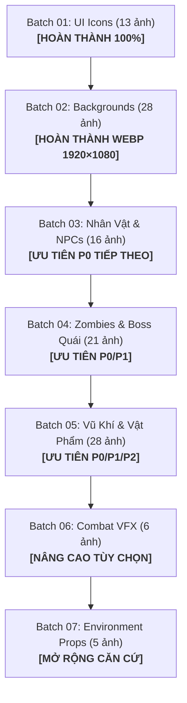

# LỘ TRÌNH TẠO HÌNH ẢNH GAME (IMAGE GENERATION ROADMAP)
## DỰ ÁN: ZOMBIE WORLD RPG — PHASE 1.5 GRAPHICS EXPANSION

**Thời gian thiết lập:** 2026-11-05 16:10:00 (ICT)  
**Tiêu chuẩn mỹ thuật chung:** Dark Post-apocalyptic Survival RPG. Tông màu trầm lạnh (xám thép, nâu gỉ, xanh rêu, đỏ thẫm), ánh sáng điện ảnh tương phản cao, phong cách bán tả thực 3D (semi-realistic 3D render / concept art). Không anime, không cartoon, không chữ text/watermark.

---

## 1. TỔNG QUAN LỘ TRÌNH CÁC BATCH TẠO ẢNH

---

## 2. CHI TIẾT CÁC BATCH TẠO ẢNH

### BATCH 01: UI ASSETS & CORE VITAL ICONS
- **Trạng thái:** **HOÀN THÀNH & ĐÃ TÍCH HỢP 100% (INTEGRATED)**.
- **Số lượng:** 13 ảnh.
- **Quy cách:** PNG 32-bit ARGB, Kênh Alpha thực (True Alpha 50-80% diện tích trong suốt), 256×256px (icons) và 1024×512px (logo).
- **Thư mục lưu trữ:** `public/assets/icons/`, `public/assets/ui/`.
- **Vai trò:** Hiển thị trực tiếp trên DOM UI (Stats, Ba lô, Hàng hóa, Vũ khí, Options) và Canvas PixiJS.

---

### BATCH 02: ENVIRONMENT BACKGROUNDS & MAPS
- **Trạng thái:** **HOÀN THÀNH CHUYỂN ĐỔI & TỐI ƯU HÓA WEBP 1920×1080 (100% PASS)**.
- **Số lượng:** 28 ảnh (23 bản đồ địa điểm + 4 đấu trường chiến đấu + 1 menu chính).
- **Hiện trạng trên đĩa:** Toàn bộ 28 file là WebP chuẩn (RIFF/WEBP), kích thước 1920×1080, tổng dung lượng 8.87 MB (giảm 96.24% từ 236.15 MB ban đầu, tiết kiệm 227.28 MB).
- **Hành động kỹ thuật kế tiếp:** Tích hợp chuyển đổi background động theo vị trí `state.location` trong `PixiRenderer._updateLocation()`.

---

### BATCH 03: PLAYER CHARACTERS & STORY NPCS (16 ASSET)
- **Mục tiêu:** Tạo ảnh chân dung / sprite nhân vật bán thân (Bust Portrait) có nền trong suốt cho người chơi và toàn bộ NPC có trong cốt truyện.
- **Số lượng:** **16 ảnh** (Bắt buộc 14, Tùy chọn 2).
- **Quy cách kỹ thuật:**
  - Định dạng: **PNG 32-bit ARGB (True Alpha Channel)**.
  - Kích thước: **512×768 pixels (Tỷ lệ 2:3)**.
  - Không viền nền hộp, không chữ, ánh sáng hướng từ góc trên bên trái chiếu xuống.
- **Phân nhóm ưu tiên:**
  - **Nhóm P0 (Cốt lõi — 7 ảnh):**
    1. `char_player_default` (Nhân vật chính người sống sót mặc áo khoác chiến thuật dã chiến)
    2. `char_npc_v` (Cô V: Sát thủ nữ áo choàng trùm đầu, ánh mắt sắc lạnh, cầm dao găm)
    3. `char_npc_xiaohan` (Tiểu Hàm: Nữ y tá trẻ tuổi mặc áo blouse sờn rách đeo túi thuốc)
    4. `char_npc_lili` (Lili: Nữ thợ máy cơ khí đeo kính bảo hộ, găng tay dính dầu mỡ, cờ lê lớn)
    5. `char_npc_mumiao` (Mục Miêu Miêu: Trinh sát liên lạc viên nhanh nhẹn)
    6. `boss_karen_king` (Vua Lâu Đài: Lãnh chúa Karen áo giáp thép mạ vàng, vương miện gai nhọn)
    7. `boss_dr_tran` (Tiến Sĩ Trần: Nhà khoa học biến chất tay cầm ống nghiệm huyết thanh đột biến)
  - **Nhóm P1 (Quan trọng — 8 ảnh):**
    8. `char_npc_ma_san` (Mã Tam: Thợ săn đô thị sẹo mặt cầm ống sắt)
    9. `char_npc_shadow` (Hắc Ảnh: Người liên lạc áo choàng xám ẩn mình trong bóng tối)
    10. `char_npc_banker` (Trưởng Ngân Hàng: Quý tộc vest dạ cũ nát kiểm đếm xu vàng)
    11. `char_npc_leader` (Trưởng Trận Địa: Sĩ quan quân đội dã chiến mang huy hiệu Đợi Sáng)
    12. `char_npc_survivor_generic` (Lưu dân mạt thế: Người tị nạn rách rưới)
    13. `char_npc_bandit_generic` (Đao Ba: Thổ phỉ cơ bắp cầm đao lớn)
    14. `char_npc_trader_generic` (Thương nhân chợ đen: Lái buôn mang ba lô cồng kềnh)
    15. `char_npc_doctor_generic` (Du y mạt thế: Thầy thuốc lang băm dã chiến)
  - **Nhóm P2 (Tùy chọn — 1 ảnh):**
    16. `boss_veteran_zhao` (Lão Binh Lão Triệu: Cựu binh thiết giáp cơ khí đầy huân chương cũ)

---

### BATCH 04: ZOMBIES & BOSS ENEMIES (21 ASSET)
- **Mục tiêu:** Tạo hình ảnh toàn thân / thế đứng chiến đấu (Combat Stance) của toàn bộ 16 loại zombie trong `zombies.js` và 5 quái vật đặc biệt / Boss trong `npcs.js`.
- **Số lượng:** **21 ảnh** (Bắt buộc 19, Tùy chọn 2).
- **Quy cách kỹ thuật:**
  - Định dạng: **PNG 32-bit ARGB (Nền trong suốt 100%)**.
  - Kích thước: **512×768 pixels**.
  - Tư thế đe dọa, mắt phát sáng đục ngầu, vết rách thịt và gân guốc chi tiết.
- **Phân nhóm ưu tiên:**
  - **Nhóm P0 (Zombie then chốt & Boss — 8 ảnh):**
    1. `zombie_walker` (Zombie Lãng Du Thường: Da xám xanh, mắt đục, quần áo rách tơi tả)
    2. `zombie_runner` (Zombie Chạy Nhanh: Thân hình gầy gò, gân máu đỏ căng cứng, tư thế lao tới)
    3. `zombie_exploder` (Zombie Phát Nổ: Bụng căng phồng phát sáng vàng xanh dịch độc)
    4. `zombie_riot_police` (Zombie Quân Cảnh: Mũ bảo hiểm chống bạo động, giáp đen nứt vỡ)
    5. `zombie_berserker` (Zombie Cuồng Nộ: Cơ bắp cuồn cuộn đỏ rực, móng vuốt cào xé)
    6. `zombie_acid_spitter` (Zombie Phun Axit: Hàm dưới tách đôi, axit xanh chảy nhỏ giọt)
    7. `zombie_juggernaut` (Zombie Xe Tăng: Quái vật khổng lồ cơ bắp hóa sừng bất khả xâm phạm)
    8. `boss_zombie_king` (Vua Zombie Im Lặng: Chúa tể thây ma khoác gai xương, khí chất kinh hoàng)
  - **Nhóm P1 (Zombie biến dị & Sinh vật biển — 11 ảnh):**
    9. `zombie_crawler` (Thây Rách), 10. `zombie_creeper` (Zombie Bò), 11. `zombie_bloater` (Zombie Béo Phì), 12. `zombie_swarm_mother` (Mẹ Zombie Bầy Đàn), 13. `zombie_ironclad` (Zombie Giáp Sắt), 14. `zombie_frost` (Zombie Băng Giá), 15. `zombie_leaper` (Zombie Nhảy), 16. `zombie_invisible` (Zombie Tàng Hình Ảo Ảnh), 17. `zombie_piercer` (Zombie Xuyên Thủng), 18. `zombie_giant_puppet` (Cỗ Rối Khổng Lồ), 19. `zombie_sea_monster` (Hải Zombie Khổng Lồ Xúc Tu).
  - **Nhóm P2 (Zombie ngoại truyện — 2 ảnh):**
    20. `zombie_football` (Zombie Bóng Bầu Dục), 21. `zombie_diver` (Zombie Thợ Lặn).

---

### BATCH 05: WEAPONS, EQUIPMENT & SURVIVAL ITEMS (28 ASSET)
- **Mục tiêu:** Tạo bộ icon vật phẩm tiêu chuẩn hóa cho hệ thống Ba lô, Túi đồ, và Trang bị giao diện.
- **Số lượng:** **28 ảnh** (Vũ khí cận chiến: 8, Vũ khí tầm xa: 7, Tiêu hao & Tài nguyên: 13).
- **Quy cách kỹ thuật:**
  - Định dạng: **PNG 32-bit ARGB (Nền trong suốt)**.
  - Kích thước: **256×256 pixels (Tỷ lệ 1:1)**.
  - Phong cách: Isometric / Top-down tactical item render, có đổ bóng nhẹ bên dưới.
- **Danh sách rút gọn theo Archetype:**
  - **Vũ khí Cận chiến:** Dao găm, Gậy bóng chày đinh, Cây nạy xà beng, Rìu cứu hỏa, Đao rựa, Búa tạ, Trảm mã đao, Dao laser.
  - **Vũ khí Tầm xa:** Súng cao su, Cung nỏ săn, Súng lục tự chế, Súng lục 9mm, Súng săn hai nòng, Súng trường bắn tỉa, Súng laser.
  - **Vật phẩm Tiêu hao & Y tế:** Thịt hộp, Lương khô nén, Táo tươi, Chai nước sạch, Lon nước tăng lực, Chai rượu mạnh, Cuộn băng gạc, Lọ kháng sinh, Huyết thanh kháng độc, Hộp cứu thương dã chiến.
  - **Nguyên liệu Xây dựng & Năng lượng:** Mảnh kim loại phế liệu, Bó gỗ khô, Lõi năng lượng tinh khiết.

---

### BATCH 06: COMBAT ANIMATIONS & VFX (6 ASSET - TÙY CHỌN NÂNG CAO)
- **Mục tiêu:** Hiệu ứng hình ảnh hỗ trợ màn chiến đấu trong PixiJS.
- **Số lượng:** **6 ảnh**.
- **Cơ chế triển khai:**
  - **Khuyến nghị:** Sử dụng sprite tĩnh có kênh alpha kết hợp với Tween Animation trong PixiJS (Flash, Scale, Rotate, Shake). Không cần tạo Sprite Sheet phức tạp hàng chục frame vì cấu trúc chiến đấu hiện tại của game chủ yếu hiển thị lượt đánh văn bản.
- **Danh mục:**
  1. `vfx_slash` (Vết chém sáng lưỡi đao)
  2. `vfx_gunfire` (Tia lửa đầu nòng)
  3. `vfx_blood_splatter` (Vết máu văng)
  4. `vfx_explosion` (Khối lửa nổ da cam)
  5. `vfx_acid_poison` (Làn khói axit xanh độc)
  6. `vfx_laser_beam` (Tia xung lực laser)

---

### BATCH 07: INTERACTIVE ENVIRONMENT PROPS (5 ASSET - TÙY CHỌN MỞ RỘNG)
- **Mục tiêu:** Hình ảnh minh họa các vật thể khám phá và công trình căn cứ trong bản đồ.
- **Số lượng:** **5 ảnh**.
- **Quy cách:** PNG 256×256px hoặc 256×512px trong suốt.
- **Danh mục:** `prop_loot_crate` (Hòm tiếp tế), `prop_wrecked_car` (Xác xe hơi), `prop_locked_door` (Cửa thép khóa), `prop_water_collector` (Bể hứng nước mưa), `prop_watchtower` (Tháp canh gỗ).

---

## 3. PHÂN ĐỊNH TÀI NGUYÊN BẮT BUỘC VS TÙY CHỌN

1. **Bắt buộc tuyệt đối (Core Mandatory — 60 Asset):**
   - 13 UI Assets (Đã hoàn thành 100%).
   - 28 Backgrounds (Đã có file, chỉ cần nén WebP).
   - 7 Nhân vật P0 (Player + 4 NPC chính + 2 Boss người).
   - 8 Zombie P0 (Walker, Runner, Exploder, Riot Police, Berserker, Spitter, Juggernaut, Zombie King).
   - 4 Vũ khí cận chiến P0 + 5 Vũ khí tầm xa P0.
   - 7 Vật phẩm y tế & sinh tồn P0 (Thịt hộp, Lương khô, Nước sạch, Tăng lực, Băng gạc, Kháng sinh, Huyết thanh).
2. **Tùy chọn nâng cao (Optional / Polish — 58 Asset):**
   - Các biến thể zombie phụ (Football, Thợ lặn), vũ khí laser viễn tưởng, công trình căn cứ và hiệu ứng VFX.
