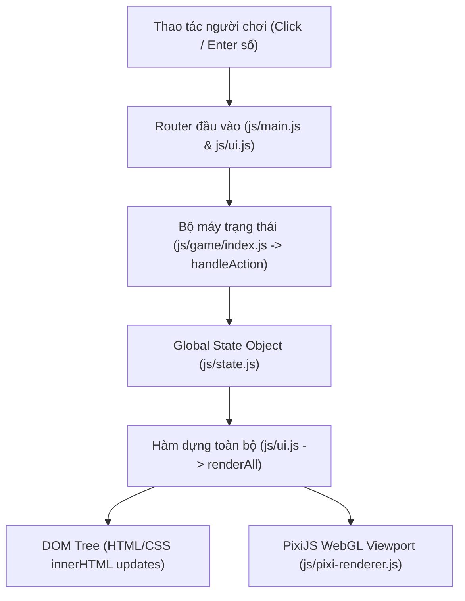
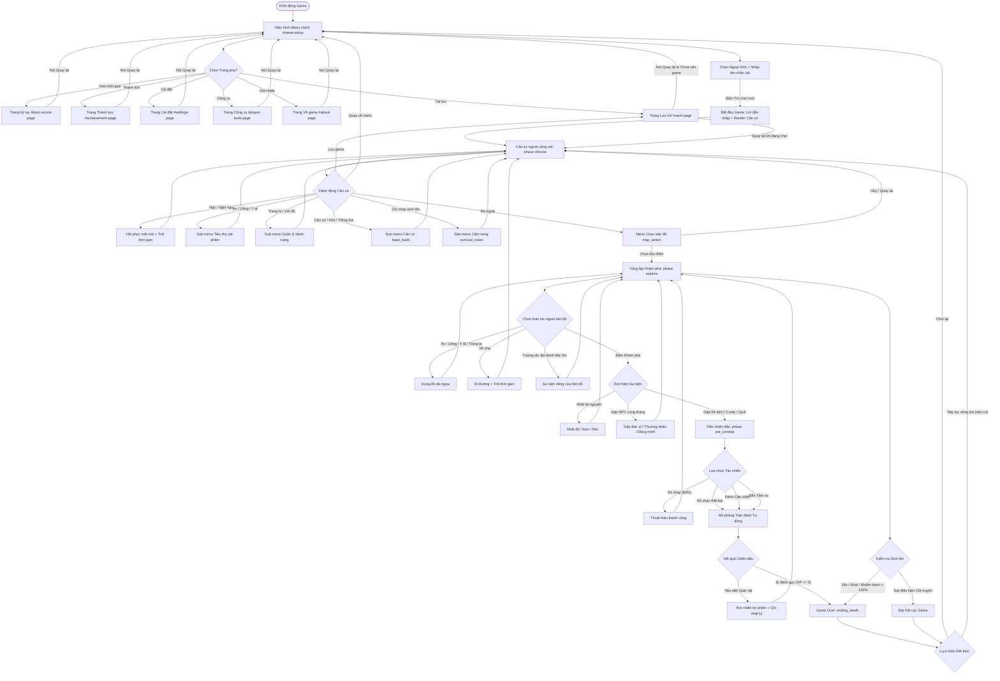
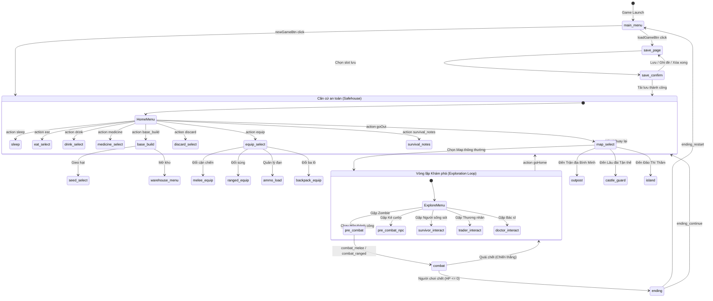

# BÁO CÁO PHÂN TÍCH TOÀN DIỆN LUỒNG GIAO DIỆN HIỆN TẠI (UI FLOW)
**Dự án:** Zombie World RPG (Vanilla JavaScript + PixiJS v7.4.3)  
**Tài liệu:** `docs/UI_FLOW_CURRENT.md`  
**Ngày thực hiện:** 05/11/2026  
**Mục tiêu:** Khảo sát, phân tích và hệ thống hóa toàn bộ kiến trúc giao diện, luồng trải nghiệm người dùng (UX flow), máy trạng thái (state machine) và các vấn đề tồn đọng để chuẩn bị cho giai đoạn tái thiết kế (UI Redesign).  
**Nguyên tắc thực hiện:** Chỉ phân tích và lập tài liệu (Analysis-only), tuyệt đối không sửa đổi mã nguồn (`.js`, `.html`, `.css`).

---

## MỤC LỤC
1. [Kiến trúc UI tổng thể (UI Architecture)](#1-kiến-trúc-ui-tổng-thể-ui-architecture)
2. [Danh mục toàn bộ màn hình & thành phần (Screen Inventory)](#2-danh-mục-toàn-bộ-màn-hình--thành-phần-screen-inventory)
3. [Luồng trải nghiệm người chơi qua 16 giai đoạn (The 16 Game Flow Stages)](#3-luồng-trải-nghiệm-người-chơi-qua-16-giai-đoạn-the-16-game-flow-stages)
4. [Sơ đồ luồng trạng thái (Mermaid State & Flow Diagrams)](#4-sơ-đồ-luồng-trạng-thái-mermaid-state--flow-diagrams)
5. [Đánh giá các vấn đề UX hiện tại (UX Issues Ranked by Severity)](#5-đánh-giá-các-vấn-đề-ux-hiện-tại-ux-issues-ranked-by-severity)
6. [Cơ hội & Định hướng tái thiết kế (Redesign Opportunities & Roadmap)](#6-cơ-hội--định-hướng-tái-thiết-kế-redesign-opportunities--roadmap)

---

## 1. KIẾN TRÚC UI TỔNG THỂ (UI ARCHITECTURE)

### 1.1. Mô hình hiển thị kết hợp (Hybrid DOM + PixiJS Rendering)
Hệ thống giao diện của *Zombie World RPG* hoạt động theo mô hình lai (Hybrid Architecture):
- **DOM/HTML/CSS (100% Core UI & Controls):** Toàn bộ giao diện điều khiển, màn hình mở đầu, các trang phụ (Save, Record, Achievements, Settings, Tools, About), bảng thống kê nhân vật (Stats), ba lô (Inventory), hàng hóa (Cargo), vũ khí (Weapons), nhật ký sự kiện/cốt truyện (`#story-area`) và hệ thống lựa chọn hành động (`#options-area`) được render thuần túy bằng DOM HTML thông qua thao tác ghi trực tiếp `innerHTML` trong `js/ui.js`.
- **PixiJS v7.4.3 Canvas Viewport (Scene Visuals):** Được nhúng bên trong `#pixi-viewport` thuộc Cột 3 (`#zone-3`), phía trên `#story-area`. Được điều khiển bởi singleton `pixiRenderer` trong `js/pixi-renderer.js`. Renderer này chịu trách nhiệm:
  - Render nền bản đồ / địa điểm (Backgrounds) theo `state.location` và `state.currentMap`.
  - Hiển thị thanh HP trực quan và thông tin ngày/thời tiết cơ bản.
  - Hiển thị danh sách thực thể/đồng đội (Entity Object Pool tối đa 6 NPC).
  - Hoạt động offline hoàn toàn nhờ local vendor (`public/vendor/pixi.min.js`), tự động fallback về DOM thuần nếu WebGL/Canvas gặp lỗi khởi tạo.



### 1.2. Cơ chế phân trang & điều phối hành động (Action Routing & Pagination)
- **Chu kỳ vòng lặp đơn (Single-cycle Update):** Mỗi khi người chơi tương tác (click vào 1 ô tùy chọn hoặc gõ số vào ô `#action-input` rồi nhấn Enter), hàm `handleAction(value)` trong `js/game/index.js` được gọi:
  1. Kiểm tra mã gian lận (cheats).
  2. Kiểm tra tùy chọn có bị vô hiệu hóa (`disabled`) hay không.
  3. Dựa theo `state.phase` hiện tại để rẽ nhánh đến hàm xử lý tương ứng (`handleChooseAction`, `handleExploreAction`, `handlePreCombatChoice`, v.v.).
  4. Cập nhật `state.story`, `state.options`, chỉ số sinh tồn và trạng thái game.
  5. Kiểm tra kết thúc game / cái chết (`checkDeath()`, `checkEndingTriggerAfterAction()`).
  6. Gọi `renderAll()` để dựng lại toàn bộ các panel DOM.
  7. Gọi `pixiRenderer.render(getState())` để đồng bộ đồ họa Canvas.
- **Lưới tùy chọn cố định 30 ô (Rigid 30-Slot Grid):**
  - Hàm `renderOptions(state)` trong `js/ui.js` luôn tạo chính xác **30 ô** (2 cột × 15 dòng) trong `#options-area`.
  - Nếu số lượng tùy chọn thực tế nhỏ hơn 30 (ví dụ chỉ có 3 tùy chọn: Đánh, Chạy, Dùng đồ), 27 ô còn lại được lấp đầy bằng các ô rỗng placeholder (`<div class="option-item option-empty"></div>`).
  - Nếu số lượng tùy chọn vượt quá 30, cơ chế phân trang `_optionPage` được kích hoạt với nút `⬅️` và `➡️`.

---

## 2. DANH MỤC TOÀN BỘ MÀN HÌNH & THÀNH PHẦN (SCREEN INVENTORY)

Toàn bộ hệ thống giao diện được định nghĩa trong `index.html` và chuyển đổi hiển thị thông qua CSS `display: none | block | flex`.

### 2.1. Nhóm Màn hình Menu chính & Trang phụ (Sub-pages)

| ID Màn hình / Component | Vị trí DOM | Mô tả chức năng & Thành phần con | Cơ chế hiển thị |
| :--- | :--- | :--- | :--- |
| **Game Header** (`#game-header`) | Đầu trang | Logo game (`#header-logo`), tiêu đề h1 "Thế Giới Zombie", phụ đề nhóm phát triển YOCIM. | Ẩn khi vào gameplay hoặc trang quản lý lưu. |
| **Start Screen** (`#name-setup`) | Khối menu chính | - Component chọn ngoại hình nhân vật (`.character-appearance-box`): Xem trước ảnh đại diện (`#appearance-preview-img`), 3 dropdown (Độ tuổi: 5 cấp, Giới tính: 2 cấp, Trang phục: 3 cấp), nhãn trạng thái (`#appearance-status-badge`), nút xác nhận (`#confirm-appearance-btn`).<br>- Ô nhập tên người chơi (`#name-input`).<br>- 7 nút điều hướng chính: Trò chơi mới, Tải lưu, Xem thời gian, Thành tích, Cài đặt, Công cụ người chơi, Về trò chơi. | Mặc định hiển thị khi mới mở game (`state.phase === 'main_menu'`). |
| **Trang Quản lý lưu trữ** (`#save-page`) | Trang phụ toàn màn hình | - Tiêu đề panel (`Quản lý lưu trữ`).<br>- Khu vực thông báo trạng thái (`#save-story-area`).<br>- Danh sách ô lưu (`#save-slots-area`): 1 ô tự động lưu (Auto-save slot 0) + các ô lưu thủ công (Slot 1..N).<br>- Tùy chọn thao tác lưu (`#save-options-area`): Tải lưu, Ghi đè, Xóa lưu.<br>- Nút quay lại (`#save-return-btn`). | Hiển thị khi `state.phase === 'save_page'` hoặc `'save_confirm'`. Ẩn toàn bộ gameplay và header. |
| **Trang Kỷ lục sinh tồn** (`#best-record-page`) | Trang phụ toàn màn hình | Bảng hiển thị thông tin kỷ lục sống sót lâu nhất (`#best-record-content`): Số ngày sống sót, tên nhân vật, máu, mệt mỏi, lý trí, nhiễm bệnh, vị trí, vũ khí trang bị, tài nguyên hàng hóa. Kèm nút quay lại (`#best-record-return-btn`). | Kích hoạt khi click nút "Xem thời gian" từ `#name-setup`. |
| **Trang Thành tựu** (`#achievement-page`) | Trang phụ toàn màn hình | Danh sách thành tựu dạng lưới (`#achievement-content`): Duyệt mảng `ACHIEVEMENTS`, hiển thị biểu tượng, tên và mô tả cho các thành tựu đã mở khóa; hiển thị dấu `❓` cho thành tựu bị khóa. Kèm nút quay lại (`#achievement-return-btn`). | Kích hoạt khi click nút "Thành tích" từ `#name-setup`. |
| **Trang Cài đặt** (`#settings-page`) | Trang phụ toàn màn hình | 3 nút toggle cài đặt chế độ (`#settings-content`):<br>1. `#click-mode-btn`: Bật/Tắt chế độ nhấp chuột trực tiếp.<br>2. `#input-mode-btn`: Bật/Tắt chế độ gõ số hành động.<br>3. `#music-btn`: Bật/Tắt nhạc nền game.<br>Kèm nút mở DevTools (`#devtools-trigger-btn`) và nút quay lại (`#settings-return-btn`). | Kích hoạt khi click nút "Cài đặt" từ `#name-setup`. |
| **Trang Công cụ người chơi** (`#player-tools-page`) | Trang phụ toàn màn hình | Liên kết mở trang ngoài (`target="_blank"`): Tra cứu xác suất (`tools/probability.html`) và Bách khoa toàn thư (`tools/encyclopedia.html`). Kèm nút quay lại (`#player-tools-return-btn`). | Kích hoạt khi click nút "Công cụ người chơi" từ `#name-setup`. |
| **Trang Giới thiệu** (`#about-page`) | Trang phụ toàn màn hình | Thông tin ghi công (`#about-content`): Nhà phát triển chính, phiên bản game (V0.2.3), đóng góp mã, thiết kế mỹ thuật, âm nhạc, liên kết GitHub, email liên hệ. Kèm nút quay lại (`#about-return-btn`). | Kích hoạt khi click nút "Về trò chơi" từ `#name-setup`. |

---

### 2.2. Nhóm Bảng điều khiển Gameplay (`#game-content` — Bố cục 4 Phân vùng Cố định)

Giao diện chơi game chia thành 4 cột (desktop) hoặc lưới 2×2 (mobile tablet):

```
+---------------------------------------------------------------------------------------------------+
| #game-header (Ẩn trong gameplay)                                                                 |
+-------------------+-------------------+-------------------------------------+---------------------+
| Zone 1 (200px)    | Zone 2 (200px)    | Zone 3 (Flex: 1)                    | Zone 4 (360px)      |
|-------------------|-------------------|-------------------------------------|---------------------|
| #identity-panel   | #weapon-panel     | #pixi-viewport (Canvas 640x320)     | #options-area       |
| #stats-panel      | #inventory-panel  |-------------------------------------| (Lưới 2x15 = 30 ô)  |
| #cargo-panel      |                   | #story-area (Nhật ký văn bản cuộn)  | #pagination-area    |
|                   |                   |                                     | #input-area (Gõ số) |
+-------------------+-------------------+-------------------------------------+---------------------+
```

| Tên Panel | Vị trí DOM | Chi tiết thành phần con & Dữ liệu hiển thị |
| :--- | :--- | :--- |
| **Bảng Thân phận** (`#identity-panel`) | Zone 1 (trên cùng) | Hiển thị tước vị/thân phận nhân vật (`state._identityDisplay`, e.g. "Người dân thường", "Hiệp sĩ", "Hầu tước"). |
| **Bảng Trạng thái sinh tồn** (`#stats-panel`) | Zone 1 (giữa) | - Thẻ nhân vật (`.stat-player-card`): Ảnh đại diện chân dung (`avatarPath`), tên người chơi, nhãn tuổi/giới tính/trang phục.<br>- Dòng thông tin: Nhân vật, Ngày + Khung giờ (`TIME_PHASES[state.phaseIndex]`) + Thời tiết, Vị trí hiện tại.<br>- 6 Thanh tiến độ (Progress Bars):<br>  1. ❤️ **Sức khỏe (HP)**: `state.health / 100`<br>  2. 🍖 **Bụng no (Hunger)**: `state.hunger%`<br>  3. 💧 **Nước (Hydration)**: `state.hydration%`<br>  4. 🧠 **Lý trí (Sanity)**: `state.sanity%`<br>  5. 💪 **Mệt mỏi (Fatigue/Crash)**: `state.crash%`<br>  6. 🦠 **Nhiễm bệnh (Infection)**: `state.infection%`<br>- Trạng thái (`state.status`) & Cấp căn cứ (`state.baseLevel`). |
| **Bảng Hàng hóa & Tài chính** (`#cargo-panel`) | Zone 1 (dưới cùng) | Hiển thị tài nguyên đặc biệt & kinh tế sinh tồn:<br>- 🚬 Thuốc lá (`cigarettes`), ⛽ Xăng (`gasoline`), 👑 Tiền hoàng gia (`royalCoins`), 🔋 Năng lượng tinh khiết (`pureEnergy`).<br>- 🏰 Nợ lâu đài (`castleDebt`: số lượng, số ngày còn lại / quá hạn).<br>- 🏝️ Nợ đảo (`islandDebt`).<br>- 📈 Khoản đầu tư (`investment`). |
| **Bảng Trang bị Vũ khí** (`#weapon-panel`) | Zone 2 (trên cùng) | - 🔪 Vũ khí cận chiến (`meleeWeapon.name`, sát thương, tỷ lệ liên kích combo).<br>- 🛡️ Độ bền cận chiến (`currentDurability / durability`).<br>- 🏹 Vũ khí tầm xa (`rangedWeapon.name`).<br>- ⚙️ Độ nguyên vẹn tầm xa (`integrity`).<br>- 💥 Danh sách đạn dược khả dụng (`formatAmmo(state)`). |
| **Bảng Ba lô / Vật phẩm** (`#inventory-panel`) | Zone 2 (dưới cùng, cuộn dọc) | - Tên ba lô & sức chứa (`getBackpackCount() / backpack.capacity`).<br>- Danh mục vật phẩm (hiển thị dạng chuỗi văn bản nối bằng dấu phẩy): Thực phẩm, Đồ uống, Y tế, Cá, Vũ khí dự phòng, Súng, Vật liệu xây dựng, Hạt giống, Đồ linh tinh khác. |
| **Khu vực Đồ họa PixiJS** (`#pixi-viewport`) | Zone 3 (nửa trên) | Canvas WebGL (`#pixi-canvas`) kích thước ảo 640×320: Hiển thị ảnh nền địa điểm mờ ảo, khung viền cyberpunk, tiêu đề vị trí (`locText`), thông tin ngày/thời tiết (`dayText`), thanh HP mini, danh sách NPC lân cận (`entityPool`). |
| **Khu vực Nhật ký Sự kiện** (`#story-area`) | Zone 3 (nửa dưới, cuộn dọc) | Toàn bộ văn bản mô tả cốt truyện, diễn biến sự kiện, kết quả hành động, hội thoại NPC và nhật ký chiến đấu nhiều hiệp (`state.story`). Tự động cuộn xuống đáy mỗi khi render. |
| **Khu vực Lựa chọn Hành động** (`#options-area`) | Zone 4 (chiếm toàn bộ) | Lưới 2 cột × 15 dòng (chính xác 30 ô bấm). Mỗi ô có số thứ tự tự động (`data-index="1..30"`). Nếu tùy chọn không hợp lệ sẽ bị gán cờ `disabled`. Nếu ô thừa sẽ lấp ảnh rỗng `ui_placeholder_empty.png`. |
| **Thanh Phân trang Tùy chọn** (`#pagination-area`) | Zone 4 (dưới lưới) | Nút lùi trang (`#prev-page-btn`), thông tin trang (`#page-info`), nút tiến trang (`#next-page-btn`). Chỉ hiển thị khi số lượng lựa chọn > 30. |
| **Thanh Nhập số Bàn phím** (`#input-area`) | Zone 4 (đáy cùng) | Ô nhập văn bản `#action-input` và nút `#submit-btn`. Ẩn/Hiện dựa trên cài đặt `settings.inputMode`. Cho phép người chơi nhập số hành động hoặc lệnh gian lận (cheats). |

---

## 3. LUỒNG TRẢI NGHIỆM NGƯỜI CHƠI QUA 16 GIAI ĐOẠN (THE 16 GAME FLOW STAGES)

Dưới đây là tài liệu chi tiết về hành trình của người chơi từ lúc mở game cho đến khi kết thúc:

### Giai đoạn 1: Khởi động game & Menu chính (Game Launch / Main Menu)
- **Người chơi thấy gì:** Header game kèm Logo `ui_game_logo.png`, Hộp chọn ngoại hình nhân vật (`.character-appearance-box`), Ô nhập tên nhân vật (`#name-input`), và 7 nút điều hướng Menu.
- **Thành phần UI hiển thị:** `#game-header` (block), `#name-setup` (flex). Toàn bộ `#game-content` và các sub-pages đều ẩn (`display: none`).
- **Tương tác:** Người chơi có thể click vào các dropdown chọn tuổi/giới tính/trang phục, click nút Menu hoặc nhập tên.
- **Hành động kích hoạt bước kế:** Click "Trò chơi mới" hoặc click các nút Menu phụ.
- **Module logic:** `js/main.js` (`init()`), `js/ui.js` (`initUI()`, `initAppearanceUI()`).
- **Biến State đọc/ghi:** `state.phase = 'main_menu'`, `state.name = ''`.
- **Cơ chế chuyển đổi:** DOM thuần túy.

### Giai đoạn 2 & 3: Tạo nhân vật & Chọn ngoại hình (New Game & Character Appearance)
- **Người chơi thấy gì:** Live preview ngoại hình thay đổi theo thời gian thực khi chọn giữa 5 độ tuổi (`teen`, `young_adult`, `adult`, `middle_aged`, `elderly`), 2 giới tính (`male`, `female`), 3 trang phục (`survivor`, `tactical`, `casual`). Nếu ảnh chưa tải được hoặc pending, hiển thị placeholder phong cách pixel.
- **Thành phần UI hiển thị:** Dropdowns (`#appearance-age-select`, `#appearance-gender-select`, `#appearance-outfit-select`), Preview Card (`#appearance-preview-img`), Nút "Xác nhận ngoại hình", Ô nhập tên `#name-input`.
- **Tương tác:** Chọn các option, nhập tên (tối đa 10 ký tự), nhấn Enter hoặc click nút "Trò chơi mới".
- **Hành động kích hoạt bước kế:** Click `#new-game-btn`. Nếu tên trống -> gọi `alert('Vui lòng nhập biệt danh nhân vật')`. Nếu hợp lệ -> gọi `resetState()`, `setName()`, `setPlayerAppearance()`, `setPhase('choose')`, `startGameMusic()`, `renderAll()`.
- **Module logic:** `js/ui.js` (`initUI`, `initAppearanceUI`), `js/data/player-appearance.js`.
- **Biến State đọc/ghi:** Ghi đè `state.name`, `state.playerAppearance`, `state.phase = 'choose'`. Khởi tạo các mảng ba lô mặc định.
- **Cơ chế chuyển đổi:** DOM cập nhật (ẩn `#name-setup`, hiện `#game-content`), đồng thời PixiJS canvas khởi tạo và render lần đầu.

### Giai đoạn 4 & 5: Dẫn nhập cốt truyện & Giao diện Gameplay chính (Intro & Main Interface)
- **Người chơi thấy gì:** Toàn màn hình chuyển sang giao diện sinh tồn 4 phân vùng. Khung ảnh PixiJS ở Cột 3 hiển thị bối cảnh căn cứ "Lều Người Sống Sót". Khung `#story-area` hiển thị lời dẫn nhập tận thế u ám (`GAME_INTRO`). Bảng Zone 1 & 2 hiển thị đầy đủ avatar nhân vật vừa chọn, tên, 6 thanh sinh tồn đầy 100%, trang bị dao găm ban đầu, 2 ổ bánh mì và 2 chai nước.
- **Thành phần UI hiển thị:** `#game-content` (flex), `#identity-panel`, `#stats-panel`, `#cargo-panel`, `#weapon-panel`, `#inventory-panel`, `#pixi-viewport`, `#story-area`, `#options-area`.
- **Tương tác:** Lưới 30 ô ở Zone 4 hiển thị 12 hành động căn cứ chính: 1. Ngủ, 2. Ăn, 3. Uống, 4. Y tế, 5. Trang bị, 6. Ra ngoài, 7. Vứt bỏ, 8. Lưu, 9. Thu hoạch đồng đội, 10. Xây dựng căn cứ, 11. Ghi chú sinh tồn, 12. Quay lại menu.
- **Hành động kích hoạt bước kế:** Click vào 1 trong các ô tùy chọn (chế độ click) hoặc gõ số 1..12 vào `#action-input` rồi Enter.
- **Module logic:** `js/ui.js` (`renderAll`), `js/game/index.js` (`handleAction -> handleChooseAction`), `js/routing.js` (`showHomeOptions`).
- **Biến State đọc/ghi:** Đọc toàn bộ thuộc tính sinh tồn; `state.phase === 'choose'`.
- **Cơ chế chuyển đổi:** DOM rendering kết hợp PixiJS redraw cảnh nền.

### Giai đoạn 6: Điều hướng Bản đồ & Chọn địa điểm (Map & Location Navigation)
- **Người chơi thấy gì:** Khi chọn "Ra ngoài" (Tùy chọn 6):
  - Nếu thời tiết là `mua_axit`: Tùy chọn bị disabled hoặc hiện thông báo "Ngoài trời đang mưa axit ăn mòn, căn bản không thể ra ngoài."
  - Nếu bình thường: `#story-area` chuyển thành "Hãy chọn địa điểm bạn muốn đến:". Cột 4 liệt kê danh sách các bản đồ sinh tồn mở khóa kèm cấp độ nguy hiểm (ví dụ: `Bãi phế liệu [Thấp]`, `Bệnh viện bỏ hoang [Cực cao]`, `Lâu đài Tận thế [Đặc biệt]`, `Quay lại`).
- **Thành phần UI hiển thị:** Vẫn giữ nguyên 4 zone. Cột 3 hiển thị danh sách văn bản; Cột 4 hiển thị danh sách bản đồ.
- **Tương tác:** Click vào bản đồ muốn đến.
- **Hành động kích hoạt bước kế:** `handleMapAction(input)` trong `js/game/navigation.js`.
- **Module logic:** `js/game/navigation.js` (`handleGoOut`, `handleMapAction`), `js/config.js` (`MAPS`).
- **Biến State đọc/ghi:** Cập nhật `state.phase = 'explore'`, `state.location = map.name`, `state.currentMap = map`, gọi `advanceTime(1)` (tiêu hao đói/khát/mệt mỏi), ghi nhận `state.stats.mapsExplored`.
- **Cơ chế chuyển đổi:** DOM update văn bản + PixiJS cập nhật `locText` và load background texture tương ứng với bản đồ mới.

### Giai đoạn 7 & 8: Khám phá địa điểm & Sự kiện ngẫu nhiên (Exploration & Random Events)
- **Người chơi thấy gì:** Sau khi vào bản đồ, lưới tùy chọn chuyển thành menu khám phá: 1. Khám phá, 2. Ăn, 3. Uống, 4. Y tế, 5. Trang bị, 6. Về nhà, 7. Vứt bỏ + các tùy chọn hành động đặc thù của bản đồ (ví dụ: Tìm hòm đồ, Leo tháp canh, Thăm NPC).
- **Tương tác:** Click "Khám phá" (`explore`).
- **Hành động kích hoạt bước kế:** Hàm `handleExplore()` trong `js/game/exploration.js` được thực thi.
- **Cơ chế ngẫu nhiên phân nhánh:**
  1. Kiểm tra cướp đường (`checkRobberEncounter`): Nếu gặp cướp, kích hoạt sự kiện trấn lột tài nguyên.
  2. Tung xúc xắc NPC (`Math.random() < NPC_RATE` ~15%):
     - `survivor`: Gặp người sống sót lang thang (Giao dịch / Đâm lén / Rời đi).
     - `wanderingTrader`: Gặp thương nhân lưu động (Mua đạn, vũ khí, thuốc lá).
     - `doctor`: Gặp bác sĩ lang thang (Trị liệu, mua thuốc).
     - `bandit`: Gặp kẻ cướp có vũ trang (Bắt buộc chiến đấu hoặc bỏ chạy).
  3. Tung xúc xắc quái vật (`Math.random() < map.encounterRate`): Gặp zombie đặc trưng của map (chuyển sang `pre_combat`).
  4. Nếu không gặp quái/NPC: Nhặt vật phẩm ngẫu nhiên (`pickRandomLoot`), nhặt đạn, hoặc khám phá địa danh bí mật. Thời gian trôi đi 1 lượt (`advanceTime(1)`).
- **Module logic:** `js/game/exploration.js`, `js/map-events/*`, `js/combat.js`.
- **Biến State đọc/ghi:** Cập nhật `state.story`, thêm đồ vào ba lô (`addItem`), tiêu hao độ no/nước, tăng mệt mỏi.
- **Cơ chế chuyển đổi:** DOM cập nhật nội dung văn bản `#story-area`.

### Giai đoạn 9: Lựa chọn của người chơi & Hệ quả cốt truyện (Choices & Consequences)
- **Người chơi thấy gì:** Các sự kiện NPC hoặc bản đồ đưa ra từ 2 đến 6 nhánh lựa chọn có thưởng - phạt rõ ràng trong `#options-area`.
- **Ví dụ điển hình:**
  - Sự kiện Liu Ruyan: Cứu (cần Serum kháng virus trước ngày 15) vs Bỏ mặc (Liu Ruyan biến thành zombie boss).
  - Sự kiện Trại lính / Căn cứ Bình Minh: Ám sát thủ lĩnh Leader vs Quy phục nhận chức đội trưởng.
  - Sự kiện Nợ Lâu Đài / Ngân hàng Đảo: Vay tiền giải quyết cấp bách vs Bị sát thủ truy sát khi quá hạn nợ.
- **Module logic:** `js/map-events/*`, `js/npcs/*`, `js/castle/*`, `js/island/*`.
- **Biến State đọc/ghi:** Cập nhật các biến tiến trình như `state.liuruyanRescued`, `state.castleDebt`, `state.npcAffinity[npcId]`.

### Giai đoạn 10 & 11: Gặp địch & Hệ thống Chiến đấu (Turn-based Combat Loop)
> **Phát hiện cấu trúc quan trọng:** Trò chơi **KHÔNG** sử dụng hệ thống chiến đấu từng lượt tương tác qua nút bấm bấm từng hiệp (interactive turn-by-turn). Thay vào đó, toàn bộ trận đánh được **mô phỏng tự động đồng bộ (Synchronous Auto-Resolution)** ngay khi người chơi bấm chọn phương thức tác chiến!

- **Bước 1 — Tiền chiến đấu (`pre_combat` / `pre_combat_npc`):**
  - **Người chơi thấy gì:** Thông tin zombie/địch thủ (Tên, HP, Sát thương, Kỹ năng đặc biệt), vũ khí hiện có, lượng đạn còn lại. Kèm cảnh báo nếu nhân vật quá kiệt sức (`crash >= 100`).
  - **Lựa chọn:**
    1. `Trận chiến cận chiến`: Dùng vũ khí cận chiến (`meleeWeapon`).
    2. `Trận chiến tầm xa`: Dùng súng (`rangedWeapon`) tiêu hao đạn tương ứng. (Bị khóa nếu không có súng hoặc hết đạn).
    3. `Bỏ chạy`: Tỷ lệ thành công dựa theo `GAME_CONSTANTS.COMBAT.FLEE_RATE` (mặc định 60%).
- **Bước 2 — Mô phỏng trận đánh tự động (`handleCombat` trong `js/combat.js`):**
  - Ngay khi người chơi chọn Cận chiến hoặc Tầm xa, hàm `handleCombat(zombieDef, mode)` chạy một vòng lặp `while (zombie.currentHp > 0 && state.health > 0)`:
    - Tính toán giảm lý trí (Sanity) khi giáp mặt quái vật.
    - Tính toán tỷ lệ né đòn, bắn headshot chí mạng, liên kích combo cận chiến.
    - Tiêu hao độ bền vũ khí hoặc độ nguyên vẹn của súng và đạn.
    - Kích hoạt kỹ năng quái vật (phun axit, cắn lây nhiễm, làm mù, đóng băng, vấp ngã, tự phát nổ).
    - Toàn bộ diễn biến từng lượt được đẩy vào mảng `combatLog`.
- **Bước 3 — Kết quả & Nhặt đồ (Victory / Defeat):**
  - Toàn bộ `combatLog` được nối lại và ghi đè vào `#story-area`.
  - Nếu thắng: Tính toán rơi đồ (Thực phẩm, Đồ uống, Gel zombie), tăng điểm hạ gục `state.stats.zombieKills`, kiểm tra mở khóa thành tựu diệt quái. Trò chơi gọi `advanceTime(1)` và quay lại `showExploreOptionsState()`.
  - Nếu thua (`state.health <= 0`): Gọi `checkDeath()`, kích hoạt màn hình Kết thúc / Cái chết (`triggerEnding('ending_death')`).
- **Module logic:** `js/combat.js`.
- **Biến State đọc/ghi:** `state.health`, `state.sanity`, `state.infection`, `state.meleeWeapon.currentDurability`, `state.ammo`.
- **Cơ chế chuyển đổi:** DOM update văn bản. (PixiJS hiện tại chưa có animation tấn công/quái vật riêng trong combat).

### Giai đoạn 12: Quản lý Ba lô & Trang bị (Inventory & Equipment Management)
- **Người chơi thấy gì:**
  - Chọn "Trang bị" (`equip`): Menu lựa chọn danh mục (Vũ khí cận chiến, Vũ khí tầm xa, Quản lý nạp đạn, Đổi loại túi/ba lô, Quay lại).
  - Chọn "Ăn", "Uống", "Y tế": Lưới hiển thị danh sách các món ăn/nước uống/thuốc men hiện có trong ba lô kèm chỉ số hồi phục.
  - Chọn "Vứt bỏ" (`discard`): Cho phép chọn món đồ muốn bỏ lại để giải phóng sức chứa kèm hỏi số lượng muốn vứt.
- **Hành động kích hoạt:** Click vào vật phẩm muốn sử dụng. Sau khi sử dụng, vật phẩm giảm số lượng (`count--`), các chỉ số sinh tồn được hồi phục ngay lập tức, nhật ký ghi nhận và tự động trở về menu chính.
- **Module logic:** `js/equipment.js`, `js/game/consumables.js`.
- **Biến State đọc/ghi:** `state.food`, `state.drinks`, `state.medicine`, `state.backpack`, `state.meleeWeapon`, `state.rangedWeapon`.

### Giai đoạn 13: Chỉ số sinh tồn & Đồng hồ sinh học (Survival Status & Time Progression)
- **Cơ chế trôi thời gian (`advanceTime(turns)`):**
  - Một ngày gồm nhiều khung giờ (`TIME_PHASES`: Sáng sớm, Buổi sáng, Buổi trưa, Buổi chiều, Hoàng hôn, Buổi tối, Đêm khuya, Nửa đêm).
  - Mỗi hành động (Di chuyển map, Khám phá, Ngủ, Chiến đấu) tiêu tốn từ 1 đến nhiều lượt thời gian.
  - Khi thời gian trôi:
    - Bụng no (`hunger`) giảm.
    - Nước uống (`hydration`) giảm.
    - Nếu đói/khát về 0: Máu (`health`) tụt dần mỗi lượt.
    - Mệt mỏi (`crash`) tăng dần. Nếu không ngủ, khi mệt mỏi đạt 100% nhân vật rơi vào trạng thái tê liệt (`Crippled`), không thể phản kháng trong chiến đấu.
    - Nhiễm bệnh (`infection`): Nếu chạm 100% người chơi biến thành zombie và chết.
- **Module logic:** `js/state.js` (`advanceTime`, `updateStatusEffects`, `checkDeath`).

### Giai đoạn 14: Hệ thống Nhiệm vụ & Đồng minh (Quests & NPCs)
- **Người chơi thấy gì:** Tương tác với các NPC chủ chốt tại căn cứ hoặc bản đồ (Cô V, Tiểu Hàm, LiLi, Mục Miêu Miêu, Thủ lĩnh Leader, Yumo, v.v.).
- **Giao diện hội thoại:** Toàn bộ hiển thị qua `#story-area` và cây lựa chọn trong `#options-area`: Trò chuyện, Tặng quà tăng độ thân thiện, Nhận nhiệm vụ, Trả nhiệm vụ nhận thưởng, Giao dịch vật tư đặc biệt, Sửa chữa vũ khí.
- **Module logic:** `js/npcs/*`, `js/outpost/*`, `js/castle/*`, `js/island/*`.

### Giai đoạn 15: Lưu trữ & Nạp game (Save / Load System)
- **Cách thức truy cập:** Click "Tải lưu" từ Menu chính hoặc chọn "Lưu" (Tùy chọn 8) tại căn cứ.
- **Người chơi thấy gì:** Trang `#save-page` che toàn bộ giao diện chơi game. Hiển thị 1 ô Auto-save (tự lưu mỗi 5 ngày) và 10 ô lưu thủ công (Slot 1..10) lưu trữ trong `localStorage`.
- **Thao tác:** Nhấp chọn ô lưu -> Chọn "Tải lưu", "Ghi đè lưu", hoặc "Xóa lưu".
- **Module logic:** `js/save.js`, `js/game/save.js`.
- **Biến State đọc/ghi:** Serialize toàn bộ `gameState` thành chuỗi JSON lưu vào `localStorage`. Khi nạp, gọi `Object.assign(getState(), saveData.gameState)`.

### Giai đoạn 16: Kết thúc game & Khởi động lại (Game Over & Endings)
- **Người chơi thấy gì:**
  - Nếu chết (hết máu, nhiễm bệnh 100%, tự sát, thua boss): Kích hoạt `ending_death`. `#story-area` hiển thị văn bản mô tả cái chết bi thảm. `#options-area` chỉ có duy nhất nút "Chơi lại" (`ending_restart`).
  - Nếu đạt được 1 trong các kết cục cốt truyện (Tên lửa thoát ly không gian `ending_space`, Xây dựng lực lượng mới `ending_newforce`, Trở thành hoàng tử lâu đài `ending_prince`, Nông trang yên bình `ending_farming`, Sống sót 999 ngày `ending_999`): Hiển thị đại kết cục, tặng trang bị vĩnh viễn (Balo vũ trụ, Kiếm bất khuất) và cho phép "Chơi lại" hoặc "Tiếp tục sống sót".
- **Module logic:** `js/game/endings.js`.
- **Biến State đọc/ghi:** Ghi nhận kỷ lục sống sót vào `updateBestRecord()`, reset toàn bộ biến về `INITIAL_STATE`, chuyển `state.phase = 'main_menu'`.

---

## 4. SƠ ĐỒ LUỒNG TRẠNG THÁI (MERMAID STATE & FLOW DIAGRAMS)

### 4.1. Sơ đồ Tổng quan Vòng đời Người chơi (High-Level User Journey)



---

### 4.2. Sơ đồ Máy trạng thái chi tiết (State Machine & Action Handling)



---

## 5. ĐÁNH GIÁ CÁC VẤN ĐỀ UX HIỆN TẠI (UX ISSUES RANKED BY SEVERITY)

Dưới đây là bảng xếp hạng các điểm nghẽn trải nghiệm người dùng (UX bottlenecks) được phân tích trực tiếp từ mã nguồn triển khai hiện tại:

### 🔴 CẤP ĐỘ 1: NGHIÊM TRỌNG (CRITICAL UX FLAWS)

1. **Lưới 30 ô tùy chọn cứng nhắc kèm biểu tượng rác (Rigid 30-slot Grid with Empty Placeholders):**
   - *Hiện trạng trong code:* `js/ui.js` (`renderOptions`) luôn buộc vòng lặp chạy đủ `totalSlots = 30`. Khi chỉ có 3-6 tùy chọn, 24-27 ô còn lại bị nhồi nhét bằng ảnh placeholder rỗng `ui_placeholder_empty.png`.
   - *Hệ quả gameplay:* Chiếm dụng toàn bộ Cột 4 (`#zone-4`, 360px) một cách lãng phí; tạo cảm giác giao diện bị lỗi hoặc chưa hoàn thiện; làm loãng sự tập trung của người chơi vào các hành động chính.
2. **Sự chia cắt giữa Nhật ký cốt truyện và Khu vực lựa chọn (Story vs Actions Disconnect):**
   - *Hiện trạng:* Nội dung dẫn dắt, hội thoại NPC và nhật ký chiến đấu nằm ở Cột 3 (`#story-area`), trong khi các nút bấm lựa chọn lại nằm biệt lập ở Cột 4 (`#options-area`).
   - *Hệ quả gameplay:* Mắt người chơi phải liên tục đảo qua lại giữa hai cột màn hình cách xa nhau. Với các game nhập vai văn bản (Interactive Fiction / Text RPG), chuẩn mực UX tối ưu là đặt các lựa chọn ngay dưới khối văn bản dẫn truyện tương ứng.
3. **Chiến đấu tự động thiếu tính tương tác và tường chữ quá tải (Non-interactive Wall of Text Combat):**
   - *Hiện trạng:* Trong `js/combat.js`, toàn bộ trận đánh 10–20 lượt được tính toán trong nháy mắt thông qua vòng lặp `while` và in ra hàng trăm dòng văn bản dồn vào `#story-area`.
   - *Hệ quả gameplay:* Người chơi hoàn toàn thụ động (zero agency during combat), không có cảm giác hồi hộp của chiến đấu theo lượt thực thụ (không thể chọn bơm máu giữa trận, đổi vũ khí, hay phòng thủ khi sắp chết). Người chơi bị ngợp bởi một "bức tường văn bản" dài dặc.

---

### 🟠 CẤP ĐỘ 2: TRUNG BÌNH CAO (HIGH SEVERITY ISSUES)

4. **Phân bổ không gian màn hình mất cân đối (Asymmetrical Screen Allocation):**
   - *Hiện trạng:* Cột 1 (`#zone-1`) và Cột 2 (`#zone-2`) chiếm cố định tổng cộng **400px** chiều rộng chỉ để hiển thị các danh sách văn bản tĩnh nối với nhau bằng dấu phẩy (ví dụ: `Thực phẩm: Bánh mì, Thịt khô, Táo đỏ...`).
   - *Hệ quả gameplay:* Lãng phí không gian hiển thị của khu vực thị giác trung tâm (PixiJS Viewport chỉ được cấp diện tích co cụm ở Cột 3); thiếu hệ thống ô lưới trang bị trực quan (Grid Inventory) với tooltip đồ họa tương tác.
5. **Trang Quản lý Lưu trữ và Trang phụ che khuất hoàn toàn gameplay (Modal Intrusion & Screen Hiding):**
   - *Hiện trạng:* Khi chọn Lưu game (`save_game`) hoặc mở Thành tích/Kỷ lục, toàn bộ `#game-content` bị gán `display: none`, thay thế bằng một trang giao diện màu xám đơn điệu.
   - *Hệ quả gameplay:* Phá vỡ tính liên tục của trải nghiệm đắm chìm (immersion break). Chuẩn mực hiện đại nên sử dụng Modal Popup / Drawer trượt bán trong suốt đè lên màn hình chơi.
6. **Sự nhập nhằng giữa Chế độ Nhấp chuột và Chế độ Gõ số (Click Mode vs Input Mode Duality):**
   - *Hiện trạng:* Trong `index.html` và `js/ui.js` có cả 2 chế độ. Dù ở chế độ Click mode, thanh gõ số `#input-area` vẫn có thể hiển thị nếu được bật trong settings, đồng thời các ô lựa chọn luôn bị gán thêm số thứ tự `[1]`, `[2]`, `[3]` ở góc trái.
   - *Hệ quả gameplay:* Gây bối rối cho người chơi mới không hiểu tại sao vừa có nút bấm lại vừa có ô nhập số ở dưới cùng.

---

### 🟡 CẤP ĐỘ 3: TRUNG BÌNH (MEDIUM SEVERITY ISSUES)

7. **Vỡ bố cục trên màn hình nhỏ & Thiết bị di động (Mobile Responsiveness Breakdown):**
   - *Hiện trạng:* File `css/style.css` (dòng 1044) chuyển `#game-content` thành lưới `grid-template-columns: 40% 60%` khi chiều rộng < 768px.
   - *Hệ quả gameplay:* 4 cột bị ép thành 4 ô vuông nhỏ xíu, các thanh bar trạng thái bị cắt chữ, khu vực lựa chọn 30 ô bị tràn màn hình buộc phải cuộn ngang dọc hỗn loạn.
8. **Thông báo lỗi bằng cửa sổ Popup nguyên thủy của trình duyệt (`alert()`):**
   - *Hiện trạng:* Khi người chơi thao tác sai (ví dụ chưa nhập tên, nhập số tùy chọn không hợp lệ, hoặc chọn thao tác bị cấm), code gọi trực tiếp hàm `alert(...)` của trình duyệt.
   - *Hệ quả gameplay:* Làm đứng luồng thực thi JavaScript, mất tính thẩm mỹ của một tựa game dark post-apocalyptic chỉn chu. Cần thay bằng Toast Notification hoặc Banner cảnh báo nội bộ (In-game Banner).

---

## 6. CƠ HỘI & ĐỊNH HƯỚNG TÁI THIẾT KẾ (REDESIGN OPPORTUNITIES & ROADMAP)

Dựa trên kết quả khảo sát kỹ thuật, dưới đây là các khuyến nghị chiến lược để chuẩn bị cho giai đoạn thiết kế lại UI mà không làm đảo lộn logic cốt lõi của game:

### 6.1. Nguyên tắc cốt lõi: Tôn trọng Máy trạng thái (Preserve State Machine Invariants)
- Mọi hàm xử lý logic nghiệp vụ game (`handleAction`, `handleChooseAction`, `handleExploreAction`, `advanceTime`, `checkDeath`) đều dựa trên giá trị `input` nguyên (tương ứng với vị trí tùy chọn `options[input - 1]`).
- Do đó, **bất kỳ thiết kế UI mới nào cũng chỉ cần đóng vai trò là Lớp Hiển thị (View Presentation Layer)**: ánh xạ sự kiện tương tác của người chơi thành lời gọi `handleAction(selectedOptionIndex)`. Điều này cho phép tự do hoàn toàn trong việc tái cấu trúc layout CSS/HTML mà không sợ phát sinh lỗi gameplay!

### 6.2. Đề xuất Kiến trúc Giao diện Mới (Target UI Layout Concept)

Chuyển đổi từ mô hình 4 Cột phân mảnh sang **Mô hình 3 Khu vực Hiện đại (Modern 3-Panel HUD)**:

```
+---------------------------------------------------------------------------------------------------+
| TOP BAR: Logo mini | Tên nhân vật | Ngày 5 (Buổi trưa - Âm u) | Căn cứ Lv.1 | Nút Menu | Nút Lưu      |
+----------------------------------------------------+----------------------------------------------+
| LEFT PANEL (280px)                                 | MAIN CENTER STAGE (Flex: 1)                  |
| - Chân dung nhân vật lớn (Live 512x768 avatar)     | +------------------------------------------+ |
| - Thân phận & Tước vị                              | | PIXI VIEWPORT (Visual Canvas 16:9)       | |
| - 6 Thanh sinh tồn hiện đại có icon & %            | | Background động + Weather FX + NPC       | |
| - Tài nguyên nhanh (Thuốc lá, Xăng, Tiền)          | +------------------------------------------+ |
|----------------------------------------------------| | NARRATIVE & CHOICE STREAM                | |
| TABBED DRAWER:                                     | | - Khối văn bản cốt truyện / log (cuộn)   | |
| [Ba lô] [Vũ khí] [Nhiệm vụ] [Ghi chép]             | | - KHỐI NÚT LỰA CHỌN THEO NGỮ CẢNH        | |
| (Hiển thị dạng lưới biểu tượng tương tác)          | |   (Chỉ hiện các nút thực sự có, không có  | |
|                                                    | |    ô rỗng, tự co giãn 1-2 cột thông minh)| |
+----------------------------------------------------+----------------------------------------------+
```

### 6.3. Bảng so sánh Hiện trạng vs Đề xuất Cải tiến

| Hạng mục | Hiện trạng (Current Legacy UI) | Đề xuất Cải tiến (Proposed Modern UI) |
| :--- | :--- | :--- |
| **Bố cục tổng thể** | 4 Cột cố định (`#zone-1`..`#zone-4`), Cột 4 chiếm 360px cho ô rỗng. | 2 Cột chính (Bảng trạng thái bên trái + Khung trải nghiệm trung tâm hợp nhất). |
| **Khu vực lựa chọn** | Lưới cứng nhắc 30 ô, đầy biểu tượng placeholder rác. | Dynamic Action Pills: Chỉ hiển thị đúng các lựa chọn khả dụng, bố trí linh hoạt ngay dưới đoạn văn bản cốt truyện. |
| **Túi đồ (Inventory)** | Danh sách văn bản thuần nối bằng dấu phẩy ở Zone 2. | Grid Inventory trực quan dạng ô vuông RPG, có huy hiệu số lượng và tooltip khi hover. |
| **PixiJS Viewport** | Nằm lọt thỏm ở nửa trên Cột 3, kích thước nhỏ 640×320. | Khung nhìn điện ảnh (Cinematic Canvas), tích hợp hiệu ứng thời tiết hạt (Particle FX), hiển thị đầy đủ avatar NPC khi đối thoại. |
| **Lưu game & Cài đặt** | Thay thế toàn bộ màn hình bằng sub-page `display: block`. | Slide-over Drawer hoặc Modal Dialog bán trong suốt mờ ảo (Backdrop Blur). |
| **Thông báo hệ thống** | Cửa sổ `alert()` trình duyệt. | Toast Message thông minh trượt ra từ góc trên bên phải. |

---

## 7. KẾT LUẬN & BƯỚC TIẾP THEO
Toàn bộ mã nguồn giao diện, luồng chuyển đổi trạng thái và danh mục màn hình của *Zombie World RPG* đã được phân tích và lập tài liệu đầy đủ tại `docs/UI_FLOW_CURRENT.md`. 
Hệ thống hiện tại đã sẵn sàng để bước vào giai đoạn thảo luận thiết kế UI và triển khai mockup/prototype sau khi có sự đồng thuận từ người dùng.

