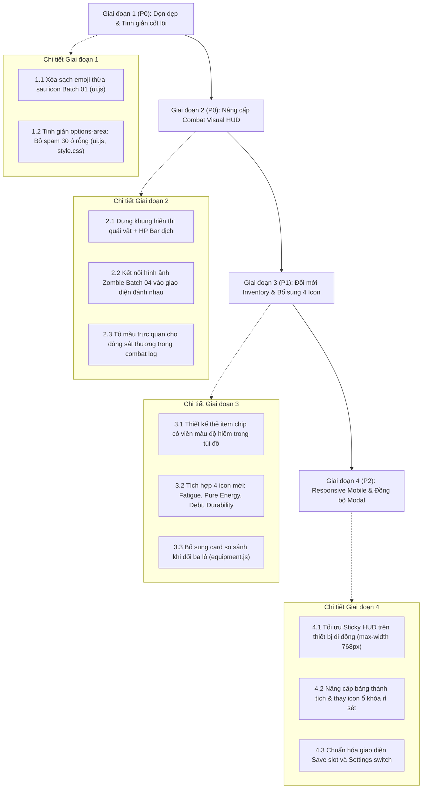

# BÁO CÁO KIỂM KÊ VÀ ĐÁNH GIÁ GIAO DIỆN GAME (BATCH 06 – GAME UI AUDIT)
## Dự án: Zombie World RPG

> **Ngày thực hiện:** 06/11/2026  
> **Giai đoạn:** AUDIT & DESIGN SPECIFICATION (Rà soát toàn diện, không sửa code)  
> **Phạm vi khảo sát:** Toàn bộ DOM UI (`index.html`, `css/style.css`, `js/ui.js`), PixiJS Canvas Renderer (`js/pixi-renderer.js`), luồng màn hình Combat (`js/combat.js`), Trang bị (`js/equipment.js`), Căn cứ (`js/base.js`), Giao dịch (`js/trading.js`), các trang phụ trợ và toàn bộ 13 UI Assets từ Batch 01.

---

## A. TỔNG QUAN

### 1. Thống kê tổng hợp

| Chỉ số | Số lượng | Ghi chú kỹ thuật |
|---|---:|---|
| **Tổng số màn hình / View chính** | **8** | Menu chính, Lưu trữ, Kỷ lục, Thành tích, Cài đặt, Công cụ, Về game, Màn chơi chính |
| **Tổng số Component UI độc lập** | **22** | Bao gồm các panel thông số, HUD, card nhân vật, thanh trạng thái, grid điều khiển |
| **Các luồng tương tác gameplay (Flows)** | **7** | Chiến đấu, Đổi trang bị, Chế tạo/Căn cứ, Thám hiểm, Giao dịch/Shop, Hội thoại, Game Over |
| **Màn hình đã hoàn thiện & Giữ nguyên** | **3** | Character Appearance Card (Batch 03), Header Logo, About Page |
| **Màn hình cần nâng cấp & Chuẩn hóa** | **5** | HUD Game (Zone 1-4), Combat UI, Inventory Panel, Options Area, Achievement Page |
| **Tổng số UI Assets Batch 01 đã kiểm tra** | **13** | 13/13 asset hợp lệ (PNG 32-bit RGBA) |
| **Số asset Batch 01 đang được sử dụng** | **13** | 12 asset trong DOM + 1 asset render trực tiếp trên PixiJS Canvas |
| **Số asset Batch 01 có thể tái sử dụng thêm** | **8** | Tái sử dụng cho Pixi HUD, Combat HUD và Tooltip |

### 2. Các nhóm UI chính trong kiến trúc hiện tại

```mermaid
graph TD
    App[Ứng dụng Zombie World RPG] --> MainMenu[Nhóm 1: Menu chính & Cài đặt]
    App --> GameHUD[Nhóm 2: HUD & Vitals trong game]
    App --> GameplaySub[Nhóm 3: Luồng tính năng cốt lõi]
    App --> PixiCanvas[Nhóm 4: Đồ họa Canvas PixiJS]

    MainMenu --> ScreenMenu[Màn hình bắt đầu #name-setup]
    MainMenu --> ScreenSave[Trang lưu trữ #save-page]
    MainMenu --> ScreenRecord[Kỷ lục sống sót #best-record-page]
    MainMenu --> ScreenAchieve[Bảng thành tích #achievement-page]
    MainMenu --> ScreenSettings[Cài đặt & Âm thanh #settings-page]
    MainMenu --> ScreenTools[Công cụ người chơi #player-tools-page]
    MainMenu --> ScreenAbout[Thông tin trò chơi #about-page]

    GameHUD --> Zone1[Zone 1: Thân phận, Vitals, Hàng hóa]
    GameHUD --> Zone2[Zone 2: Vũ khí & Ba lô kho đồ]
    GameHUD --> Zone3[Zone 3: Pixi Viewport & Cốt truyện]
    GameHUD --> Zone4[Zone 4: 30-Slot Options & Điều khiển]

    GameplaySub --> FlowCombat[Chiến đấu theo lượt Combat]
    GameplaySub --> FlowEquip[Thay đổi ba lô / Trang bị]
    GameplaySub --> FlowBase[Xây dựng căn cứ, Nông trại, Kho]
    GameplaySub --> FlowTrade[Giao dịch hàng hóa / Cửa hàng]
    GameplaySub --> FlowEvent[Hội thoại NPC & Sự kiện]

    PixiCanvas --> Viewport[Viewport 640x320 Canvas]
    PixiCanvas --> LayerBg[Layer Background phong cảnh]
    PixiCanvas --> LayerHUD[Layer HUD chữ, Ngày & Thanh HP]
    PixiCanvas --> LayerEntity[Layer Danh sách NPC Object Pool]
```

---

## B. CHI TIẾT TỪNG MÀN HÌNH VÀ COMPONENT

| STT | Screen / Component | Source Path | Current State | Issues | Priority | Recommendation |
|:---:|---|---|---|---|:---:|---|
| 1 | **Header & Game Logo** | `index.html`, `css/style.css` | `GOOD` | Không có lỗi. Logo `ui_game_logo.png` hiển thị sắc nét, responsive tốt. | **P3** | Giữ nguyên. |
| 2 | **Character Appearance Box** | `index.html`, `js/ui.js`, `player-appearance.js` | `EXCELLENT` | Đã hoàn thiện ở Phase lựa chọn ngoại hình. Preview card, 3 selector (Tuổi, Giới tính, Trang phục), badge trạng thái hoạt động mượt mà. | **P3** | Giữ nguyên. |
| 3 | **Main Menu Actions** | `index.html`, `css/style.css` | `ACCEPTABLE` | 7 nút bấm căn lề flex wrap. Chưa có hiệu ứng hover kim loại sinh tồn đặc trưng; khoảng cách nút chưa tối ưu trên mobile. | **P2** | Áp dụng styling button đồng bộ theo Design System sinh tồn hậu tận thế. |
| 4 | **Save / Load Page** | `index.html`, `js/ui.js:298` | `ACCEPTABLE` | Hiển thị 4 slot lưu (Slot 1-3, Auto). Định dạng ngày và giờ rõ ràng nhưng bố cục bảng dạng thô sơ. | **P2** | Bổ sung khung viền slot lưu dạng thẻ (card), thêm badge trạng thái slot trống/đã lưu. |
| 5 | **Best Record Page** | `index.html`, `js/ui.js:335` | `ACCEPTABLE` | Liệt kê danh sách kỷ lục sống sót. Thiếu phân cấp đồ họa, typography dạng danh sách phẳng. | **P2** | Thêm huy hiệu xếp hạng (Vàng, Bạc, Đồng) và card tóm tắt kết cục sống sót. |
| 6 | **Achievement Page** | `index.html`, `js/ui.js:384` | `NEEDS_IMPROVEMENT` | Dùng emoji trực tiếp và ký tự `❓` cho thành tích bị khóa. Chưa có icon huy hiệu đồ họa. | **P1** | Thay thế ký tự `❓` bằng asset huy hiệu ổ khóa / rỉ sét, phân nhóm thành tích theo màu độ hiếm. |
| 7 | **Settings Page** | `index.html`, `js/ui.js:413` | `ACCEPTABLE` | Các nút toggle (Click mode, Input mode, Music). Thiếu icon công tắc chuyển đổi trực quan. | **P2** | Thiết kế lại dạng switch toggle kim loại (ON/OFF) thay vì nút bấm text đổi nhãn. |
| 8 | **Player Tools & About** | `index.html`, `css/style.css` | `GOOD` | Hiển thị bách khoa toàn thư, xác suất và thông tin tác quyền. | **P3** | Giữ nguyên bố cục hiện tại. |
| 9 | **Zone 1: Identity Panel** | `js/ui.js:64`, `#identity-panel` | `ACCEPTABLE` | Hiển thị thân phận người chơi. Còn dùng emoji `🎭`, `🆔` thay vì icon đồ họa. | **P2** | Chuẩn hóa icon thân phận, bỏ emoji trùng lặp. |
| 10 | **Zone 1: Stats Panel (Vitals HUD)** | `js/ui.js:79`, `#stats-panel` | `NEEDS_IMPROVEMENT` | **Lỗi xung đột hiển thị kép (Double-icon collision):** Vừa chèn icon Batch 01 vừa để emoji liền kề (`❤️ Sức khỏe`). Riêng Mệt mỏi (Fatigue) thiếu icon đồ họa hoàn toàn (chỉ có `💪`). | **P0** | Xóa sạch emoji thừa sau icon ảnh; bổ sung icon `ui_icon_fatigue.png` cho Mệt mỏi để đồng bộ 6 thanh sinh tồn. |
| 11 | **Zone 1: Cargo Panel** | `js/ui.js:194`, `#cargo-panel` | `NEEDS_IMPROVEMENT` | Tương tự Stats Panel: Vừa có icon ảnh vừa có emoji `🚬`, `⛽`, `👑`. Năng lượng tinh khiết dùng `🔋`, Nợ lâu đài dùng `🏰`. | **P1** | Loại bỏ emoji dư thừa; bổ sung icon đồ họa cho Năng lượng tinh khiết và Nợ lâu đài. |
| 12 | **Zone 2: Weapon Panel** | `js/ui.js:140`, `#weapon-panel` | `NEEDS_IMPROVEMENT` | Có icon cận chiến và tầm xa nhưng vẫn đính kèm emoji `🔪`, `🏹`. Các chỉ số Độ bền, Nguyên vẹn, Đạn dược dùng emoji `🛡️`, `⚙️`, `💥`. | **P1** | Dọn dẹp emoji thừa; thêm icon mini cho ô độ bền, độ nguyên vẹn và đạn dược. |
| 13 | **Zone 2: Inventory Panel** | `js/ui.js:160`, `#inventory-panel` | `NEEDS_IMPROVEMENT` | **Kho đồ dạng văn bản nối dấu phẩy:** Các danh mục (Thực phẩm, Đồ uống, Y tế, Vũ khí...) hiển thị tên chuỗi text `a, b, c`. Không có ô lưới (grid), không có phân chia slot trực quan. | **P1** | Chuyển đổi hiển thị dạng danh sách thẻ item hoặc mini-slot gọn gàng, có badge số lượng rõ rệt. |
| 14 | **Zone 3: PixiJS Canvas Viewport** | `js/pixi-renderer.js`, `#pixi-viewport` | `ACCEPTABLE` | Canvas 640×320 render background, ngày, vị trí, HP bar. Preload cả 13 asset Batch 01 nhưng trong Canvas chỉ vẽ duy nhất `ui_icon_hp.png`. Chưa vẽ NPC sprite hay quái vật. | **P2** | Kết nối asset quái vật (Batch 04) và NPC (Batch 03) vào viewport Pixi khi phát sinh sự kiện hoặc chiến đấu. |
| 15 | **Zone 3: Story Narrative Area** | `js/ui.js:217`, `#story-area` | `GOOD` | Khung cuộn hiển thị cốt truyện mượt mà, font JetBrains Mono dễ đọc. | **P3** | Tối ưu thêm thanh cuộn (scrollbar) mang phong cách kim loại sinh tồn. |
| 16 | **Zone 4: Options Area (30-Slot Grid)** | `js/ui.js:226`, `#options-area` | `NEEDS_IMPROVEMENT` | **Lỗi rác thị giác (Visual Flooding):** Cố định render đủ 30 ô. Khi chỉ có 2-3 lựa chọn, 27 ô còn lại bị nhét đầy icon rỗng `ui_placeholder_empty.png` thu nhỏ 14px, gây rối mắt nghiêm trọng. | **P0** | Chỉ render số ô tương ứng với số tùy chọn thực tế; bỏ việc spam 25-28 icon rỗng chiếm chỗ. |
| 17 | **Zone 4: Pagination & Input Area** | `index.html`, `js/ui.js:563` | `ACCEPTABLE` | Phân trang chuyển trang hoạt động ổn định. Nút bấm mũi tên phân trang dùng emoji `⬅️`, `➡️`. | **P2** | Thay mũi tên emoji bằng SVG/icon nút phân trang cơ khí. |
| 18 | **Combat UI (Giao diện Chiến đấu)** | `js/combat.js`, `#story-area` | `CRITICAL_DEFECT` | **Chiến đấu hoàn toàn là văn bản thô:** Không có thanh máu quái vật, không hiển thị sprite/portrait Zombie (dù Batch 04 đã tạo xong), nhật ký chiến đấu chèn thô vào `story-area` như bức tường chữ. | **P0** | Xây dựng Combat HUD chuyên dụng: Thanh HP quái vật trực quan, hiển thị sprite zombie đã có từ Batch 04, tách nhật ký đòn đánh có màu sắc phân biệt sát thương. |
| 19 | **Equipment Swapping Interface** | `js/equipment.js` | `NEEDS_IMPROVEMENT` | Đổi ba lô diễn ra qua lựa chọn văn bản dạng Option 1, 2, 3. Thiếu giao diện so sánh trực quan sức chứa cũ vs mới. | **P1** | Bổ sung card so sánh chỉ số ba lô (Sức chứa hiện tại ➜ Sức chứa mới) trước khi xác nhận đổi. |
| 20 | **Base Building & Farming UI** | `js/base.js`, `js/farming.js` | `ACCEPTABLE` | Trồng trọt, nâng cấp căn cứ hiển thị qua văn bản chọn số. Thiếu tiến trình thời gian thu hoạch trực quan. | **P2** | Thêm thanh tiến trình phần trăm (%) hạt giống trưởng thành tại khu vực nông trại. |
| 21 | **Shop & Trading UI** | `js/trading.js`, `js/island/street.js` | `ACCEPTABLE` | Trao đổi hàng hóa qua tùy chọn text. Thiếu so sánh tỉ lệ quy đổi (ví dụ: 2 Thịt ➜ 5 Đạn). | **P2** | Chuẩn hóa bảng tỉ giá quy đổi vật phẩm rõ ràng trong story box. |
| 22 | **Item Tooltip / Detail Modal** | Chưa có độc lập | `MISSING` | Hiện tại game không có hệ thống tooltip hay modal xem chi tiết item khi click vào tên vật phẩm trong kho. | **P2** | Thiết kế khung popup/tooltip nhẹ hiển thị mô tả, công dụng và độ hiếm khi người chơi click vào item. |

---

## C. DANH SÁCH VÀ TÌNH TRẠNG UI ASSETS (BATCH 01)

Kiểm tra toàn bộ 13 UI Assets đã hoàn thành ở Batch 01 đối chiếu với mã nguồn thực tế:

| STT | Asset ID | File Path | Dimensions | File Size | Usage (Thành phần đang dùng) | Reusable (Có thể tái sử dụng ở đâu) | Phân loại | Đánh giá thẩm mỹ |
|:---:|---|---|:---:|:---:|---|---|:---:|---|
| 1 | `ui_game_logo` | `public/assets/ui/ui_game_logo.png` | 1024×512 | 548.8 KB | `#header-logo` (Header game), Preloaded in Pixi | Màn hình giới thiệu, Credits, Game Over victory screen | **USED / REUSABLE** | Xuất sắc. Kim loại rỉ sét và vết cào máu chuẩn tông sinh tồn. |
| 2 | `ui_icon_hp` | `public/assets/icons/ui_icon_hp.png` | 256×256 | 83.3 KB | DOM Stats Panel (`ui-icon-inline`), Pixi Canvas (`hpIconSprite`) | Combat Player HP Bar, Combat Enemy HP Bar, Tooltip hồi máu | **USED / REUSABLE** | Xuất sắc. Trái tim sinh học bọc thép phát sáng đỏ thẫm. |
| 3 | `ui_icon_sanity` | `public/assets/icons/ui_icon_sanity.png` | 256×256 | 102.8 KB | DOM Stats Panel (`ui-icon-inline`), Preloaded in Pixi | Pixi Viewport Mental HUD, Cảnh báo điên loạn/hoảng loạn | **USED / REUSABLE** | Rất tốt. Não bộ huỳnh quang xanh lam nổi bật trên nền tối. |
| 4 | `ui_icon_hunger` | `public/assets/icons/ui_icon_hunger.png` | 256×256 | 58.8 KB | DOM Stats Panel (`ui-icon-inline`), Preloaded in Pixi | Danh mục thực phẩm kho đồ, Cảnh báo đói bụng trên Canvas | **USED / REUSABLE** | Tốt. Đùi thịt nướng sinh tồn viền cháy vàng. |
| 5 | `ui_icon_hydration` | `public/assets/icons/ui_icon_hydration.png` | 256×256 | 104.5 KB | DOM Stats Panel (`ui-icon-inline`), Preloaded in Pixi | Danh mục nước uống kho đồ, Cảnh báo mất nước trên Canvas | **USED / REUSABLE** | Tốt. Giọt nước tinh khiết bao quanh vòng kim loại. |
| 6 | `ui_icon_infection` | `public/assets/icons/ui_icon_infection.png` | 256×256 | 110.6 KB | DOM Stats Panel (`ui-icon-inline`), Preloaded in Pixi | Cảnh báo nhiễm độc Zombie, Hiệu ứng debuff sinh học | **USED / REUSABLE** | Rất tốt. Bào tử virus biến dị phát sáng xanh lục cảnh báo độc tố. |
| 7 | `ui_icon_res_cigarette` | `public/assets/icons/ui_icon_res_cigarette.png` | 256×256 | 64.6 KB | DOM Cargo Panel (`ui-icon-inline`), Preloaded in Pixi | Giao dịch thương nhân, Thanh toán viện phí, Trả nợ lâu đài | **USED / REUSABLE** | Tốt. Bao thuốc lá chiến trường nhăn nhúm chân thực. |
| 8 | `ui_icon_res_gasoline` | `public/assets/icons/ui_icon_res_gasoline.png` | 256×256 | 89.3 KB | DOM Cargo Panel (`ui-icon-inline`), Preloaded in Pixi | Vận hành máy phát điện, Chế tạo bom xăng Molotov | **USED / REUSABLE** | Tốt. Can xăng đỏ kim loại dập nổi công nghiệp. |
| 9 | `ui_icon_res_royal_coin` | `public/assets/icons/ui_icon_res_royal_coin.png` | 256×256 | 148.2 KB | DOM Cargo Panel (`ui-icon-inline`), Preloaded in Pixi | Cửa hàng quý tộc lâu đài, Chuộc con tin, Đấu giá | **USED / REUSABLE** | Xuất sắc. Đồng xu vàng hoàng gia dập nổi vương miện sắc sảo. |
| 10 | `ui_icon_backpack` | `public/assets/icons/ui_icon_backpack.png` | 256×256 | 76.2 KB | DOM Inventory Panel Title, Preloaded in Pixi | Icon nút mở túi đồ, Modal đổi ba lô, Cảnh báo quá tải | **USED / REUSABLE** | Rất tốt. Ba lô dã ngoại quân đội màu rêu nhiều ngăn. |
| 11 | `ui_icon_melee_slot` | `public/assets/icons/ui_icon_melee_slot.png` | 256×256 | 89.3 KB | DOM Weapon Panel Melee row, Preloaded in Pixi | Nút hành động Cận chiến trong Combat HUD, Tab vũ khí | **USED / REUSABLE** | Rất tốt. Hai thanh dao rựa chiến thuật bắt chéo sắc lạnh. |
| 12 | `ui_icon_ranged_slot` | `public/assets/icons/ui_icon_ranged_slot.png` | 256×256 | 21.3 KB | DOM Weapon Panel Ranged row, Preloaded in Pixi | Nút hành động Bắn tỉa/Tầm xa trong Combat HUD, Tab súng | **USED / REUSABLE** | Tốt. Silhouette súng trường tấn công kèm ống ngắm chấm đỏ. |
| 13 | `ui_placeholder_empty` | `public/assets/icons/ui_placeholder_empty.png` | 256×256 | 86.1 KB | DOM Options Area (lấp đầy 30 ô) | Ô slot trang bị trống, Ô đồ chưa mở khóa | **USED / NEED_REVIEW** | **Cần xem xét lại cách dùng:** Asset 256px bị co về 14px và spam 25–28 lần gây rác giao diện. Chỉ nên dùng cho ô trang bị trống thực sự. |

---

## D. DESIGN SYSTEM HIỆN TẠI CỦA DỰ ÁN

Hệ thống thiết kế giao diện được định nghĩa trong `css/style.css` với các tiêu chuẩn sau:

### 1. Bảng màu (Color Palette & Tokens)

| Token CSS | Giá trị Hex / RGBA | Vai trò & Ứng dụng |
|---|---|---|
| `--bg-primary` | `#0b0b14` | Nền tối sâu toàn màn hình (Dark abyss) |
| `--bg-secondary` | `#12121e` | Nền khu vực phụ, nền bảng điều khiển chính |
| `--bg-card` | `#181825` | Nền các khối thẻ card thông số, panel con |
| `--bg-card-alt` | `#1e1e32` | Nền card nổi bật, trạng thái hover card |
| `--bg-input` | `rgba(255, 255, 255, 0.04)` | Nền ô nhập dữ liệu, dropdown select |
| `--text-primary` | `#e2e2ee` | Chữ tiêu đề, chỉ số quan trọng (Độ tương phản cao) |
| `--text-secondary` | `#9898b0` | Nhãn thông số, văn bản mô tả phụ |
| `--text-muted` | `#5c5c74` | Ghi chú mờ, văn bản placeholder |
| `--accent` | `#e94560` | Màu đỏ thẫm sinh tồn (Blood crimson) – Màu nhận diện chủ đạo |
| `--accent-glow` | `rgba(233, 69, 96, 0.25)` | Quầng sáng đỏ viền button, highlight cảnh báo |
| `--accent-dim` | `rgba(233, 69, 96, 0.08)` | Màu nền mờ cho số thứ tự nút lựa chọn |
| `--blue` | `#5ba3e6` | Màu nước uống (Thirst), độ hiếm Hiếm (Rare) |
| `--green` | `#34d399` | Màu máu an toàn (Safe HP), độ hiếm Không phổ biến |
| `--orange` | `#f59e0b` | Màu thức ăn (Hunger), cảnh báo mệt mỏi |
| `--purple` | `#a78bfa` | Màu độ hiếm Sử thi (Epic), lý trí (Sanity) |
| `--red` | `#ef4444` | Màu máu nguy kịch (Danger HP), độc tố (Infection) |
| `--border` | `rgba(255, 255, 255, 0.06)` | Viền khung mờ tinh tế phân tách các panel |
| `--border-hover` | `rgba(255, 255, 255, 0.12)` | Viền sáng khi rê chuột |

### 2. Typography
- **Font văn bản nội dung (`--font-body`):** `'Noto Sans SC', -apple-system, BlinkMacSystemFont, sans-serif` (Độ đậm: 400, 500, 700). Đảm bảo hiển thị mượt mà đa ngôn ngữ, không lỗi dấu tiếng Việt.
- **Font chỉ số & code (`--font-mono`):** `'JetBrains Mono', 'Consolas', monospace` (Độ đậm: 400, 600, 700). Áp dụng cho: Số ngày sống sót, chỉ số HP/thông số, nhãn phím số `1-30`, bảng kỷ lục và mã kỹ thuật.
- **Kích thước chữ tiêu chuẩn:**
  - Header game H1: `26px - 32px`, chữ hoa dập nổi.
  - Panel Title: `13px - 14px`, chữ hoa cách chữ (`letter-spacing: 1px`), đậm.
  - Nội dung cốt truyện: `13.5px`, chiều cao dòng `line-height: 1.6`.
  - Nhãn thông số (Stat label): `12px - 12.5px`.
  - Nút lựa chọn (Option button): `12px`.

### 3. Thành phần giao diện (UI Components Specification)
- **Panel Containers:** Border radius `10px` (`--radius`), bo góc mềm mại; đổ bóng ngầm `box-shadow: 0 4px 24px rgba(0,0,0,0.3)`.
- **Thanh trạng thái sinh tồn (Stat Progress Bars):**
  - Chiều cao rãnh: `7px`.
  - Bo tròn rãnh: `4px`.
  - Nền rãnh: `rgba(255, 255, 255, 0.06)`.
  - Màu đổ đầy tương ứng từng loại: HP (Gradient Xanh sang Đỏ nguy kịch), Bụng no (Cam), Nước (Xanh dương), Lý trí (Tím), Mệt mỏi (Vàng đậm), Nhiễm bệnh (Đỏ tím cảnh báo).
- **Nút tùy chọn (Option Items):**
  - Chiều cao tối thiểu: `28px`.
  - Nền: Gradient `rgba(255,255,255,0.04)` chuyển dần sang `0.01`.
  - Số thứ tự: Huy hiệu nhỏ `16×16px` viền đỏ bo cong ở đầu nút.
  - Hiệu ứng tương tác: Khi rê chuột (`:hover`) sáng viền đỏ `rgba(233,69,96,0.3)` và phát sáng nền nhẹ.

---

## E. DANH SÁCH ĐỀ XUẤT NÂNG CẤP GIAO DIỆN (BATCH 06 PROPOSALS)

Dưới đây là 7 đề xuất nâng cấp trọng điểm nhằm giải quyết triệt để các tồn đọng về thẩm mỹ, tính đồng nhất và trải nghiệm người dùng:

### Đề xuất 1: Xóa bỏ xung đột Icon kép & Emoji dư thừa (Double-Icon Collision Cleanup)
- **Vấn đề hiện tại:** Sau khi tích hợp icon Batch 01, các dòng thông số bị hiển thị cả icon ảnh lẫn icon emoji cạnh nhau (`❤️ Sức khỏe`, `🍖 Bụng no`, `🔪 Cận chiến`, `🎒 Ba lô`, `🚬 Thuốc lá`).
- **Lý do cần nâng cấp:** Làm giao diện bị rối mắt, mất tính chuyên nghiệp của một game RPG sinh tồn, tạo cảm giác cắt ghép tạm bợ.
- **Hướng cải tiến:** Loại bỏ toàn bộ các ký tự emoji đứng sau thẻ ``, chỉ giữ lại icon ảnh đồ họa sắc nét cùng tên văn bản chuẩn (`[Icon] Sức khỏe`, `[Icon] Bụng no`, `[Icon] Cận chiến`).
- **Thành phần bị ảnh hưởng:** `renderStats`, `renderWeapons`, `renderCargo`, `renderInventory` trong `js/ui.js`.
- **Asset sử dụng:** Tái sử dụng trọn vẹn 12 UI Assets Batch 01.
- **Mức độ ưu tiên:** **P0** (Lỗi hiển thị trực tiếp ảnh hưởng thẩm mỹ cốt lõi).
- **Rủi ro ảnh hưởng:** Rất thấp (chỉ tinh chỉnh chuỗi HTML render trong `js/ui.js`).

### Đề xuất 2: Loại bỏ tình trạng rác thị giác 30-slot Grid trong Options Area
- **Vấn đề hiện tại:** `renderOptions` luôn ép vòng lặp tạo đủ 30 ô, nhét 25–28 icon `ui_placeholder_empty.png` thu nhỏ 14px vào màn hình khi người chơi chỉ có 2-3 lựa chọn.
- **Lý do cần nâng cấp:** Chiếm dụng không gian hiển thị quý giá trên màn hình dọc / điện thoại, khiến người chơi tưởng các ô đó là tính năng bị khóa.
- **Hướng cải tiến:** 
  1. Chỉ render đúng số lượng ô tương ứng với số tùy chọn thực tế (`options.length`).
  2. Bố cục lưới co giãn tự nhiên: Nếu ≤ 4 lựa chọn, xếp 1 hoặc 2 cột nút to dễ bấm; nếu > 6 lựa chọn, xếp 2 cột compact.
  3. Bỏ hoàn toàn việc chèn lặp lại thẻ `ui_placeholder_empty.png`.
- **Thành phần bị ảnh hưởng:** `renderOptions` (`js/ui.js:226`), `#options-area` (`css/style.css:685`).
- **Asset sử dụng:** Không dùng asset rỗng bừa bãi.
- **Mức độ ưu tiên:** **P0** (Trải nghiệm thao tác quan trọng nhất của game text sinh tồn).
- **Rủi ro ảnh hưởng:** Cần điều chỉnh CSS grid để hỗ trợ số lượng nút linh hoạt không bị vỡ layout.

### Đề xuất 3: Xây dựng Combat Visual HUD chuyên dụng (Tích hợp Asset Zombie Batch 04)
- **Vấn đề hiện tại:** Toàn bộ quá trình chiến đấu với Zombie diễn ra qua những dòng chữ thô sơ in vào `#story-area`. Kho tài nguyên tranh vẽ quái vật (Batch 04) hoàn toàn không được xuất hiện trên giao diện chiến đấu.
- **Lý do cần nâng cấp:** Chiến đấu là linh hồn của game tận thế nhưng hiện tại thiếu hẳn chiều sâu thị giác và cảm giác đe dọa sinh tử.
- **Hướng cải tiến:**
  1. Thêm khung Combat HUD nổi bật trong khu vực hiển thị:
     - Hiển thị ảnh minh họa Zombie/Boss tương ứng (từ `public/assets/zombies/`).
     - Thanh máu quái vật (Enemy HP Bar) dạng đồ họa trực quan (Đỏ/Xanh độc tố).
     - Tên quái vật kèm cấp độ nguy hiểm (Nguy hiểm thường, Đột biến, Boss).
  2. Tách nhật ký chiến đấu thành các dòng có màu sắc: Sát thương gây ra (Vàng/Cam), Sát thương nhận vào (Đỏ), Né tránh/Liên kích (Xanh/Tím).
- **Thành phần bị ảnh hưởng:** `js/combat.js`, `js/ui.js`, `css/style.css`.
- **Asset sử dụng:** Các file ảnh Zombie Batch 04 (`zombie_lang_dao.png`, `zombie_nhanh.png`, v.v.), `ui_icon_hp.png`, `ui_icon_melee_slot.png`, `ui_icon_ranged_slot.png`.
- **Mức độ ưu tiên:** **P0** (Nâng tầm trải nghiệm chiến đấu vượt bậc).
- **Rủi ro ảnh hưởng:** Trung bình (Cần đồng bộ giữa logic tính toán lượt đánh trong `combat.js` và component hiển thị DOM).

### Đề xuất 4: Bổ sung 4 Icon UI còn thiếu để hoàn thiện hệ thống chỉ số & hàng hóa
- **Vấn đề hiện tại:** 
  - Mệt mỏi (`crash`) là chỉ số sinh tồn duy nhất dùng emoji `💪`.
  - Năng lượng tinh khiết (`pureEnergy`) dùng emoji `🔋`.
  - Nợ lâu đài (`castleDebt`) dùng emoji `🏰`.
  - Độ bền vũ khí dùng emoji `🛡️`.
- **Lý do cần nâng cấp:** Đảm bảo 100% các dòng chỉ số đều có icon đồ họa đồng bộ chuẩn phong cách Batch 01.
- **Hướng cải tiến:** Tạo đặc tả và bổ sung 4 asset UI:
  1. `ui_icon_fatigue.png`: Biểu tượng nhịp tim suy kiệt / cơ bắp rạn nứt màu vàng cam.
  2. `ui_icon_pure_energy.png`: Khối tinh thể năng lượng phát sáng màu lam điện tử.
  3. `ui_icon_castle_debt.png`: Lâu đài gothic bóng tối kèm biểu tượng đồng hồ đếm ngược.
  4. `ui_icon_durability.png`: Khiên chắn thép có vết rạn nứt nhỏ.
- **Thành phần bị ảnh hưởng:** `renderStats`, `renderCargo`, `renderWeapons`.
- **Asset sử dụng:** 4 icon mới chuẩn 256×256 PNG 32-bit.
- **Mức độ ưu tiên:** **P1** (Hoàn thiện tính đồng nhất thẩm mỹ).
- **Rủi ro ảnh hưởng:** Rất thấp.

### Đề xuất 5: Nâng cấp Inventory từ danh sách chữ phẳng sang dạng thẻ/lưới (Item Card List)
- **Vấn đề hiện tại:** Kho đồ đang in tên chuỗi text ngăn cách bằng dấu phẩy (`Thực phẩm: Bánh quy (x2), Lương khô`). Không có sự phân biệt rõ ràng giữa các vật phẩm, không có nút tương tác trực tiếp.
- **Lý do cần nâng cấp:** Giúp người chơi dễ dàng kiểm đếm số lượng, nhận diện phẩm chất độ hiếm qua viền màu, tạo cảm giác quản lý túi đồ RPG thực thụ.
- **Hướng cải tiến:**
  - Thiết kế danh sách item dạng chip hoặc card nhỏ (`item-chip`).
  - Viền màu sắc tương ứng theo độ hiếm (`common`, `uncommon`, `rare`, `epic`, `legendary`).
  - Huy hiệu số lượng (`x2`, `x5`) gắn nổi bật góc phải thẻ.
  - Phân tab gọn gàng: [Tất cả] · [Nhu yếu phẩm] · [Vũ khí] · [Vật liệu] · [Khác].
- **Thành phần bị ảnh hưởng:** `renderInventory` (`js/ui.js:160`), `css/style.css`.
- **Asset sử dụng:** `ui_icon_backpack.png`, các icon độ hiếm.
- **Mức độ ưu tiên:** **P1**.
- **Rủi ro ảnh hưởng:** Thấp (Dữ liệu mảng `state.food`, `state.drinks`, `state.medicine`, `state.other` đã có sẵn cấu trúc thuộc tính).

### Đề xuất 6: Tối ưu Responsive Layout cho màn hình điện thoại (Mobile Ergonomics)
- **Vấn đề hiện tại:** Trên màn hình di động (≤ 768px), 4 zone xếp chồng thẳng đứng thành một trang cuộn rất dài. Người chơi phải cuộn lên xuống liên tục để vừa xem HP vừa chọn hành động.
- **Lý do cần nâng cấp:** Người chơi web/mobile cần nắm bắt trạng thái tức thời mà không phải cuộn trang liên tục.
- **Hướng cải tiến:**
  - Thu gọn Zone 1 thành thanh Top HUD cố định (Sticky Top Bar) hiển thị nhanh: Avatar mini, HP, Ngày, và trạng thái khẩn cấp.
  - Các bảng chi tiết (Cargo, Balo, Vũ khí) có thể thu gọn/mở rộng dạng Accordion (xổ xuống) khi chạm vào.
  - Khu vực tùy chọn Zone 4 luôn neo ở nửa dưới màn hình để ngón tay cái thao tác thuận tiện.
- **Thành phần bị ảnh hưởng:** `css/style.css` (`@media (max-width: 768px)`).
- **Asset sử dụng:** Tái sử dụng asset hiện tại.
- **Mức độ ưu tiên:** **P2**.
- **Rủi ro ảnh hưởng:** Cần kiểm tra cẩn thận trên nhiều kích thước màn hình để tránh che khuất nội dung cốt truyện.

### Đề xuất 7: Chuẩn hóa Modal, Tooltip và Bảng thành tích (Achievement Polish)
- **Vấn đề hiện tại:** Các trang phụ (`Save`, `Settings`, `Achievement`) có phong cách nút bấm và khoảng cách chưa đồng nhất. Thành tích chưa mở khóa dùng emoji dấu hỏi `❓`.
- **Lý do cần nâng cấp:** Tạo sự chỉn chu, đồng bộ 100% trong toàn bộ trải nghiệm từ menu chính đến các tính năng phụ trợ.
- **Hướng cải tiến:**
  - Thay thế emoji `❓` bằng asset huy hiệu ổ khóa xích sắt rỉ sét (`ui_badge_locked.png`).
  - Thêm thanh tiến trình phần trăm hoàn thành thành tích (ví dụ: `12/40 Thành tích - 30%`).
  - Thiết kế khung Tooltip chuẩn nổi trên màn hình khi hover/tap vào tên vật phẩm hoặc kỹ năng.
- **Thành phần bị ảnh hưởng:** `renderAchievementPage`, `renderSavePage`, `renderSettingsPage`.
- **Asset sử dụng:** Icon huy hiệu thành tích mới.
- **Mức độ ưu tiên:** **P2**.
- **Rủi ro ảnh hưởng:** Rất thấp.

---

## F. THỨ TỰ VÀ LỘ TRÌNH TRIỂN KHAI BATCH 06 (ROADMAP)

Lộ trình được chia làm 4 giai đoạn độc lập, đảm bảo nguyên tắc: **Cải thiện thành phần dùng chung trước, nâng cấp thành phần chuyên biệt sau, kiểm thử độc lập từng giai đoạn**:

### Kế hoạch từng giai đoạn:

#### Giai đoạn 1: Dọn dẹp & Tinh giản hiển thị (P0 – Khởi động nhanh, hiệu quả tức thì)
- **Mục tiêu:** Xử lý ngay các lỗi hiển thị gây phản cảm trực giác nhất mà không làm ảnh hưởng đến cấu trúc gameplay.
- **Công việc cụ thể:**
  1. Loại bỏ các emoji trùng lặp kề sát icon Batch 01 trong `renderStats`, `renderWeapons`, `renderCargo`, `renderInventory`.
  2. Bỏ hoàn toàn logic lặp chèn 20–28 ô rỗng `ui_placeholder_empty.png` trong `renderOptions`; chỉ hiển thị số nút bấm hành động thực tế.
- **File tác động:** `js/ui.js`, `css/style.css`.
- **Rủi ro:** 0% rủi ro logic, chỉ cải thiện DOM render.

#### Giai đoạn 2: Nâng cấp Combat Visual HUD (P0 – Trọng tâm trải nghiệm)
- **Mục tiêu:** Biến các trận chiến từ "bức tường văn bản" thành trải nghiệm chiến đấu sinh tồn kịch tính có hình ảnh.
- **Công việc cụ thể:**
  1. Dựng component hiển thị kẻ địch: Ảnh minh họa Zombie (tái sử dụng từ thư mục `public/assets/zombies/`), thanh máu địch có phần trăm và màu sắc nguy hiểm.
  2. Định dạng các dòng thông báo giao tranh: Sát thương người chơi (màu vàng), sát thương nhận (màu đỏ rực), né đòn (màu xanh).
- **File tác động:** `js/combat.js`, `js/ui.js`, `css/style.css`.
- **Asset tái sử dụng:** Toàn bộ ảnh Zombie từ Batch 04 + icon vũ khí Batch 01.

#### Giai đoạn 3: Hiện đại hóa Inventory & Bổ sung Icon thiếu (P1 – Chiều sâu RPG)
- **Mục tiêu:** Nâng cấp kho đồ từ danh sách chữ nối phẩy thành hệ thống thẻ vật phẩm chuyên nghiệp; lấp đầy các icon thiếu.
- **Công việc cụ thể:**
  1. Chuyển đổi danh sách vật phẩm thành các chip/card mini có viền màu độ hiếm (`quality-*`) và số lượng đính kèm.
  2. Bổ sung và gắn 4 icon đồ họa mới: `ui_icon_fatigue.png`, `ui_icon_pure_energy.png`, `ui_icon_castle_debt.png`, `ui_icon_durability.png`.
  3. Bổ sung card so sánh sức chứa khi thao tác đổi ba lô trong `js/equipment.js`.
- **File tác động:** `js/ui.js`, `js/equipment.js`, `css/style.css`.

#### Giai đoạn 4: Tinh chỉnh Responsive Mobile & Bảng thành tích (P2 – Hoàn thiện)
- **Mục tiêu:** Đảm bảo trải nghiệm mượt mà không góc chết trên mọi thiết bị di động và máy tính bảng.
- **Công việc cụ thể:**
  1. Tối ưu CSS Responsive: Giảm chiều cao cuộn trên mobile bằng Top Sticky Vitals bar.
  2. Nâng cấp bảng Thành tích: Thay thế `❓` bằng icon ổ khóa rỉ sét `ui_badge_locked.png`.
  3. Chuẩn hóa switch toggle trong Cài đặt và card trong trang Lưu trữ.
- **File tác động:** `css/style.css`, `js/ui.js`.

---

## G. DANH SÁCH FILE SOURCE CẦN CHỈNH SỬA Ở GIAI ĐOẠN TRIỂN KHAI

Để chuẩn bị cho giai đoạn code implementation tiếp theo, dưới đây là danh sách chính xác các file mã nguồn sẽ tham gia:

1. `js/ui.js`: File trọng tâm điều khiển toàn bộ cấu trúc DOM render của các panel, bảng chỉ số, kho đồ, tùy chọn và các màn hình phụ.
2. `css/style.css`: File định kiểu duy nhất của dự án, cần cập nhật layout grid tùy chọn linh hoạt, thẻ item kho đồ, Combat HUD và responsive mobile.
3. `js/combat.js`: Kết nối logic trạng thái trận đánh với component hiển thị thanh máu quái vật và ảnh minh họa zombie.
4. `js/equipment.js`: Nâng cấp giao diện so sánh chỉ số ba lô khi thay đổi trang bị.
5. `js/pixi-renderer.js`: Tối ưu hóa việc hiển thị các lớp đồ họa trên canvas, đồng bộ hóa trạng thái hiển thị với DOM.
6. `project-docs/assets/batches/batch-06-game-ui.json`: Manifest tài nguyên cho Batch 06 (nếu có bổ sung 4-5 asset UI mới).

---

## H. KẾT LUẬN VÀ XÁC NHẬN BẢO TOÀN DỰ ÁN

- Báo cáo kiểm kê Batch 06 đã khảo sát toàn diện **8 màn hình, 22 component UI, 7 luồng gameplay và 13 UI Assets Batch 01**.
- **Xác nhận bảo toàn tuyệt đối:** Trong suốt quá trình audit, **100% mã nguồn JavaScript, CSS, HTML, logic gameplay và dữ liệu project được giữ nguyên vẹn**, không có bất kỳ file code nào bị chỉnh sửa.
