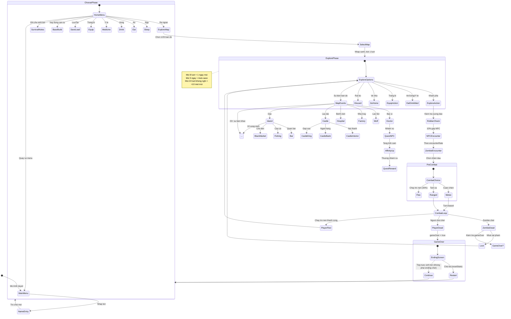

# Gameplay Flow — Zombie-World-RPG

## Luồng trình bày Batch 10 (2026-11-07)

- Menu mới: tên nhân vật và bắt đầu/tải lưu là chính; chọn ngoại hình mở qua disclosure. Trình tự reset/name/appearance/choose và nhạc giữ nguyên.
- Thanh dưới: Hiện trường, Hành trang (Túi/Trang bị/Hồ sơ), Hồ sơ sinh tồn, Hệ thống. Chuyển view chỉ thay presentation state, không tiêu lượt, đổi options/phase hoặc gọi RNG.
- Hiện trường render mọi phase/options của engine bằng semantic buttons đánh số gốc; map, encounter/result, base/crops, recipes và services có ngữ cảnh riêng. Nội dung và branches không đổi.
- Túi mở item sheet, destructive actions có confirm sheet, warehouse fullscreen logistics trên mobile; mutation vẫn qua các executors cũ.
- Mở Save từ Hệ thống gọi gateway cũ; transient phases vẫn bị chặn. Cả click-mode và numeric input đều hoạt động ở save screen. Back của gameplay vẫn qua action/handler thật, không snapshot/restore hoặc teleport.
- Combat vẫn tính cả trận trong engine sau lựa chọn cận/tầm/chạy; UI chỉ hiển thị pre-combat và log kết quả. Terminal endings chỉ có restart nếu Core cung cấp.
- Tools chạy offline khi được phục vụ local; không hứa cold hosted offline startup khi chưa có caching/service worker.

Các bước gameplay bên dưới giữ nguyên; thay đổi là đường truy cập và cách trình bày, không phải công thức hay thời gian.

## 1. Luong choi tu dau den cuoi
1. Mo trinh duyet tai `index.html`.
2. `main.js` khoi tao, hien form nhap ten nhan vat (`#name-setup`).
3. Nhap ten, nhan "Tro choi moi" -> `resetState()`, `setName()`, `setPhase("choose")`, phat nhac nen.
4. Man hinh dau tien: Menu can cu (`choose`): Ngu, An, Uong, Y te, Trang bi, Ra ngoai, Rut bo, Luu, Thu hoach dong ban, Xay dung can cu, Ghi chu sinh ton, Quay ve menu.
5. Chon "Ra ngoai" -> chon 1 trong 25 ban do (khong hidden) -> nhap canh, tick 1 luot -> menu kham pha (`explore`).
6. Tai menu kham pha, chon "Kham pha":
   - Kiem tra cuong dao (neu khong mua thong tin) -> co the bi cub, luot ket thuc.
   - 10% gap NPC -> su kien NPC, tick 1-2 luot.
   - Theo `encounterRate` cua ban do -> gap zombie -> phase `pre_combat`, chon cuan chien / tam xa / chay tro nen.
   - 0.05% tai absolute base -> tim kho vu truc (space crate).
   - Mac dinh -> nhat loot ngau nhien theo `lootTable` (co the tu balo day).
   - Tick 1-2 luot, `updateStatusEffects()`, `checkDeath()`.
7. Chon su kien dac biet tu `MAP_ACTIONS[map.id]` -> `handleExploreAction` dispatch den ham xu ly tuong ung (leo thap, hai qua, gap NPC ban do, bac si, v.v.).
8. Muon ve nha -> `handleGoHome()` -> kiem tra sanity -> ve trai, tick 1 luot, trang thai sinh ton.
9. Moi 24 luot khong nghi -> `crash` +10; moi 8 luot -> 1 ngay moi, thoi tiet doi, do -4, khat -4.
10. An/Uong/Thuoc qua `consumables.js` -> `consumeItem` -> hoi cac chi so, co the lien tuc chon neu con item.
11. Luu tien trinh: Auto-save slot 0 moi 5 ngay; luu thu cong slot 1-10 qua menu Luu. Du lieu o `localStorage`.
12. Ket thuc: `gameOver = true` khi `health <= 0` hoac `infection >= 100`. Hoac dat dieu kien ket cuoc (vi du `day >= 999` -> ending_999; tat ca 6 dieu kien "Suc Mới Mới" -> ending_newforce). Nut "Choi lai" (resetState) hoac "Tiep tuoc sinh ton" (khong phai ending chet).

**Game chua co endgame ro ret:** Sau khi dat mot ket cuoc, nguoi choi co the chon "Tiep tuoc sinh ton" (tru cac ending chet/gameOver) de choi tiep voi `gameOver = false`. Khong co he thong New Game+ hay end content biet liet.

## 2. Gameplay loop (dựa trên code thực tế)
```text
Menu can cu (choose)
    │
    ├─► Ra ngoai -> Chon ban do -> Menu kham pha (explore)
    │         │
    │         ├─► Kham pha -> [Cuong dao / NPC / Zombie / Loot]
    │         │             │
    │         │             ├─► Zombie -> Chien dau (cuan/tam xa/chay tro nen)
    │         │             │             │
    │         │             │             ├─ Thang -> Loot -> Ve menu kham pha
    │         │             │             └─ Thua/Chay -> Ve menu kham pha
    │         │             │
    │         │             ├─► Su kien dac biet (MAP_ACTIONS)
    │         │             │             │
    │         │             │             ├─► Gap NPC ban do -> Giao dich/Nhiem vu
    │         │             │             ├─► Benh vien/Vien nghien cuu -> Nhiem vu/Boss
    │         │             │             └─► ... (20+ su kien)
    │         │             │
    │         │             └─► Ve nha -> Kiem tra sanity -> Menu can cu
    │         │
    │         └─► An/Uong/Y te/Trang bi/Rut bo -> Quan ly item
    │
    ├─► Ngu -> Hoi phuc, giam met, tuc 3 luot
    ├─► Xay dung can cu -> Nang cap, trong trot, kho hang
    ├─► Ghi chu sinh ton -> Xem meo, tien do mo khoa
    └─► Luu game -> Quan ly 11 slot
    │
    ▼
Moi 8 luot = 1 ngay moi -> Thoi tiet doi, do -4, khat -4
Moi 5 ngay = Auto-save
Moi 24 luot khong nghi = +10 met mỏi
    │
    ▼
Khi du dieu kien -> Kich hoat Ket cuoc (14 loai)
    │
    ├─► Choi lai (resetState)
    └─► Tiep tuoc sinh ton (khong phai ending chet)
```

Core loop thuc te: `Kham pha ban do` -> `Quan ly sinh ton (an/uong/thuoc/ngu)` -> `Chien dau hoac Su kien` -> `Nhan loot/quest thuong` -> `Nang cap trang bi/can cu/affinity` -> `Mo khoa ban do/noi dung moi` -> `Tiep tuc kham pha`.

## 3. Flow diagram (Mermaid)


## 4. Cac he thong chu y
- `state.js`: `gameState` duy nhat, `advanceTime`, `updateStatusEffects`, `checkDeath`, `addItem`, `removeItem`, `getItemDisplayName`.
- `config.js`: `MAPS`, `MAP_ACTIONS`, `GAME_CONSTANTS`, `RARITY_WEIGHTS`, `ZOMBIE_POOLS`, `ACHIEVEMENTS`.
- `combat.js`: `handleCombat`, `handlePreCombatChoice`, `handleNpcCombat`, `getRangedAmmoInfo`, `canRangedCombat`.
- `exploration.js`: `handleExplore`, `handleExploreAction`.
- `routing.js`: `showHomeOptions`, `showExploreOptionsState`, `returnToMenu`.
- `ui.js`: `renderAll`, `initUI`, `renderOptions`, `renderStats`, `renderInventory`.

## 5. Cap nhat khi sua code
Moi lan sua source code, bat buoc ghi vao `CHANGELOG.md` va cap nhat file tai-lieu lien quan (xem `RULE.md` o goc repo).
